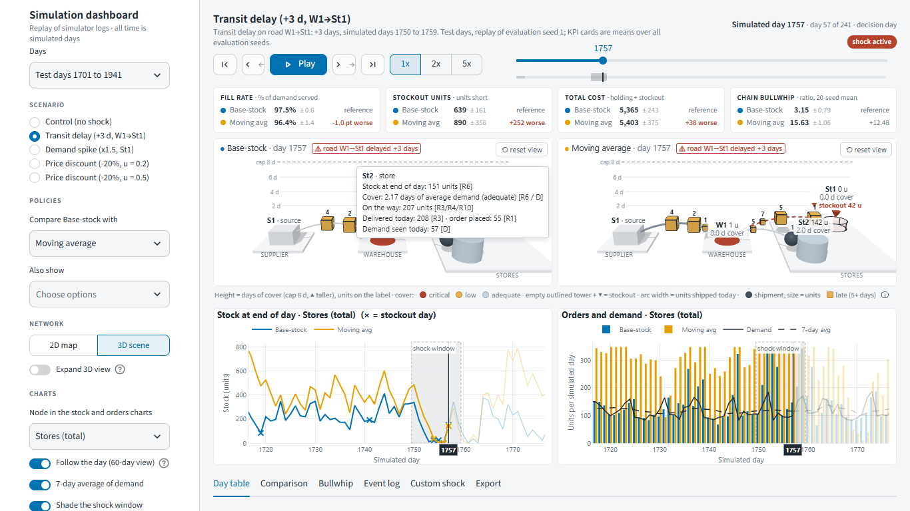
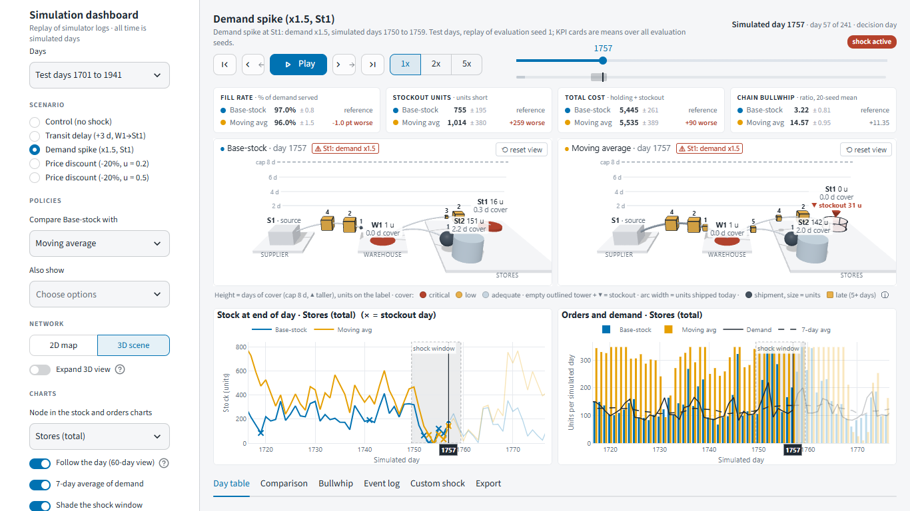
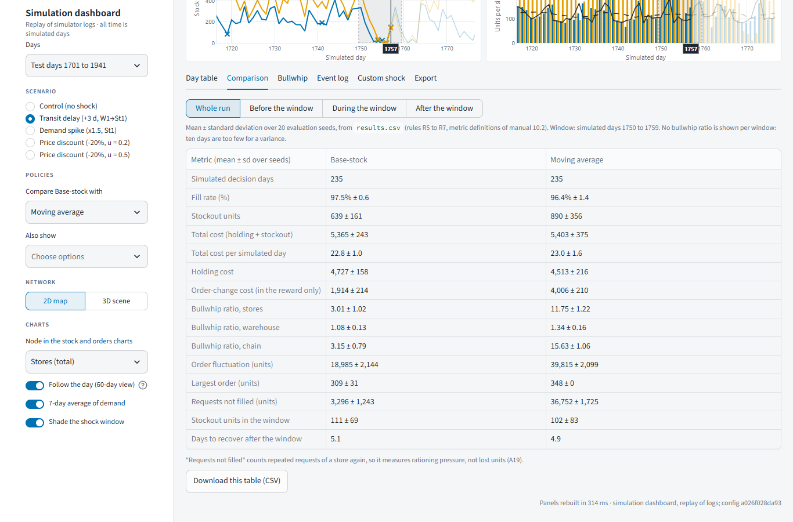
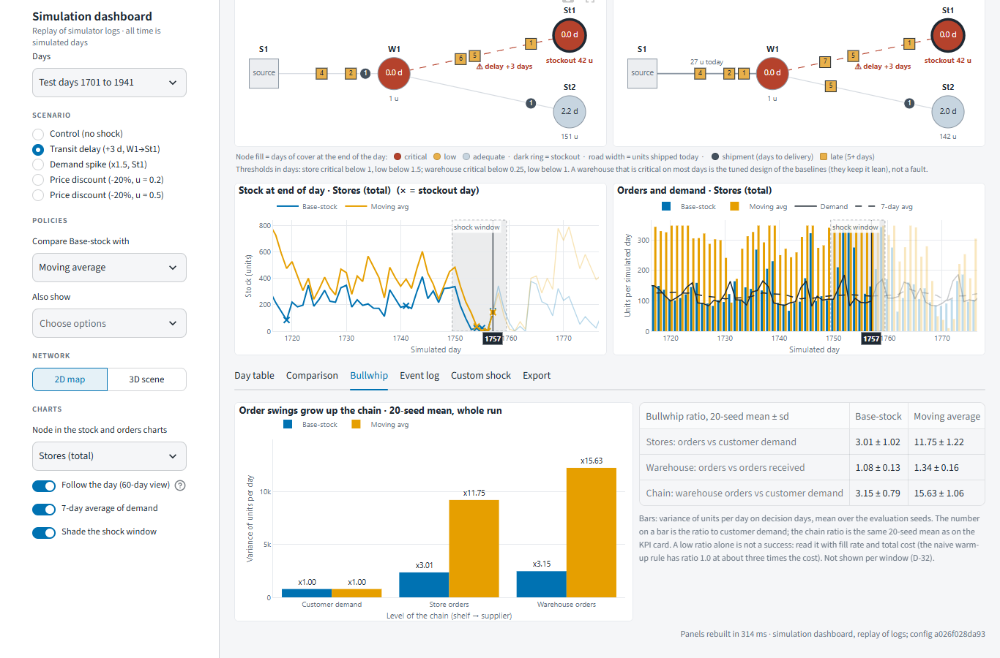

# Supply-chain replenishment with spatio-temporal graph RL

Simulation prototype: a PPO agent with a GAT + LSTM encoder orders for a small
supplier-warehouse-store network driven by M5 demand and DataCo-derived lead times, compared
with tuned base-stock and moving-average baselines. The full specification is
[`build_manual.md`](build_manual.md) (unchanged). Project decisions are in
[`DECISIONS.md`](DECISIONS.md); assumptions in [`ASSUMPTIONS.md`](ASSUMPTIONS.md).

Results describe a simulated chain only.

## Setup (Python 3.11)

```
py -3.11 -m venv .venv
.venv\Scriptsctivate
pip install -r requirements.lock
pip install -e . --no-deps
```

`requirements.lock` pins every package with hashes (regenerated at the start of Phase 5, D-38).
It was resolved on Windows with Python 3.11 and installs torch 2.14.1, CUDA 13.0 build, from the
PyTorch index named in the file (about 2 GB). Training runs on the CPU, which measured faster
than the GPU for these small networks (D-48); the CUDA build also runs on machines without a
GPU. `pyproject.toml` lists the dependencies; to regenerate the lockfile see D-38 and the header
of `requirements.lock` (pip-compile must hash the torch wheels from the PyTorch index).

Standing rules for every session are in [`CLAUDE.md`](CLAUDE.md).

## Checks

```
pytest              # tests
ruff check . && ruff format --check .
mypy
```

## Configuration

- `config.yaml`: chosen settings (source tag C).
- `derived.yaml`: facts derived from the data (`n_days`, the chosen `item_id` and `first_day`), written by the build commands, never hand-tuned.

Phase 1 run order: `inspect_files`, then `data.dataco`, `data.build`, `graph.build` (outputs in `data/processed/` and `reports/figures/`, not committed).

Phase 3 run order: `eval.baselines tune` (2 to 4 min, 10 processes), then `eval.run` (20 to 50 s) and `eval.sensitivity` (4 to 5 min). Outputs in `results/` and `runs/`, not committed (D-22). `eval.run` writes to `results/<split>/` (D-32), so runs on different splits cannot overwrite each other; for validation days use `--split val --scenarios control`. The tuned parameters and the sensitivity tables stay in `results/`.

Phase 4 run order: `eval.run` for the test split (the dashboard replays its logs, shipments tables and results), then `streamlit run app/dashboard.py`. `python -m supply_chain_rl.dashboard.timing` prints the slider-update times; `python -m supply_chain_rl.dashboard.screenshots` saves `reports/figures/dashboard_*.png`, copies the curated set to `docs/screenshots/` (D-46) and prints the browser step times with two, three and four policies (uses the installed Edge or Chrome). Logs written before Phase 4 have no shipments table: re-run `eval.run` once.

The network can be shown as the 2D map (default) or as a 3D scene (sidebar, "Network"; D-43, D-44): tower height is days of cover (capped at 8 days), colour the cover status, an empty outlined tower with a marker is a stockout, and shipments move along the roads from day to day. "Expand 3D view" shows two policies large for a demonstration. The 3D scene uses a copy of three.js r170 kept in `src/supply_chain_rl/dashboard/network3d/vendor/`, so it works offline.

## Screenshots

Test days, transit delay W1→St1 +3 days unless stated, simulated day 1757, replay seed 1 (D-46).
They show results already reported in Phases 3 and 4.

| | |
| --- | --- |
| 3D scene, first screen at 1366 x 768 |  |
| 3D scene expanded for a demonstration |  |
| Hover on a store: the day table's values with source tags |  |
| 2D map (default view) |  |
| Demand spike St1 x1.5 |  |
| Three policies |  |
| Comparison table (20-seed mean ± sd) |  |
| Bullwhip chart (20-seed means) |  |

Phase 5 run order: `rl.bench`, `eval.baselines tune --network smoke --policies basestock`, the smoke `rl.train`, then the three prototype `rl.train` runs (about 20 min in parallel on the CPU), `rl.report smoke`, `rl.report prototype --select` and `eval.run ... ppo --split val`. Checkpoints go to `checkpoints/phase5/<network>_s<seed>/` (`last.pt`, `best.pt`, `curve.csv`, `train.log`, `done.json`) and the registered policy to `checkpoints/phase5/ppo_selected.pt`; they are not committed, so back up that folder. Results in `results/phase5/`; figures in `reports/figures/phase5_*.png`, with tracked copies in `docs/figures/phase_5/`.

## Commands (target interface; `fyp` in the manual is `supply_chain_rl` here)

| Command | Phase |
| --- | --- |
| `pytest` | 0 (available) |
| `python -m supply_chain_rl.data.inspect_files` | 1 (available) |
| `python -m supply_chain_rl.data.build` | 1 (available) |
| `python -m supply_chain_rl.data.dataco` | 1 (available) |
| `python -m supply_chain_rl.graph.build` | 1 (available) |
| `python -m supply_chain_rl.data.uplift` | 3 (available: evidence for the S3 uplift `u`) |
| `python -m supply_chain_rl.sim.run --policy warmup --split train --start 100 --days 30 --seed 1` | 2 (available) |
| `python -m supply_chain_rl.sim.run --policy basestock --split test --days all --seed 1 --shock shock.json` | 2/3 (available: warmup, basestock, movavg) |
| `python -m supply_chain_rl.sim.run --golden G-A` | 2 (available) |
| `python -m supply_chain_rl.eval.baselines tune` | 3 (available) |
| `python -m supply_chain_rl.eval.run --policies warmup,basestock,movavg --seeds 20 --split test` | 3 (available) |
| `python -m supply_chain_rl.eval.sensitivity` | 3 (available) |
| `streamlit run app/dashboard.py` | 4 (available: simulation dashboard, replay of the logs) |
| `python -m supply_chain_rl.dashboard.timing` | 4 (available) |
| `python -m supply_chain_rl.dashboard.screenshots` | 4 (available) |
| `python -m supply_chain_rl.eval.baselines tune --network smoke --policies basestock` | 5 (available: base-stock re-tuned for the smoke network S1, W1, St1; D-26) |
| `python -m supply_chain_rl.rl.bench` | 5 (available: CPU against GPU, repeatability, resume; D-48) |
| `python -m supply_chain_rl.rl.train --network smoke --seed 1001` | 5 (available: PPO on the flat state; `--resume` continues from `last.pt`) |
| `python -m supply_chain_rl.rl.train --network prototype --seed 1001` (and 1002, 1003) | 5 (available) |
| `python -m supply_chain_rl.rl.report smoke` / `prototype --select` | 5 (available: validation comparison, sanity checks, G2; `--select` registers `ppo`) |
| `python -m supply_chain_rl.eval.run --policies warmup,basestock,movavg,ppo --split val --scenarios control` | 5 (available: `ppo` logs for the dashboard; refused on the test split before G3) |
| `python -m supply_chain_rl.rl.train --mode graph` | 6 |

## Data

Place the M5 files in `data/raw/m5/` and the DataCo file in `data/raw/dataco/` (see manual
Section 3). Raw and processed data are not committed.

## Working protocol

One phase per session; stop at each checkpoint and write `reports/phase_N.md` (manual 0.1).
