# Supply-chain replenishment with spatio-temporal graph RL

Simulation prototype: a PPO agent with a GAT + LSTM encoder orders for a small
supplier-warehouse-store network driven by M5 demand and DataCo-derived lead times, compared
with tuned base-stock and moving-average baselines. The full specification is
[`build_manual.md`](build_manual.md) (unchanged). Project decisions are in
[`DECISIONS.md`](DECISIONS.md); assumptions in [`ASSUMPTIONS.md`](ASSUMPTIONS.md).

Results describe a simulated chain only.

## Reproduce in one command

```
python -m supply_chain_rl.reproduce              # raw files -> data -> baselines -> evaluation -> report tables
python -m supply_chain_rl.reproduce --dashboard  # ... and open the dashboard
python -m supply_chain_rl.reproduce --train      # also retrain every learned policy (days of CPU time)
```

It rebuilds the data from `data/raw/`, tunes the baselines, re-runs them on the test days and
compares every cell with the official results, checks the frozen checkpoints against
`reports/test_lock.json`, re-runs every policy on the validation days, and regenerates the Phase 7
tables and figures (D-65). The learned policies' test run is not repeated: they saw the test days
once, and the lock refuses a second run (D-61).

## Phase 7 results (test days 1701 to 1941, 20 seeds, six scenarios)

**Headline: `graph_lstm` (graph encoder + LSTM), fixed on validation evidence by Gate G3b.** Gate
G3 failed (D-56); G3b is a post-hoc hypothesis tested on fresh training seeds (D-60, D-61). The
architecture beat the flat model on fresh seeds; this does not show that graph structure is the
reason (A22). `ppo` is the unchanged flat Phase 5 model. Full report:
[`reports/phase_7.md`](reports/phase_7.md).

- Against tuned base-stock, `graph_lstm` is cheaper in every scenario (total cost -338 to -377,
  95% intervals below 0), fills more (+1.2 to +1.5 points) and swings orders far less (chain
  bullwhip about 0.75 against about 3).
- **Against `ppo` it shows no clear difference in total cost in any scenario** (it is better on
  the reward-based cost, fill rate, bullwhip and inside the shock window). The pre-registered G3
  contender `graph_nolstm` is the cheapest named policy on the test days; the headline does not
  change after the fact.
- The baselines recover faster after a single shock; the shock-trained `ppo_shock` is dearer
  than `ppo` overall; no policy uses the price signal.

| | |
| --- | --- |
| Total cost against base-stock, every scenario |  |
| Total cost against `ppo` |  |
| Before, during and after the shock window | 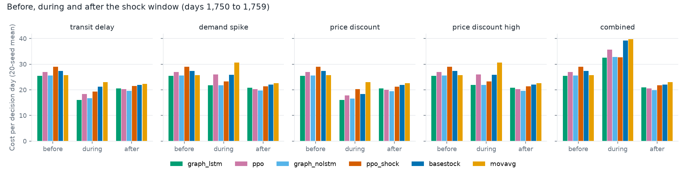 |
| Bullwhip ratio per level | 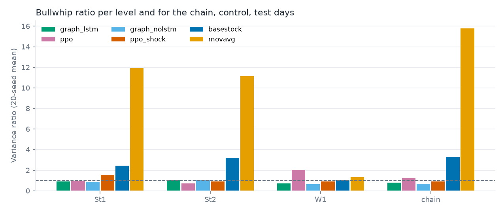 |
| Every training seed on the test days | 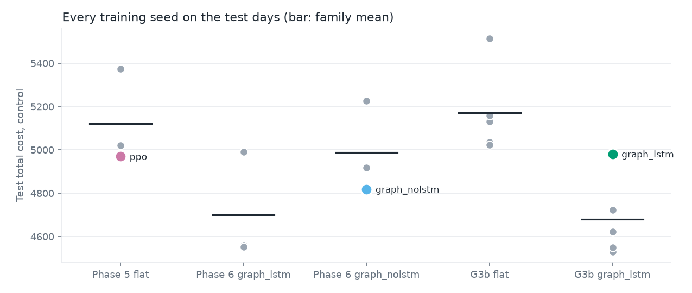 |
| Validation against test | 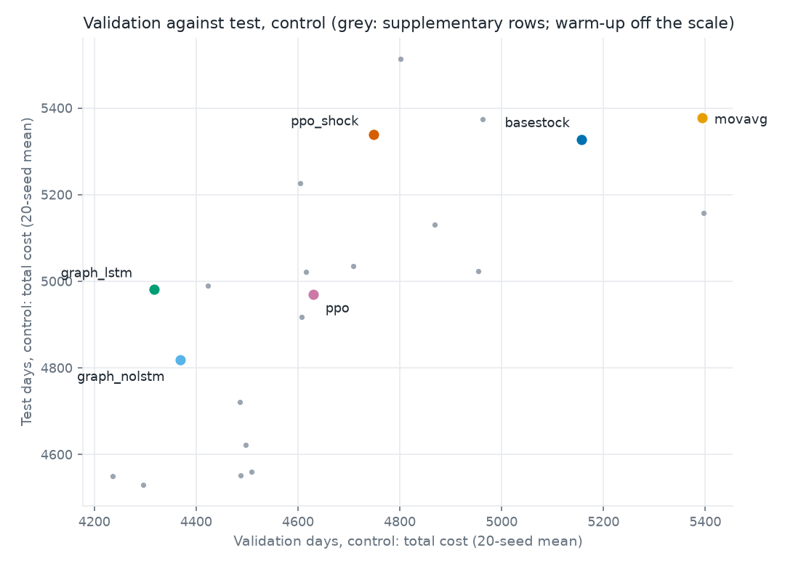 |
| St1 orders under the price discount | 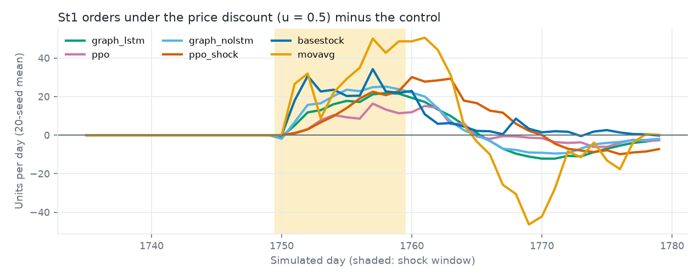 |
| St1 stock under the combined shock |  |

Dashboard with the learned policies (replayed from their single official run):

| | |
| --- | --- |
| Combined shock: base-stock, Graph + LSTM, PPO |  |
| 3D scene, combined shock | 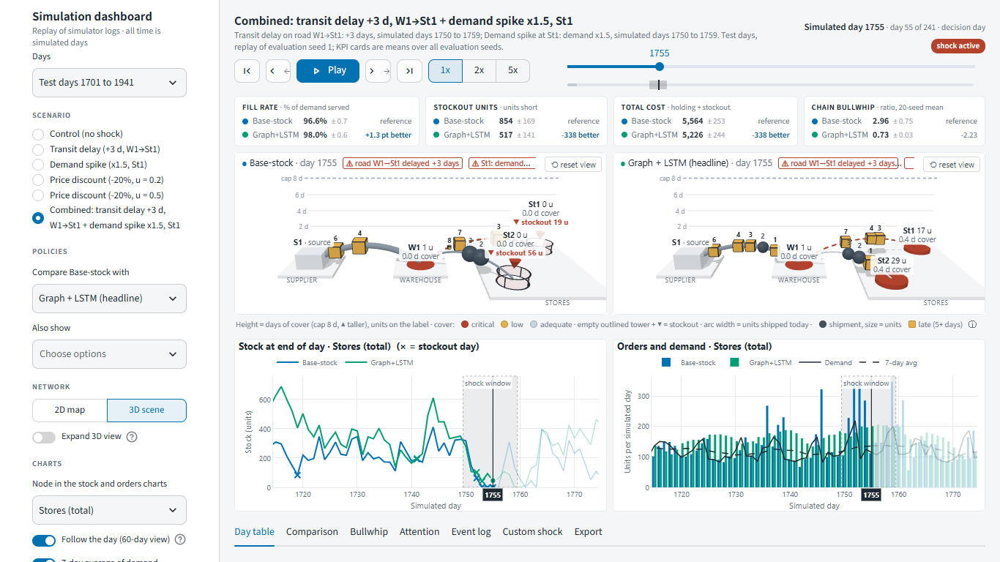 |
| Comparison table |  |
| Attention panel (where the graph model looks; not why it orders) |  |
| Bullwhip tab |  |

Dashboard after Phase 8: readable in light and dark mode, and the eight-node network:

| | |
| --- | --- |
| Four nodes, light mode | 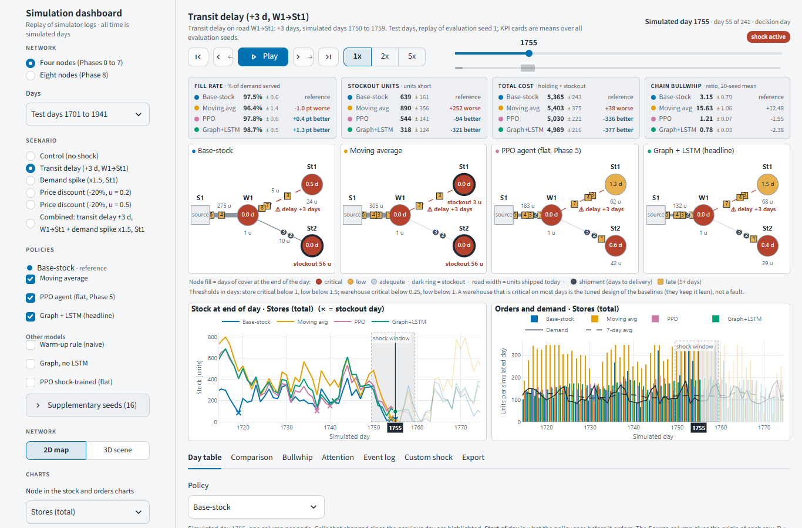 |
| Four nodes, dark mode | 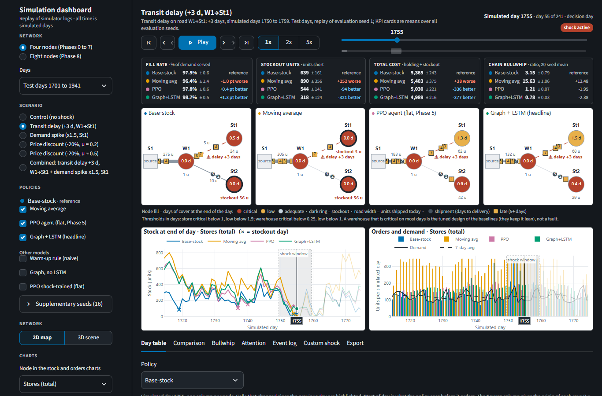 |
| Eight nodes, 2D map (transit delay) | 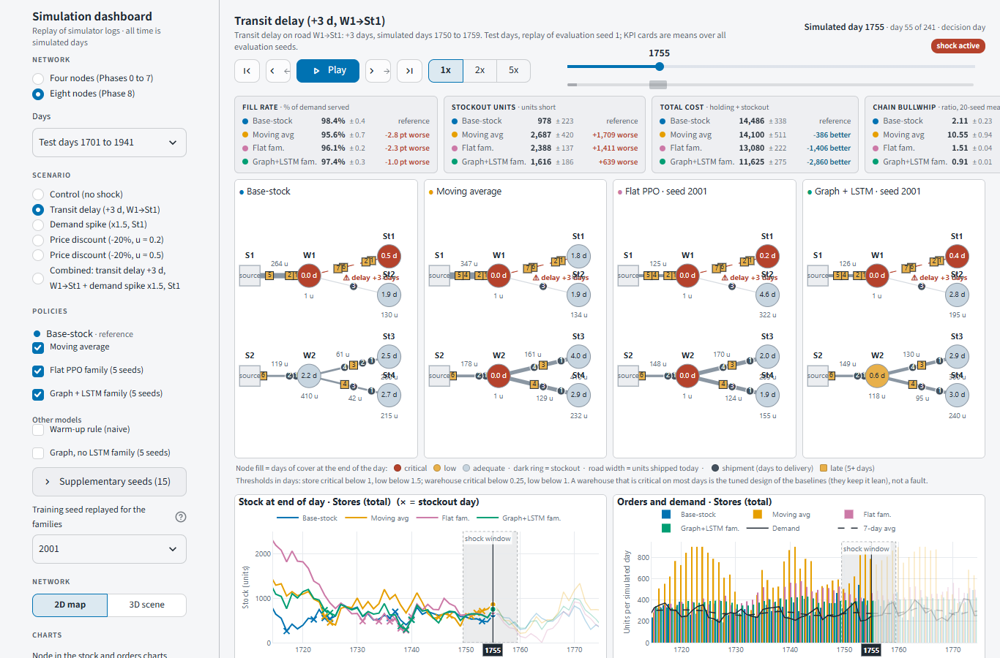 |
| Eight nodes, 3D scene (expanded) | 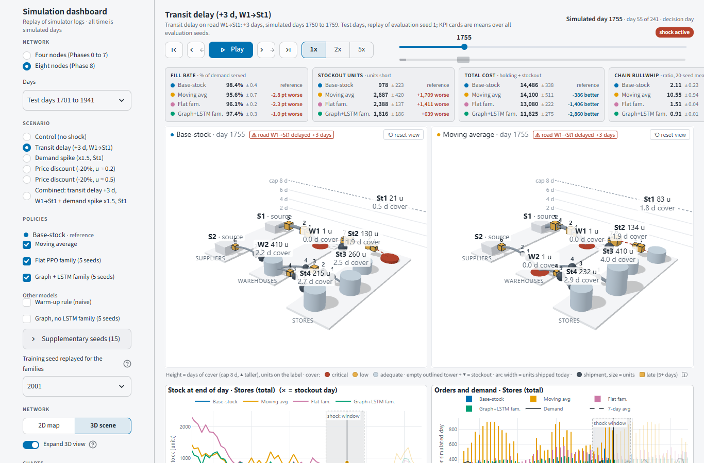 |
| Eight nodes, comparison table (family means) | 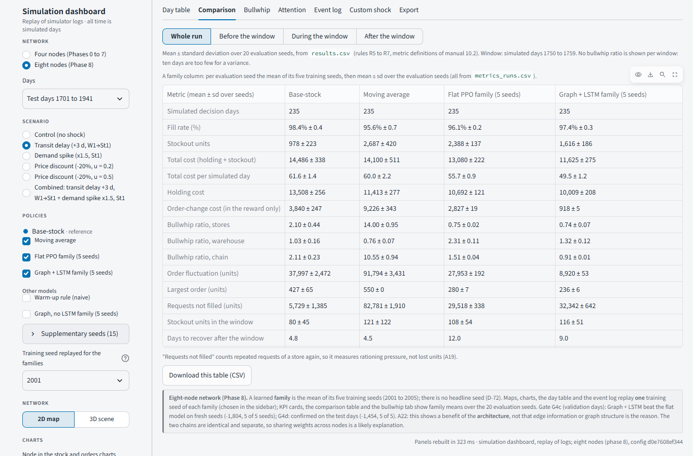 |
| Eight nodes, bullwhip per level and per chain | 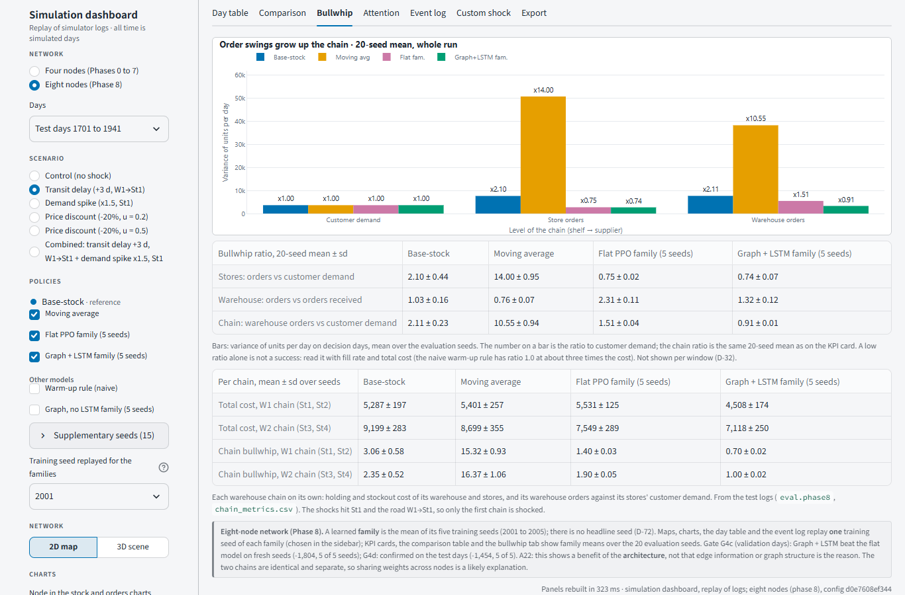 |

## Setup (Python 3.11)

```
py -3.11 -m venv .venv
.venv\Scripts\activate
pip install -r requirements.lock
pip install -e . --no-deps
```

`requirements.lock` pins every package with hashes (regenerated at the start of Phase 5, D-38).
It was resolved on Windows with Python 3.11 and installs torch 2.14.1, CUDA 13.0 build, from the
PyTorch index named in the file (about 2 GB). Training runs on the CPU, which measured faster
than the GPU for these small networks (D-48); the CUDA build also runs on machines without a
GPU. `pyproject.toml` lists the dependencies; to regenerate the lockfile see D-38 and the header
of `requirements.lock` (pip-compile must hash the torch wheels from the PyTorch index).

Standing rules for every session are in [`CLAUDE.md`](CLAUDE.md).

## Checks

```
pytest              # tests
ruff check . && ruff format --check .
mypy
```

## Configuration

- `config.yaml`: chosen settings (source tag C).
- `derived.yaml`: facts derived from the data (`n_days`, the chosen `item_id` and `first_day`), written by the build commands, never hand-tuned.

Phase 1 run order: `inspect_files`, then `data.dataco`, `data.build`, `graph.build` (outputs in `data/processed/` and `reports/figures/`, not committed).

Phase 3 run order: `eval.baselines tune` (2 to 4 min, 10 processes), then `eval.run` (20 to 50 s) and `eval.sensitivity` (4 to 5 min). Outputs in `results/` and `runs/`, not committed (D-22). `eval.run` writes to `results/<split>/` (D-32), so runs on different splits cannot overwrite each other; for validation days use `--split val --scenarios control`. The tuned parameters and the sensitivity tables stay in `results/`.

Phase 4 run order: `eval.run` for the test split (the dashboard replays its logs, shipments tables and results), then `streamlit run app/dashboard.py`. `python -m supply_chain_rl.dashboard.timing` prints the slider-update times; `python -m supply_chain_rl.dashboard.screenshots` saves `reports/figures/dashboard_*.png`, copies the curated set to `docs/screenshots/` (D-46) and prints the browser step times with two, three and four policies (uses the installed Edge or Chrome). Logs written before Phase 4 have no shipments table: re-run `eval.run` once.

**Two networks (Phase 8).** `streamlit run app/dashboard.py` opens the four-node network; with
`SCRL_PROFILE=net8` (PowerShell: `$env:SCRL_PROFILE = "net8"; streamlit run app/dashboard.py`)
it opens the eight-node network. Either can switch to the other in the sidebar ("Network") when
both have results. The sidebar shows base-stock (the reference), moving average and the main
learned model(s) by default (four nodes: PPO and Graph + LSTM; eight nodes: the flat and the
Graph + LSTM families), the other models under "Other models" and every further checkpoint under
the collapsed "Supplementary seeds". An eight-node **family** is the mean of its five training
seeds in the KPI cards, comparison and bullwhip tab; maps, charts, the day table and the event log
replay one training seed, chosen in the sidebar. The Attention tab is for the four-node graph
policies only (no attention was recorded on eight nodes, D-72); custom shocks run the baselines
only. The page follows the system's light or dark mode (`.streamlit/config.toml`); charts and
the 3D scene stay light panels. `python -m supply_chain_rl.dashboard.screenshots --phase8` saves
the Phase 8 images.

The network can be shown as the 2D map (default) or as a 3D scene (sidebar, "Network"; D-43, D-44): tower height is days of cover (capped at 8 days), colour the cover status, an empty outlined tower with a marker is a stockout, and shipments move along the roads from day to day. "Expand 3D view" shows two policies large for a demonstration. The 3D scene uses a copy of three.js r170 kept in `src/supply_chain_rl/dashboard/network3d/vendor/`, so it works offline.

## Screenshots

Test days, transit delay W1→St1 +3 days unless stated, simulated day 1757, replay seed 1 (D-46).
They show results already reported in Phases 3 and 4.

| | |
| --- | --- |
| 3D scene, first screen at 1366 x 768 | 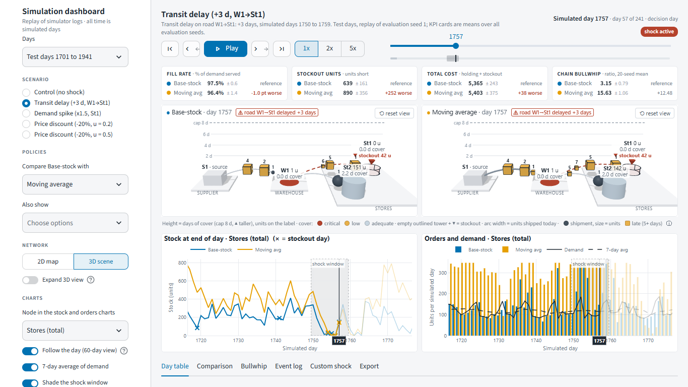 |
| 3D scene expanded for a demonstration | 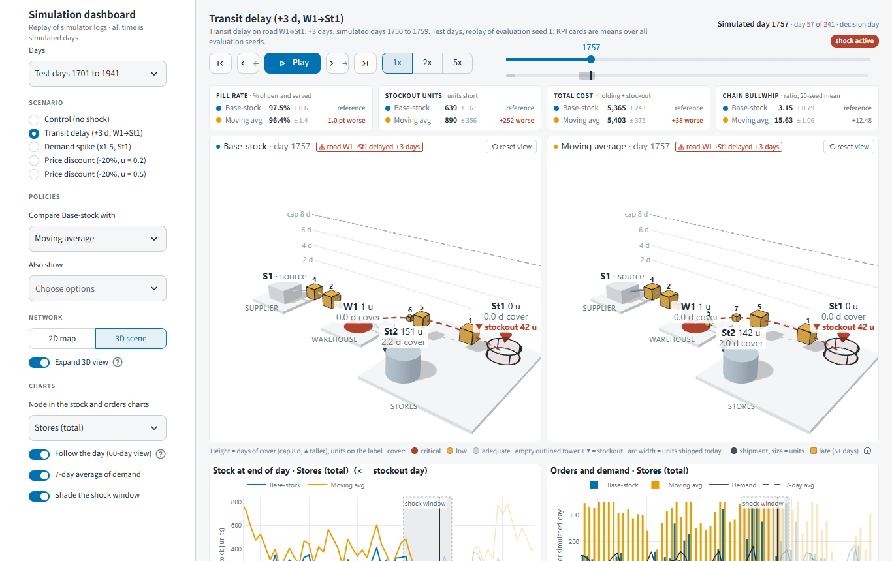 |
| Hover on a store: the day table's values with source tags |  |
| 2D map (default view) | 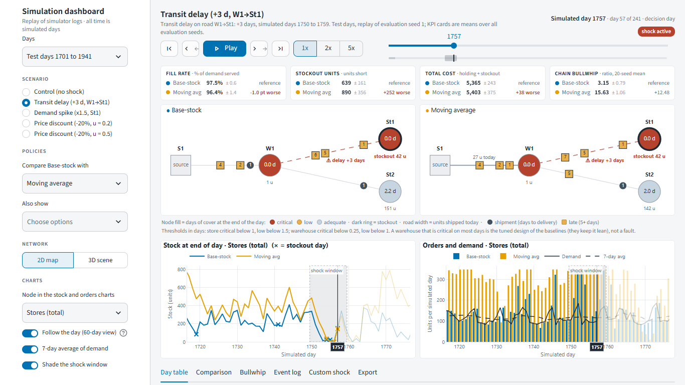 |
| Demand spike St1 x1.5 |  |
| Three policies | 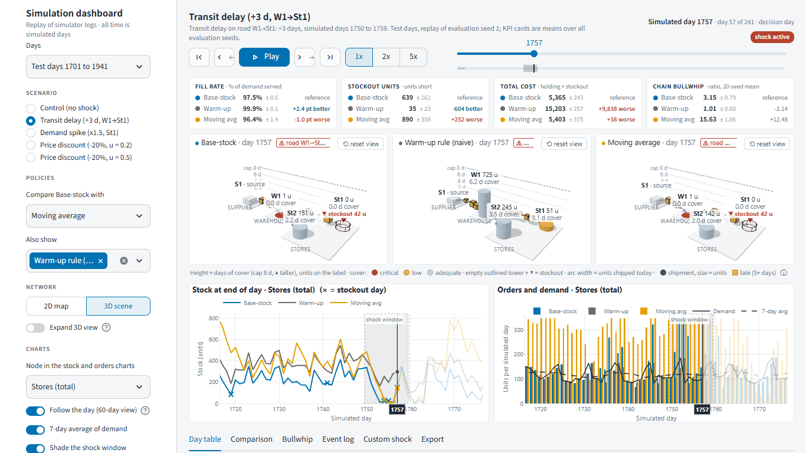 |
| Comparison table (20-seed mean ± sd) |  |
| Bullwhip chart (20-seed means) |  |

Checkpoints are not committed: back up `checkpoints/phase5/`, `checkpoints/phase6/`, `checkpoints/g3b/` and `checkpoints/phase7/` (the 20 frozen policies of D-61), and keep `results/phase7/test_official/`, `runs/test/` and `runs/net8/`, which cannot be regenerated after the test lock.

The trained checkpoints and the learned test logs (`checkpoints/`, `results/`, `runs/` including
`runs/net8/` and `runs/test/`) are not committed, because of their size and the test lock; the
authors keep them offline.

Phase 5 run order: `rl.bench`, `eval.baselines tune --network smoke --policies basestock`, the smoke `rl.train`, then the three prototype `rl.train` runs (about 20 min in parallel on the CPU), `rl.report smoke`, `rl.report prototype --select` and `eval.run ... ppo --split val`. Checkpoints go to `checkpoints/phase5/<network>_s<seed>/` (`last.pt`, `best.pt`, `curve.csv`, `train.log`, `done.json`) and the registered policy to `checkpoints/phase5/ppo_selected.pt`; they are not committed, so back up that folder. Results in `results/phase5/`; figures in `reports/figures/phase5_*.png`, with tracked copies in `docs/figures/phase_5/`.

## Commands (target interface; `fyp` in the manual is `supply_chain_rl` here)

| Command | Phase |
| --- | --- |
| `pytest` | 0 (available) |
| `python -m supply_chain_rl.data.inspect_files` | 1 (available) |
| `python -m supply_chain_rl.data.build` | 1 (available) |
| `python -m supply_chain_rl.data.dataco` | 1 (available) |
| `python -m supply_chain_rl.graph.build` | 1 (available) |
| `python -m supply_chain_rl.data.uplift` | 3 (available: evidence for the S3 uplift `u`) |
| `python -m supply_chain_rl.sim.run --policy warmup --split train --start 100 --days 30 --seed 1` | 2 (available) |
| `python -m supply_chain_rl.sim.run --policy basestock --split test --days all --seed 1 --shock shock.json` | 2/3 (available: warmup, basestock, movavg) |
| `python -m supply_chain_rl.sim.run --golden G-A` | 2 (available) |
| `python -m supply_chain_rl.eval.baselines tune` | 3 (available) |
| `python -m supply_chain_rl.eval.run --policies warmup,basestock,movavg --seeds 20 --split test` | 3 (available) |
| `python -m supply_chain_rl.eval.sensitivity` | 3 (available) |
| `streamlit run app/dashboard.py` | 4 (available: simulation dashboard, replay of the logs) |
| `python -m supply_chain_rl.dashboard.timing` | 4 (available) |
| `python -m supply_chain_rl.dashboard.screenshots` | 4 (available) |
| `python -m supply_chain_rl.eval.baselines tune --network smoke --policies basestock` | 5 (available: base-stock re-tuned for the smoke network S1, W1, St1; D-26) |
| `python -m supply_chain_rl.rl.bench` | 5 (available: CPU against GPU, repeatability, resume; D-48) |
| `python -m supply_chain_rl.rl.train --network smoke --seed 1001` | 5 (available: PPO on the flat state; `--resume` continues from `last.pt`) |
| `python -m supply_chain_rl.rl.train --network prototype --seed 1001` (and 1002, 1003) | 5 (available) |
| `python -m supply_chain_rl.rl.report smoke` / `prototype --select` | 5 (available: validation comparison, sanity checks, G2; `--select` registers `ppo`) |
| `python -m supply_chain_rl.eval.run --policies warmup,basestock,movavg,ppo --split val --scenarios control` | 5 (available: `ppo` logs for the dashboard; refused on the test split before G3) |
| `python -m supply_chain_rl.rl.train --variant <name> --seed <s>` and `python -m supply_chain_rl.rl.ablation` | 6 (available: graph variants, Gate G3) |
| `python -m supply_chain_rl.rl.g3b` | 6/7 (available: Gate G3b, D-60) |
| `python -m supply_chain_rl.eval.run --policies <baselines + rl.evaluated> --split test` | 7 (done once; `reports/test_lock.json` refuses a second learned test run) |
| `python -m supply_chain_rl.eval.phase7` | 7 (available: Phase 7 tables and figures from the result files) |
| `python -m supply_chain_rl.dashboard.screenshots --phase7` | 7 (available) |
| `python -m supply_chain_rl.reproduce [--train] [--dashboard]` | 7 (available: one-command reproduction, D-65) |
| `python -m supply_chain_rl.dashboard.screenshots --phase8` | 8 (available: theme and eight-node images) |

## Data

### Data sources

- **M5**: the M5 Forecasting competition data on Kaggle,
  <https://www.kaggle.com/competitions/m5-forecasting-accuracy>. See the original source for the
  terms of use.
- **DataCo**: the DataCo Smart Supply Chain dataset (Constante, Silva and Pereira) on Mendeley
  Data, <https://data.mendeley.com/datasets/8gx2fvg2k6/5>, where it is listed under CC BY 4.0. See
  the original source for the full terms.

The raw data is **not** included in this repository. Download it from the original sources
yourself; the original terms of use apply.

Place the M5 files in `data/raw/m5/` and the DataCo file in `data/raw/dataco/` (see manual
Section 3). Raw and processed data are not committed.

## Working protocol

One phase per session; stop at each checkpoint and write `reports/phase_N.md` (manual 0.1).
