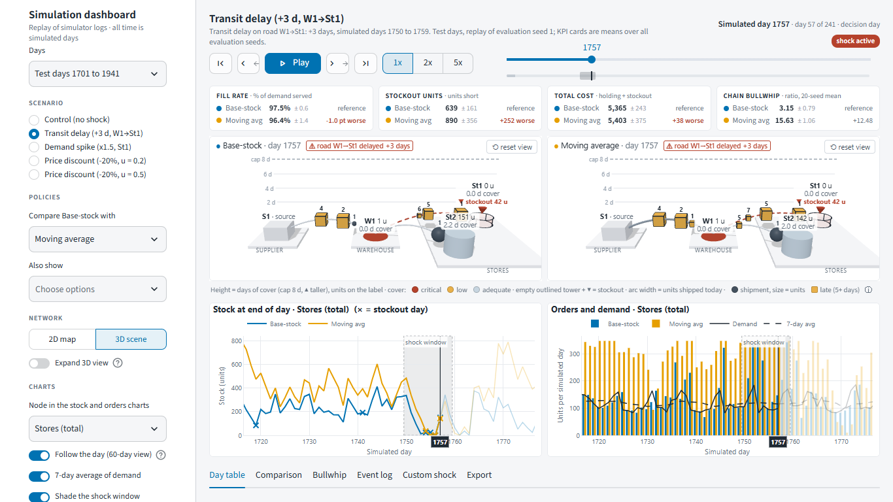
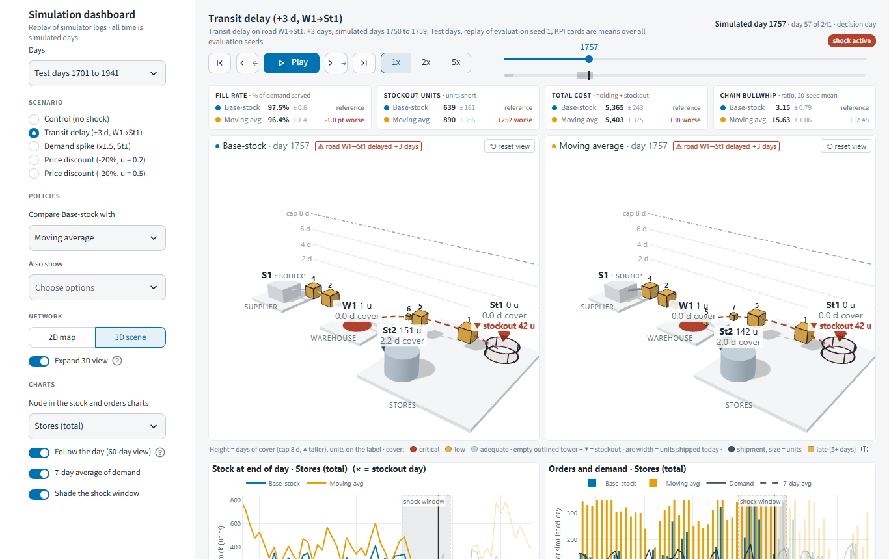
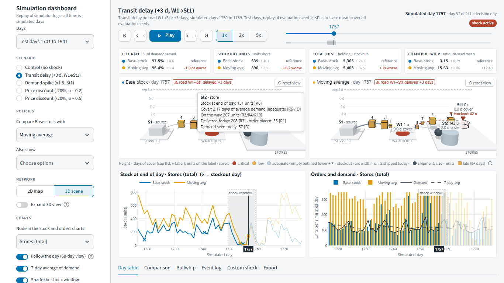
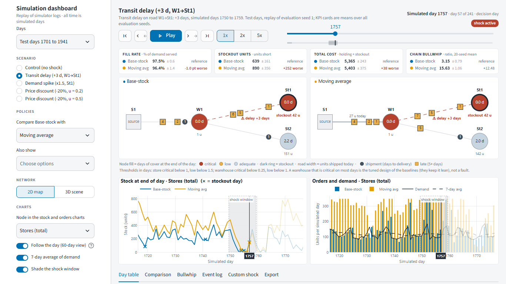
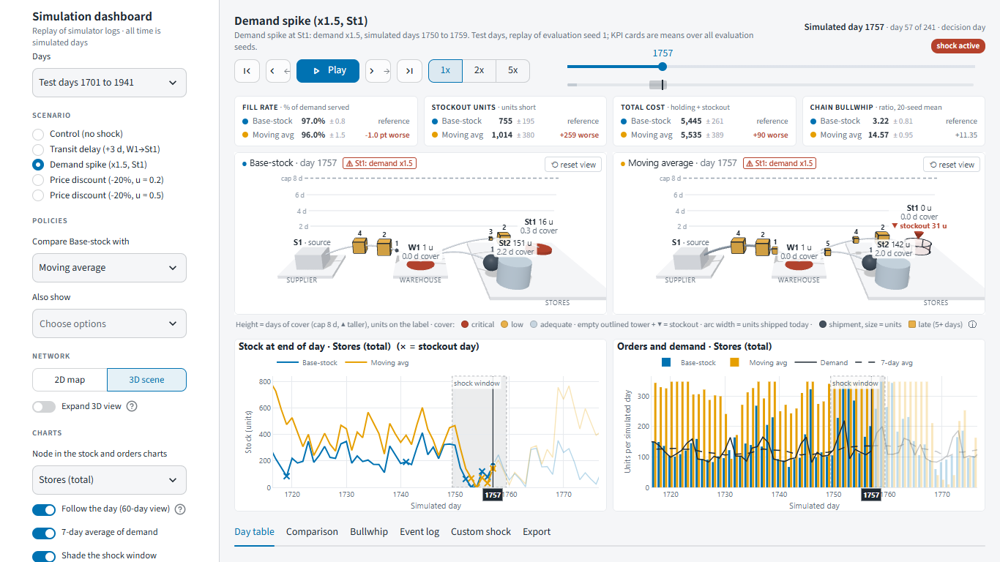
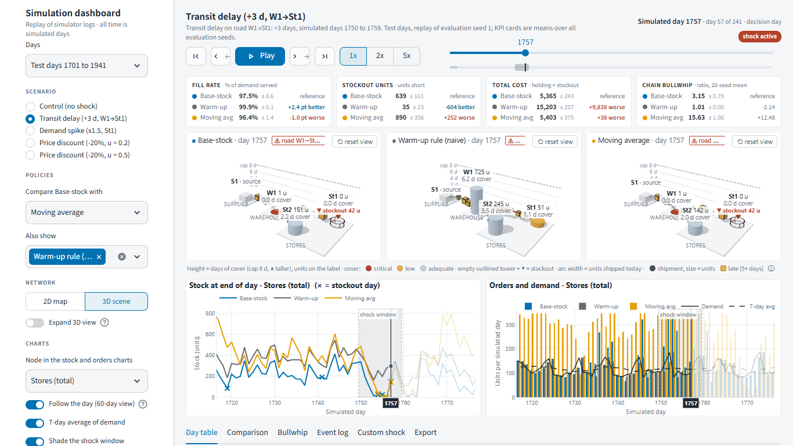
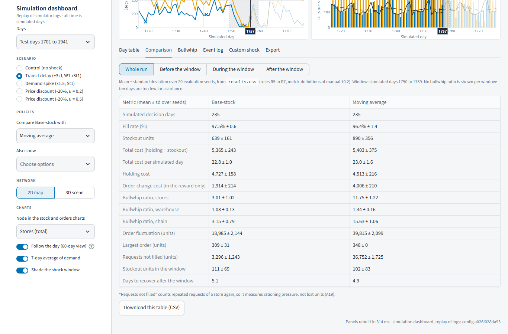
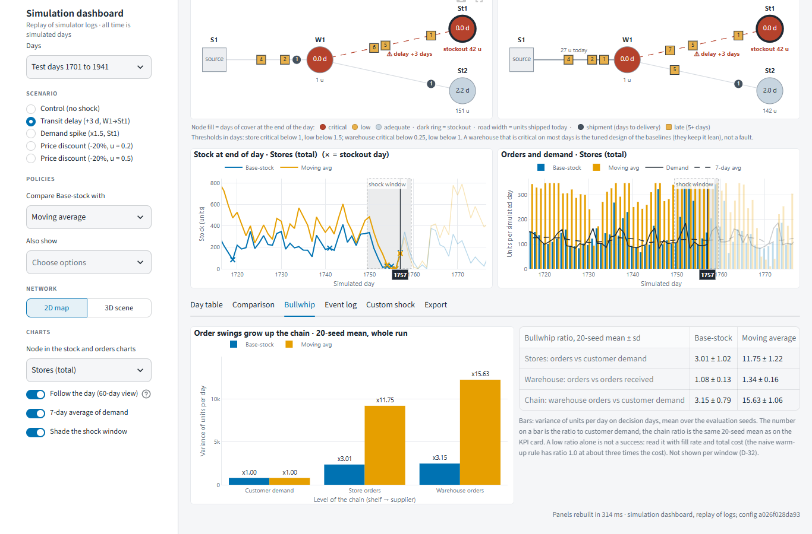

# Phase 4 checkpoint report: the simulation dashboard

Date: 2026-11-17. The dashboard is a replay of the logs written by the evaluation harness. It
runs no simulator rule of its own. All time shown is simulated days.

    python -m supply_chain_rl.eval.run --policies warmup,basestock,movavg --seeds 20 --split test
    streamlit run app/dashboard.py

## What was built

| File | Role |
| --- | --- |
| `sim/env.py`, `sim/logs.py` | Shipments table of a run (D-32 c, D-40): what the simulator already kept in memory is now written. No rule changed. |
| `eval/runner.py`, `eval/run.py` | One shipments file per run and one `scenario.json` per scenario; results in `results/<split>/` with a `split` column (D-32 a); extra scenarios for custom shocks. |
| `eval/metrics.py` | Fill rate, stockout units, cost and cost per day before, during and after the window (D-32 b); the three variances behind the bullwhip ratios. |
| `dashboard/store.py` | Readers for logs, shipments, results and scenario files; scenarios and policies found on disk, policies in registry order. |
| `dashboard/derive.py` | Day table with source tags and changed cells, shipments on the road, late flag, cover status, event log, KPI rows, comparison rows, bullwhip levels. |
| `dashboard/figures.py` | Network map, stock chart, orders chart, bullwhip chart, KPI cards, timeline strip. |
| `dashboard/theme.py` | One palette, one chart style, the page's CSS. |
| `dashboard/custom.py` | Custom shock: validation with the simulator's parser, run through the harness, cache by hash (D-41). |
| `dashboard/timing.py`, `dashboard/screenshots.py` | Timing of a slider move; screenshots and timing in a real browser. |
| `app/dashboard.py`, `.streamlit/config.toml` | The page and its theme. |
| `config.yaml` | `dashboard:` block: thresholds, replay seed, reference policy, speeds, policies allowed in custom runs. |
| Tests | `test_dashboard.py` (28 tests), one addition each to `test_metrics.py` and `test_eval.py`. |

## Checkpoint P4 (manual 11.6, as amended by D-32 and D-33)

| # | Item | Result | Evidence |
| --- | --- | --- | --- |
| 1 | Every component of 11.3 is present | PASS | Table "Components" below; `test_app_renders_every_panel_and_updates_in_under_a_second` finds the six tabs, at least five charts and four tables on the page. |
| 2 | KPI cards and comparison table equal `results.csv` | PASS | `test_kpi_cards_equal_results_csv` (4 scenarios, 3 policies, 4 metrics: mean, spread, difference from base-stock) and `test_comparison_table_equals_results_csv` (whole run, before, during, after) compare every number with the file read directly. `test_bullwhip_chart_agrees_with_kpi_card`: the chart's chain ratio is the card's number. |
| 3 | Replayed stock and orders equal the log on three random days | PASS | `test_replay_equals_log_on_three_random_days`: map, day table, stock chart and orders chart against the log file, three seeded-random days, two scenarios, three policies. |
| 4 | Slider updates all panels in under one second on cached logs | PASS | Table "Performance" below: 129 ms median in the browser, 278 ms for a whole page run. |
| 5 | Delay scenario shows the shaded window, the marked road and falling stock; the spike shows demand jumping and the average rising more slowly | PASS | `dashboard_transit_delay.png`, `dashboard_demand_spike.png`; `test_map_marks_the_shock_and_the_stockouts`, `test_time_chart_view_and_shading`. |
| 6 | Source tags are shown | PASS (as relaxed by D-33 c) | Day table: a `Source` column per row and the legend as column help; map and charts: tag in the hover text. `test_day_table_source_tags_and_changed_cells`. |
| 7 | Exports work | PASS | All five downloads were made in a browser run: replay logs (244,888 bytes), shipments, metrics (mean and sd), metrics per seed, scenario JSON. Charts: the camera button of each chart saves a PNG. |
| 8 | `reports/phase_4.md` contains the screenshots | PASS | Section "Screenshots". The images are in `reports/figures/`, which is not committed (D-5); `python -m supply_chain_rl.dashboard.screenshots` rebuilds them. |

`pytest`: 193 passed (30 new). `ruff check`, `ruff format --check` and `mypy` (strict) clean.

## D-32 (c): the shipments table is logging only

| Check | Outcome |
| --- | --- |
| Golden and property tests | 41 passed (`pytest -k "property or golden"`), unchanged. |
| Phase 3 test-split numbers after the change | Identical. All 495 rows of the previous `results.csv` (mean, std, n), `paired.csv` and every per-run metric of `metrics_runs.csv` are equal to the files saved in `results/repro_logs/` before the change. This covers the control, paired and shock tables of `reports/phase_3.md`. |
| Reference log of `reports/phase_2.md` (warm-up rule, 30 days, seed 1) | SHA-256 still `0518ef02...`; also a test (`test_phase2_reference_log_is_unchanged`). |
| Shipments table against the log | `test_shipments_reconcile_with_the_log`: what leaves a node each day equals `shipped` (R4), arrivals equal `delivered` (R3), and what is on the road equals `pipeline_end`, on every day. |
| Determinism | `test_shipments_table_is_deterministic_and_logging_only`: same seed, same bytes; writing the table does not change the log. |

`results.csv` now has 780 rows per split instead of 495: the 285 new ones are the window metrics
and variances of D-40. The config hash changed from `0d33af3b17fa` to `a026f028da93` because of
the new `dashboard` block; no simulator setting changed.

## Components (manual 11.3)

| Component | Where | Notes |
| --- | --- | --- |
| Scenario and policy controls | Sidebar | Control, transit delay, demand spike, both price discounts, then cached custom shocks. Base-stock plus one policy by default; more can be added. |
| Day slider, play, pause, speed | Top row | First, back, play or pause, forward, last; speeds 1x, 2x, 5x; left and right arrow keys step a day. A strip under the slider marks the warm-up days, the window and the chosen day. |
| Network map | One per policy, side by side | Node fill by days of cover (D-39) with the number printed; dark ring and label on a stockout; road width by units shipped that day; a marker per group of shipments with the days until delivery, amber square when late (A24, A27); dashed road and label on an active transit delay; label on a shocked store. Roads are described as "2 to 6 days"; the delay probability appears only in the hover text as a DataCo label (D-29). |
| KPI cards | Under the controls | Fill rate, stockout units, total cost, chain bullwhip: mean and sd over 20 seeds, difference from base-stock (D-33 b). The bullwhip difference carries no better or worse (manual 10.2 reading note). |
| Stock chart, orders chart | First screen | Stock per policy with stockout days marked; orders as bars per policy with the demand seen and its 7-day average. Window shaded the same way in both; days after the chosen day are faint. |
| Day table | Tab | One column per node; start of day, during the day, end of day; changed cells highlighted; `Source` column. |
| Comparison table | Tab | Whole run, before, during, after; mean ± sd; CSV download. No bullwhip per window (D-32 b). |
| Bullwhip chart | Tab | Variance of customer demand, store orders and warehouse orders per policy with the ratio on each bar; 20-seed means. |
| Event log | Tab | Shock start and end, stockouts, unfilled requests, largest orders, late deliveries, capped orders, in words; selecting a row jumps to its day. |
| Custom shock | Tab | Demonstration only (D-41); progress bar; cached. |
| Export | Tab | Logs, shipments, metrics, scenario JSON; chart PNG through the camera button. |

## Performance (manual 11.6 item 4)

Machine of this session, cached logs, transit-delay scenario.

| Measurement | Command | Result |
| --- | --- | --- |
| One-day step in the browser until the day label, both maps and both charts are redrawn (10 steps) | `dashboard.screenshots` | median 129 ms, max 151 ms |
| Whole page run after a slider move, 20 random days, two policies | `dashboard.timing` | median 278 ms, max 326 ms |
| The same with three policies | `dashboard.timing --policies basestock,movavg,warmup` | median 268 ms, max 331 ms (earlier run of the same command) |
| Panels alone (median): maps 10.5 ms, stock chart 29.8, orders chart 31.0, day table 40.2, KPI cards 13.4, comparison table 31.5, bullwhip chart 32.1, event filter 0.3 | `dashboard.timing` | sum 189 ms |
| Custom shock, 3 policies x 20 seeds through the harness | in the app | 3.7 s the first time, 0.0 s from the cache |

The browser figure is lower than the page-run figure because the browser shows the first screen
as soon as its panels arrive, while the page run also rebuilds every tab.

Play at 1x advanced 4 simulated days in 4.2 s in the browser check.

## Layout at 1366 x 768

Bottom edge of the lowest first-screen panel (KPI cards, maps, stock and orders charts), measured
in the browser by `dashboard.screenshots`:

| View | Bottom edge (px) | Fits in 768 |
| --- | --- | --- |
| Control and each of the four shocks, two policies | 715 | yes |
| Three policies | 734 | yes |
| Four policies | 752 | yes |

The four-policy case was checked with a placeholder: a copy of the warm-up logs relabelled `ppo`,
in a temporary folder outside the repository. That image is not kept, because it would show
numbers under the name of a policy that does not exist yet.

## Screenshots

Day 1757 of the test days (shock window 1750 to 1759), replay seed 1.

| View | File |
| --- | --- |
| Control |  |
| Transit delay W1→St1 +3 days |  |
| Demand spike St1 x1.5 |  |
| Price discount St1 20%, u = 0.2 |  |
| Price discount St1 20%, u = 0.5 |  |
| Three policies |  |
| Day table |  |
| Comparison table |  |
| Bullwhip chart |  |
| Event log |  |
| Custom shock |  |
| Export |  |

### Review of the screenshots

Four rounds were taken. Fixed between rounds: text styles that Streamlit overrode (titles, notes,
KPI headings); KPI cards and the map legend clipped by the panel below; icon buttons showing their
icon names as text; the speed control cut off; the timeline strip out of line with the slider;
shipment markers running into the node circles; the stockout and shock labels touching the node;
chart legends colliding with chart titles; the bullwhip table cut off; download buttons that
re-ran the page.

Remaining, accepted:

- With three or four maps the shipment markers on a delayed road sit close together (up to nine
  days of shipments on a short road). Two maps, the default, are clear.
- With three or more policies the orders chart's legend takes the full width and its last entries
  sit just above the window label.
- The source-tag legend above the day table is long and runs under the table's toolbar at its
  right end.
- The moving-average warehouse is critical on most days. This is accurate and intended (D-39);
  the legend says so.

## What the replay shows

Read from the screenshots and the comparison tab, test days, 20 seeds; these are Phase 3 results
seen in a new form, not new results.

- Transit delay: St1 runs out during the window under both baselines (day 1757, seed 1: 42 units
  short under each), and the delayed shipments are visible on the road with 5 to 7 days to go.
  Stockout units in the window: base-stock 111 ± 69, moving average 102 ± 83 (control 61 and 59).
- Demand spike: demand at St1 jumps on day 1750 and the 7-day average follows over the next days.
- In every scenario the moving-average policy's orders swing far more than demand (chain bullwhip
  about 15 against about 3), which the orders chart shows directly.

## Decisions and assumptions made in this phase

D-39 (thresholds), D-40 (files written by the harness; the D-32 c check), D-41 (custom shocks are
demonstration only), D-42 (layout and presentation); A25 (days of cover), A26 (derived day-table
columns), A27 (late means 5 days or more), A28 (one replayed run against 20-seed means).

## Open items

1. ~~A27 needs the owner's confirmation.~~ **Closed 2026-11-17:** the owner confirmed that a
   delivery is late at 5 days or more (A27 accepted).
2. The combined scenario (D-34) is not defined; the custom form takes one shock.
3. Result files left at the top level of `results/` by earlier runs are stale; the current ones
   are in `results/test/` and `results/val/`. They were not deleted.
4. One custom scenario from the checks of this session is cached
   (`runs/test/custom_a8df8974`, transit delay S1→W1 +3 days) and appears in the scenario list.
5. `explanation.md` does not describe Phase 4 yet.
6. `requirements.lock` is still the Phase 0 list; D-38 regenerates it at the start of Phase 5,
   and it will then include `streamlit` and `playwright`.

## Visual upgrade (Phase 4 extension, 2026-11-17)

A 3D network scene beside the 2D map, livelier 2D charts and KPI cards, and tracked screenshots.
No number shown by the dashboard changed; nothing in the simulator, the harness or the result
files changed. Decisions D-43 (library), D-44 (3D encoding, with the owner's change to tower
height = days of cover), D-45 (2D charts and KPI cards), D-46 (tracked screenshots).

### What was built

| File | Role |
| --- | --- |
| `dashboard/scene3d.py` | Every value of the 3D scene for one day, from `figures.map_state` (the 2D map's source): towers in days of cover capped at 8, units and cover text, stockout, cap flag, roads, shipments keyed by road and arrival day, sizes, hover text, transition length. |
| `dashboard/network3d/` | The component's page and `network3d.js` (three.js scene: towers, outlines, arcs, shipments, labels with overlap avoidance, hover, camera, reset, eased moves), and three.js r170 in `vendor/` with its MIT licence. |
| `dashboard/component.py` | The Streamlit component (protocol version 1, no npm helper, no build step). |
| `dashboard/figures.py` | Hover text shared by the 2D map and the 3D scene; day dot on the stock lines; day ids on bars and points; KPI odometer. |
| `dashboard/theme.py` | Day label on the day line, day-aware shock band, transitions, unified hover title, odometer CSS. |
| `dashboard/screenshots.py` | 3D, expanded and hover screenshots; curated copy to `docs/screenshots/`; 3D step timing with two, three and four policies (four: placeholder `ppo` in a temporary folder). |
| `app/dashboard.py` | "Network" switch (2D map or 3D scene) and "Expand 3D view" in the sidebar; transition lengths; day-independent panels built once per run. |
| `pyproject.toml` | The component's files are package data. |
| Tests | 9 new in `test_dashboard.py`; the app test also opens the 3D and expanded views. |

### Checkpoint of the extension

| # | Item | Result | Evidence |
| --- | --- | --- | --- |
| V1 | The 3D scene shows the log's stock, cover status, stockouts and shipments on three random days | PASS | `test_scene3d_equals_log_on_three_random_days` (two scenarios, three policies, values against the log and shipments files read directly; R5, R6, R10, D-39, A27). `test_scene3d_draws_what_the_log_says_in_a_browser`: what three.js actually drew (tower height in days, filled or outlined, marker, colour, label; shipment position, size, late shape, days label) equals those values on three random days including a stockout day, before and after an eased move. |
| V2 | Tower height = days of cover capped at 8, units printed, cap marker | PASS | `test_scene3d_height_is_days_of_cover_capped_at_eight`; browser test checks the drawn height and label. |
| V3 | Stockout not shown by colour alone | PASS | Empty outlined tower, red cone and "▼ stockout n u"; browser test asserts outline and marker on every stockout. |
| V4 | Hover shows the same values and source tags as the 2D map and day table | PASS | `test_scene3d_hover_equals_the_2d_map`; `03_3d_scene_hover.png`. |
| V5 | Late deliveries and the shocked road use the existing styling | PASS | `test_scene3d_shock_and_transition_rules`; amber late cubes and dashed vermilion road in the screenshots. |
| V6 | 2D charts livelier, every value still read off its axis | PASS | `test_charts_day_marker_band_and_transition`: day dot equals the log, band edges fixed, ids keep bars on their day, transitions only when asked. Existing chart tests unchanged and passing. |
| V7 | KPI count-up ends on the exact value | PASS | `test_kpi_count_up_ends_on_the_exact_value`; `test_kpi_cards_equal_results_csv` unchanged and passing. |
| V8 | A one-day step redraws everything in under one second, with two, three and four policies | PASS | Table "Performance with the 3D scene" below. |
| V9 | First screen fits 1366 x 768 | PASS | Table "Layout" below. |
| V10 | Same policy colours, cover ramp and shock styling | PASS | Colours come from `theme` (`scene3d.palette`); `test_scene3d_shock_and_transition_rules` checks the palette. |
| V11 | The component works offline and is pinned | PASS | `test_component_is_offline_and_pinned`. |

`pytest`: 202 passed (9 new). `ruff check`, `ruff format --check` and `mypy` (strict) clean.

### Performance with the 3D scene

Browser (`dashboard.screenshots`), transit delay, 10 one-day steps each, cached logs. "New day
drawn": until the day label, every 3D scene and both time charts show the new day. "Move ended":
until the 3D scenes have finished easing to it.

| View | New day drawn, median / max | Move ended, median / max |
| --- | --- | --- |
| 2D map, two policies (all panels, as in Phase 4) | 196 / 229 ms | n/a |
| 3D scene, two policies | 480 / 533 ms | 590 / 601 ms |
| 3D scene, three policies | 526 / 576 ms | 621 / 657 ms |
| 3D scene, four policies (placeholder `ppo`, not kept) | 537 / 654 ms | 637 / 679 ms |

The 3D scenes themselves received the new day about 120 to 280 ms after the key press; the rest is the
page run and the two time charts, which appear when the page run ends. Two fixes were needed to
stay under one second: the day-independent panels are built once per run (D-45 e), and the
orders chart draws only the days in view (with day ids) instead of the whole run. A first
measurement also showed a cold first step of 1.1 to 1.9 s in a freshly started server; it came
from Plotly loading its transition support on the first move and was removed by always setting
the transition (0 ms when nothing moves). Page run without a browser (`dashboard.timing`, two
policies): median 373 ms on this machine today, against 365 ms for the code before the extension
measured the same way the same day (the Phase 4 figure of 278 ms was taken on a less loaded
machine). Play at 1x advanced about one simulated day per second with the scenes following (checked in
the browser, no errors).

### Layout at 1366 x 768

| View | Bottom edge (px) | Fits in 768 |
| --- | --- | --- |
| 2D map, control and each shock, two policies | 715 | yes (unchanged) |
| 2D map, three / four policies | 734 / 752 | yes (unchanged) |
| 3D scene, control and each shock, two policies | 699 | yes |
| 3D scene, three / four policies | 717 / 736 | yes |

### Screenshots (tracked, D-46)

| View | File |
| --- | --- |
| 3D scene, first screen |  |
| 3D scene expanded |  |
| Hover on St2 |  |
| 2D map |  |
| Demand spike |  |
| Three policies |  |
| Comparison table |  |
| Bullwhip chart |  |

### Review of the screenshots

Several rounds. Fixed between rounds: the first screen ran past 768 px (3D panel 240 px and a
two-line legend; now 222 px and one line, expand control moved to the sidebar); the KPI rows grew
by about 9 px through the odometer's vertical offset (four policies in 2D no longer fitted; now
back to 752 px); the cap line ran into the panel title; the expanded view cut the supplier off and
left the scene small (narrow frames now use a corner camera fitted to the frame); St1's label sat
under St2's when St1's tower was short (stores now set diagonally, and overlapping labels move
apart); the stockout label hid behind St2's label (now part of St1's own label, above a red cone);
the ruler's "0" tick touched the supplier label (ruler now in days from 2 up, labels at the left);
the hover screenshot caught a road instead of a tower; scene labels showed through the tooltip.
Found by the browser test: the 3D label rounded a cover of 1.25 to "1.3" (JavaScript) while the
2D map printed "1.2" (Python); label numbers are now formatted in Python for both views.

Remaining, accepted:

- With three or four policies the small 3D scenes are dense (labels close together, shipment day
  numbers shown on hover only below 420 px width). The 2D map or "Expand 3D view" is the better
  choice there; two scenes, the default, are clear.
- On days with low stock the upper part of a scene is empty up to the 8-day ruler; this is the
  fixed scale that makes days comparable, and towers fill it on well-stocked days.
- The three.js code is not type-checked; the browser test is its check, and it is skipped on a
  machine without Edge or Chrome.

### Not included

The optional 3D summary view (a surface of stock by node and day) was left out, as recommended in
the plan and agreed by the owner: with three stocking nodes a surface would show invented values
between St1 and St2, and the 2D stock chart already shows the same series exactly.
