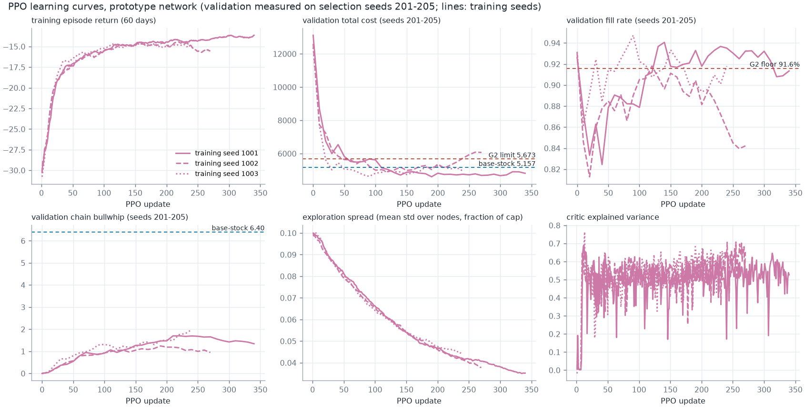
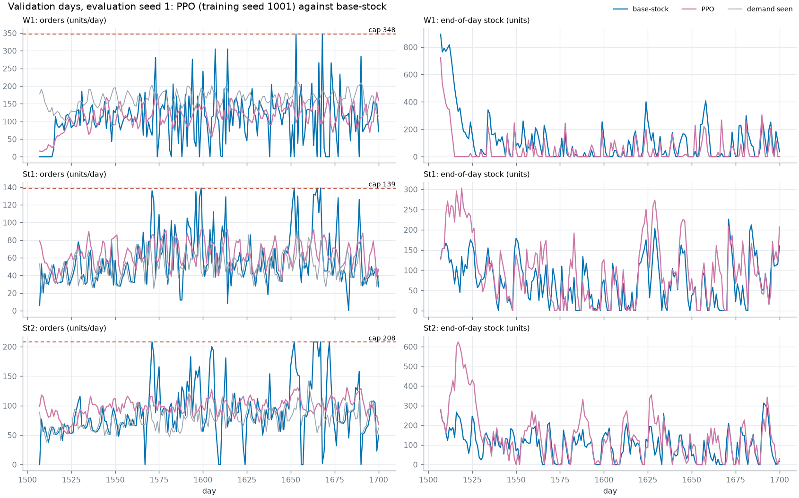

# Phase 5 checkpoint report: PPO on a flat state

Date: 2026-11-17. Validation days only: no test day was used for training, selection or
evaluation in this phase, and the learned policy is refused on the test split in code (M-33).
All costs are relative weights over simulated days (D-14 c).

**Result: Gate G2 is passed**, on every criterion, by each of the three training seeds and by
their mean. PPO beats the tuned base-stock and moving-average baselines on validation days on
total cost, reward-based cost and chain bullwhip, and matches or beats them on fill rate.

**Read the G2 numbers with this caveat.** Checkpoints were selected on validation days
(selection seeds 201 to 205), and Gate G2 is judged on the same validation days (evaluation
seeds 1 to 20). The seeds differ, so the delivery luck differs, but the demand history is the
same. The G2 numbers may therefore be slightly optimistic. The test days in Phase 7 are the
independent check. Also, validation demand is 8% above the training level and test demand 8%
below it (`reports/reproduction.md` 4; D-35 d), so selecting the lowest validation cost may
favour checkpoints that hold more stock than the test days need.

    python -m supply_chain_rl.rl.bench
    python -m supply_chain_rl.eval.baselines tune --network smoke --policies basestock
    python -m supply_chain_rl.rl.train --network smoke --seed 1001
    python -m supply_chain_rl.rl.train --network prototype --seed 1001   # and 1002, 1003
    python -m supply_chain_rl.rl.report smoke
    python -m supply_chain_rl.rl.report prototype --select
    python -m supply_chain_rl.eval.run --policies warmup,basestock,movavg,ppo --split val --scenarios control

## What was built

| File | Role |
| --- | --- |
| `rl/flat_ppo.py` | Settings from `config.yaml` (`PPOSettings`), flat state, actor (sigmoid mean, learned log std, starting mean one third of the cap) and critic, GAE with bootstrap at truncation, clipped PPO update. |
| `rl/train.py` | Training loop: whole 60-day episodes in 8 environments, random starting stock in training only, selection on validation days, checkpoints, exact resume, `train.log`, `curve.csv`, GPU temperature. |
| `rl/policy.py` | `PPOPolicy`: frozen weights, mean action; loads a checkpoint. |
| `rl/bench.py` | CPU against GPU speed, repeatability and resume check. |
| `rl/report.py` | Random policy, comparison on seeds 1 to 20, paired differences, sanity checks, G2 verdict, figures, registration of `ppo`. |
| `sim/env.py` | `peek_observation()`: read-only observation after the last day, for the bootstrap (D-51 a). |
| `sim/data.py` | `avg_d` and `price_mean` for a network other than the configured one (smoke network, D-51 d). |
| `eval/runner.py`, `eval/run.py`, `eval/baselines.py` | Observation policies in `play`; `score_policy`; test-split guard; smoke network (`network_config`, `--network smoke`); paired comparisons with `ppo`. |
| `policies/registry.py`, `dashboard/custom.py` | `ppo` registered (loads `rl.selected_checkpoint`); left out of custom shock runs before G3. |
| `config.yaml` | Every PPO setting in the `rl` block. |
| `pyproject.toml`, `requirements.lock`, `README.md`, `.gitignore` | torch added; lockfile regenerated with hashes; setup uses the lockfile again; `checkpoints/` ignored. |
| Tests | `tests/test_rl.py` (19 tests, each named after its rule or decision); `test_policies.py` and `test_dashboard.py` updated for the registry's new `ppo`. |

## Checkpoint P5 (manual 12.2, as amended by D-25, D-35, D-36)

| # | Item | Result | Evidence |
| --- | --- | --- | --- |
| 1 | The smoke test learns | PASS | S1, W1, St1 network (D-26). Validation cost (selection seeds) 5,357 untrained, 1,951 after 50 updates, best 1,828 at update 80. On seeds 1 to 20 it beats the re-tuned base-stock: 1,887 against 2,063, lower on 19 of 20 seeds. Section "Smoke test". |
| 2 | The prototype network run has learning curves | PASS | Three training seeds; `docs/figures/phase_5/phase5_prototype_learning_curves.png`; table "Learning curves". |
| 3 | Validation comparison table against the tuned baselines | PASS | Section "Comparison on validation days". |
| 4 | G2 outcome written down | PASS: **G2 passed** | Section "Gate G2". |
| 5 | Sanity checks (manual 12.1 step 5.4) | PASS, all six | Section "Sanity checks". |
| 6 | D-35: starting mean one third, bootstrap, random starting stock in training only, selection seeds 201 to 205, at least three training seeds | PASS | `test_D35a_...`, `test_D35b_...` (two tests), `test_D35c_...`, `test_D35d_...`, `test_D35_D50_settings_...`. |
| 7 | Recorded, reproducible run | PASS | Same seed on the CPU gives identical weights; interrupted and resumed runs give identical weights (`results/phase5/bench.json`, `test_D48_...`, `test_D50_resume_...`). Every checkpoint stores the settings, config hash and git commit. |
| 8 | Baselines unchanged | PASS | The validation numbers of D-25 reproduce exactly after the `play` change (`test_D51_baseline_validation_results_unchanged_by_the_ppo_branch`), and all 60 baseline rows of `results/val/metrics_runs.csv` are identical before and after the `ppo` run. No rule changed. |
| 9 | `ppo` registered and replayable in the dashboard | PASS | `checkpoints/phase5/ppo_selected.pt`; `runs/val/control/ppo_s*.csv`. The page renders on validation days comparing base-stock with PPO, KPI 4,630 against 5,157, no error. `ppo` is refused on the test split and left out of custom runs (`test_M33_D41_...`). |

`pytest`: 221 passed (19 new). `ruff check`, `ruff format --check` and `mypy` (strict) clean.

## GPU, device and repeatability (D-47, D-48)

- **GPU.** The laptop has an RTX 3070 Ti Laptop GPU (8 GB), driver 610.62, CUDA 13.3. With
  `torch 2.14.1+cu130`, `torch.cuda.is_available()` is True.
- **Why D-12 missed it.** Most likely the Phase 0 check ran on another machine; this is not
  proven, because no command output was kept (D-47).
- **Temperature.** The GPU read 86 to 87 °C at every evaluation of every run, while idle (the
  runs use the CPU).

Same short run on each device (`python -m supply_chain_rl.rl.bench`, prototype network, 20
updates, seed 1001). Source: `results/phase5/bench.json`.

| Device | Rollout per update | PPO update | Environment steps/s while training | PPO updates per minute |
| --- | --- | --- | --- | --- |
| **CPU, 1 thread (chosen)** | 0.48 s | 0.45 s | 3,975 | **64.3** |
| GPU | 0.72 s | 0.57 s | 2,659 | 46.5 |
| Simulator alone | | | 6,434 | |

The networks are small and every simulated day needs a copy between CPU and GPU, so the CPU
wins. In the real runs, three in parallel ran at 45 to 50 updates per minute each.

| Repeatability check | Result |
| --- | --- |
| Same seed on the CPU twice | identical weights (largest difference 0.0) |
| Stopped half-way and resumed from `last.pt`, against uninterrupted | identical weights (0.0) |
| Same seed on CPU and on GPU | **not identical**: largest weight difference 0.094 after 20 updates; validation cost 6,757 (CPU) against 6,998 (GPU) |

All reported runs use the CPU.

## PPO settings (`config.yaml`, `rl`)

| Setting | Value | Setting | Value |
| --- | --- | --- | --- |
| discount, GAE lambda, clip | 0.99, 0.95, 0.2 | learning rate | 3e-4 (Adam) |
| steps per update | 1,920 (8 envs x 4 whole 60-day episodes; D-50) | passes, minibatch | 10, 256 |
| hidden layers | 128, 128 (tanh), separate actor and critic | entropy, value weights | 0.001, 0.5 |
| gradient clip | 0.5, actor and critic separately | starting mean, spread | 1/3 of the cap, 0.10 (D-35 a) |
| evaluation interval | 10 updates, seeds 201 to 205 | updates | min 200, max 1,000, patience 15 evaluations |
| training seeds | 1001, 1002, 1003 | starting stock (training only) | stores 0.5 to 4.0 days, warehouse 0.25 to 8.0 days (D-49) |
| smoke | max 300, min 100 updates, seed 1001 | device | CPU, 1 thread (D-48) |

## Smoke test (S1, W1, St1; D-26)

**Base-stock re-tuned for this network.** Training days, tuning seeds 101 to 105, joint grid of
D-19, 151 pairs, no grid extension: m = 1.40 (store) and 1.10 (warehouse); training total cost
14,327 ± 179, fill 93.6%. The four-node values (1.35 / 1.10) were not reused.

**Training.** 230 updates in 3 min 25 s, stopped by patience. Best checkpoint at update 80.

**Comparison.** Validation days, evaluation seeds 1 to 20, mean ± standard deviation over seeds.
Source: manual 10.2 metrics; reward-based cost = holding + stockout + order change (R7, D-38 d);
`results/phase5/smoke/`.

| Policy | Total cost | Reward-based cost | Fill rate | Stockout units | Order-change cost | Chain bullwhip | Largest order | Orders at zero / at cap |
| --- | --- | --- | --- | --- | --- | --- | --- | --- |
| Base-stock (1.40 / 1.10) | 2,063 ± 100 | 3,133 | 90.76% ± 1.11 | 887 | 1,070 | 4.79 ± 0.88 | 139 (cap) | 9.5% / 4.9% |
| PPO (seed 1001) | **1,887 ± 101** | **2,092** | **93.32% ± 0.59** | 641 | 206 | **0.88 ± 0.04** | 84 | 0% / 0% |
| Random | 23,658 | 25,443 | 100% | 0 | 1,785 | 7.10 | 139 | 0.3% / 0.9% |

Paired over the same seeds (PPO minus base-stock, approximate 95% interval):

- total cost -177 (-229 to -124), PPO lower on 19 of 20 seeds;
- fill rate +2.6 points (+2.0 to +3.1), higher on 20 of 20;
- chain bullwhip -3.9, lower on 20 of 20.

**What this proves.** The observation, the fraction action and its scaling by R1, the reward,
the warm-up handling and the bootstrap all work: the agent learns quickly and orders around
demand, never at zero or at the cap.

Figures: `docs/figures/phase_5/phase5_smoke_learning_curves.png`,
`phase5_smoke_validation_episode.png`.

## Prototype network (S1, W1, St1, St2)

**Training.** Three training seeds in parallel, 19:06 to 19:13 (under 7 minutes). All three
stopped by patience, well before the 1,000-update budget.

| Training seed | Updates | Decision days seen | Best update | Selection cost at best (seeds 201-205) | Selection cost at the last update |
| --- | --- | --- | --- | --- | --- |
| 1001 | 340 | 652,800 | 190 | 4,607 | 4,815 |
| 1002 | 270 | 518,400 | 120 | 4,912 | 6,070 (fill 84.2%) |
| 1003 | 240 | 460,800 | 90 | 4,627 | 4,959 |

### Learning curves

Validation total cost on the selection seeds (source: `checkpoints/phase5/prototype_s*/curve.csv`):

| Update | 0 | 50 | 100 | 150 | 200 |
| --- | --- | --- | --- | --- | --- |
| Seed 1001 | 13,118 | 5,825 | 5,615 | 4,876 | 4,822 |
| Seed 1002 | 12,600 | 5,638 | 5,003 | 4,987 | 5,364 |
| Seed 1003 | 12,378 | 5,067 | 4,821 | 4,738 | 5,258 |

- **Learning is fast.** The training return rises from about -26 to about -14 per 60-day
  episode in the first 100 to 150 updates, then flattens.
- **Not every run stays at its best.** Seed 1002 degrades after update 200: validation fill fell
  to 84% and cost rose to 6,070. Checkpoint selection kept its update-120 weights.
- **The updates are fairly large.** Mean approximate KL is 0.025 to 0.033 and about 30% of
  samples are clipped. That is larger than is usual for PPO, and it is the likeliest cause of
  the noise and late drift. It is not changed here, because G2 is passed and tuning is ladder
  step 2.

### Comparison on validation days

Control scenario, evaluation seeds 1 to 20, configured starting stock, frozen weights, mean
action. Mean ± standard deviation over evaluation seeds. Source: manual 10.2 metrics (A19 for
the bullwhip levels and `unfilled`); reward-based cost R7 and D-38 d; orders at zero or at the
cap from the logs (A12: an order equal to the floored cap counts as at the cap);
`results/phase5/prototype/comparison.csv`.

| Policy | Total cost | Reward-based cost | Fill rate | Stockout units | Order-change cost | Bullwhip stores | Bullwhip W1 | Bullwhip chain | Largest order | Unfilled | At zero / at cap |
| --- | --- | --- | --- | --- | --- | --- | --- | --- | --- | --- | --- |
| Warm-up R9 (naive) | 10,861 ± 200 | 11,839 | 99.52% | 117 | 978 | 1.00 | 0.99 | 0.99 | 225 | 0 | 0% / 0% |
| Base-stock (1.35 / 1.10) | 5,157 ± 328 | 7,683 | 90.03% ± 1.50 | 2,441 | 2,526 | 6.29 | 1.03 | 6.40 ± 1.11 | 344 | 8,386 | 5.8% / 3.1% |
| Moving average (2.10 / 0.40) | 5,394 ± 355 | 8,748 | 92.62% ± 1.82 | 1,809 | 3,354 | 8.33 | 2.36 | 19.55 ± 1.42 | 348 (cap) | 34,564 | 11.3% / 46.0% |
| PPO, training seed 1001 (registered) | 4,630 ± 167 | 5,338 | 93.15% ± 0.58 | 1,678 | 708 | 0.62 | 2.26 | 1.40 ± 0.08 | 195 | 8,695 | 0% / 0% |
| PPO, training seed 1002 | 4,963 ± 184 | 5,477 | 91.76% ± 0.69 | 2,018 | 514 | 0.77 | 1.32 | 1.01 ± 0.06 | 169 | 6,100 | 0% / 0% |
| PPO, training seed 1003 | 4,615 ± 201 | 5,110 | 94.79% ± 0.61 | 1,275 | 495 | 0.22 | 5.91 | 1.32 ± 0.08 | 186 | 5,779 | 0% / 0% |
| **PPO, mean of 3 training seeds** | **4,736** (sd across seeds 197) | **5,309** (185) | **93.24%** (1.52 points) | 1,657 (372) | 572 (117) | | | **1.24** (0.20) | | | |
| Random | 59,966 ± 7,838 | 64,480 | 100% | 0 | 4,514 | 6.10 | 1.96 | 11.82 | 347 | 649 | 0.3% / 0.7% |

The baseline rows equal `reports/reproduction.md` 4 and D-25 exactly.

**Paired over the same seeds.** Source: `results/phase5/prototype/paired.csv`; approximate 95%
interval = mean ± 1.96 sd / sqrt(20), the Phase 3 rule.

| PPO training seed | vs | Total cost | Seeds PPO better | Fill rate (points) | Seeds | Chain bullwhip | Reward-based cost |
| --- | --- | --- | --- | --- | --- | --- | --- |
| 1001 | base-stock | -527 (-647 to -407) | 20 | +3.1 (+2.6 to +3.6) | 20 | -5.0 | -2,345 |
| 1002 | base-stock | -194 (-323 to -66) | 13 | +1.7 (+1.3 to +2.2) | 19 | -5.4 | -2,205 |
| 1003 | base-stock | -542 (-679 to -405) | 19 | +4.8 (+4.2 to +5.3) | 20 | -5.1 | -2,572 |
| 1001 | moving average | -764 (-894 to -634) | 20 | +0.5 (-0.1 to +1.2), tie | 15 | -18.2 | -3,410 |
| 1002 | moving average | -431 (-570 to -293) | 18 | **-0.9 (-1.5 to -0.2)**, moving average better | 4 | -18.5 | -3,271 |
| 1003 | moving average | -779 (-939 to -619) | 20 | +2.2 (+1.5 to +2.9) | 17 | -18.2 | -3,637 |

The baselines win only on fill rate, and only in one pairing: moving average fills 0.9 points
more than PPO seed 1002. That row is reported as found.

**How PPO does it.** Average stock in days of the node's own training demand, from
`avg_stock_*`:

| Policy | W1 | St1 | St2 |
| --- | --- | --- | --- |
| Base-stock | 0.95 | 1.51 | 1.43 |
| Moving average | 0.35 | 2.94 | 2.76 |
| PPO (seeds 1001 / 1002 / 1003) | 0.53 / 0.66 / 0.77 | 2.16 / 2.27 / 1.97 | 2.05 / 1.74 / 2.35 |

Like moving average, PPO keeps the warehouse lean and the stock in the stores, where shortages
are charged. Unlike either baseline, its orders are smooth:

- store orders vary about a tenth as much as base-stock's (bullwhip stores 0.2 to 0.8 against
  6.3);
- it never orders zero and never hits the cap;
- its largest order is 169 to 195 against 344 to 348.

That is where most of the saving in reward-based cost comes from: order changes cost 495 to
708 against 2,526. Rationing at the warehouse still happens (`unfilled` 5,779 to 8,695, about
base-stock's level), because the warehouse is kept lean.

**One ratio to read with care.** The warehouse-level bullwhip of seed 1003 is 5.91. That is
the variance of W1's orders over the variance of the stores' orders it receives, and the
stores' orders are very smooth, so the denominator is small. The chain ratio (W1's orders over
customer demand, 1.32) is the measure of D-25.

## Sanity checks (manual 12.1 step 5.4)

| Check | Result | Evidence |
| --- | --- | --- |
| Clearly better than a random policy | PASS | Random: total cost 59,966. It orders half the cap on average, 1.5 times demand, and floods the chain (fill 100%, holding 59,966). Every PPO seed is lower on 20 of 20 seeds; paired total cost -55,003 to -55,351, 95% intervals far from zero. As M-19 says, this is a plumbing check; the naive floor of D-36 is the meaningful one (below). |
| Orders not stuck at zero or at the cap | PASS | PPO orders at zero on 0% and at the floored cap on 0% of node-days, all seeds and nodes. Base-stock: 5.8% at zero, 3.1% at the cap. Moving average: 11.3% and 46.0% (its stores on 65% and 71% of days). |
| Exploration spread not collapsed early | PASS | Standard deviation (fraction of the cap) per node: 0.10 at the start; 0.072 to 0.087 at update 50; 0.028 to 0.050 at the end. The criterion "below 0.02 within 50 updates" was never met. The spread decays smoothly (learning-curve figure, lower middle). |
| Reward scale sensible | PASS | Mean daily reward -0.50 at the start, -0.22 to -0.26 at the end (base-stock on validation days: -0.34). Episode returns -30 to -13. Value targets about -21 to -25. Value loss falls from 12 to 0.4 to 0.8; explained variance 0.51 to 0.65 over the last 10 updates. Neither tiny nor huge. |
| No end-of-episode collapse in orders | PASS | Frozen mean policy, 100 training-style 60-day episodes with the configured stock. The mean order fraction on the last 6 days is 1.06 to 1.11 times that on days 1 to 54 (W1 1.16 to 1.19, stores 1.00 to 1.08): no drop at the end. The policy has no calendar-of-episode input, so it cannot see the end coming. The slight rise follows from the configured starting stock running down. |
| One validation episode plotted against base-stock | PASS | `phase5_prototype_validation_episode.png` (evaluation seed 1, registered seed 1001). PPO's orders track demand seen with small swings. Base-stock's orders jump between 0 and the cap after rationing. PPO draws the warehouse's starting stock down faster and holds more in the stores. |

## Gate G2 (D-25, D-36, criteria fixed before training; how PPO is read: D-53)

Validation days, control, evaluation seeds 1 to 20. "Clearly better than random" and "rising"
as defined in D-53 and A31.

| Criterion | Limit | Mean of 3 training seeds | Seed 1001 | Seed 1002 | Seed 1003 |
| --- | --- | --- | --- | --- | --- |
| 1. Total cost | at most 5,673 | **4,736 PASS** | 4,630 PASS | 4,963 PASS | 4,615 PASS |
| 2. Fill rate | at least 91.6% | **93.24% PASS** | 93.15% PASS | 91.76% PASS | 94.79% PASS |
| 3a. Clearly better than random | paired 95% interval excludes 0 | **PASS** | PASS | PASS | PASS |
| 3b. Learning curve rising (A31) | best below update 0, and last tenth of return above first tenth | **PASS** | 4,607 < 13,118; -13.8 > -21.4 | 4,912 < 12,600; -15.5 > -21.8 | 4,627 < 12,378; -14.8 > -22.1 |
| 3c. Below the naive rule | below 10,861 | **4,736 PASS** | PASS | PASS | PASS |
| 4. (Alternative route) chain bullwhip below 6.40, fill at least 91.6%, cost at most 6,446 | | **1.24, 93.24%, 4,736: PASS** | PASS | PASS | PASS |
| **G2** | 3 and (1 and 2, or 4) | **PASS** | PASS | PASS | PASS |

**G2 is passed. No fallback step was needed or started.** The margin on fill rate is small for
seed 1002 (91.76% against the 91.6% floor). The caveat at the top of this report applies:
selection and gate share the validation days.

The registered policy `ppo` is training seed 1001. It had the lowest selection cost on seeds
201 to 205 (4,607 against 4,627 and 4,912); seeds 1 to 20 were not used for this choice. On
seeds 1 to 20 seed 1003 happens to be marginally lower (4,615 against 4,630).

## Files and where they are

| What | Where | Committed |
| --- | --- | --- |
| Checkpoints, logs, curves | `checkpoints/phase5/smoke_s1001/`, `prototype_s1001/`, `prototype_s1002/`, `prototype_s1003/` (each: `best.pt`, `last.pt`, `curve.csv`, `train.log`, `done.json`, `console.*`) | no (back up `checkpoints/phase5/`, 9 MB) |
| Registered policy | `checkpoints/phase5/ppo_selected.pt` (copy of seed 1001's `best.pt`, update 190) | no |
| Results | `results/phase5/bench.json`, `results/phase5/{smoke,prototype}/` (comparison, paired, per-run metrics, summary with sanity checks and G2), `results/val/` (harness files with `ppo`), `results/smoke/baselines_tuned.json` | no (D-22) |
| Replay logs | `runs/val/control/ppo_s*.csv` and shipments | no |
| Figures | `reports/figures/phase5_*.png`; tracked copies in `docs/figures/phase_5/` (owner's decision) | copies only |

## Decisions and assumptions of this phase

- D-47: GPU check corrected; supersedes D-12.
- D-48: CPU training; speeds; repeatability.
- D-49: starting-stock range in training.
- D-50: whole-episode batches of 1,920; checkpoints and resume; stopping rule.
- D-51: `peek_observation`, observation policies in the harness, `ppo` in the registry and its
  guards, smoke-network statistics.
- D-52: lockfile regenerated and checked by a clean install.
- D-53: how the PPO result is read at G2; fixed before the prototype results.
- A29 (flat observation), A30 (log-probability of the unclipped action), A31 (learning curve
  "rising").

## Open items

1. **PPO update size.** Mean approximate KL 0.025 to 0.033, clip fraction about 0.3, and a late
   drift in seed 1002. A smaller learning rate or fewer passes would probably steady training.
   This was not tuned, because G2 passed and any tuning must be selected on validation days.
   Worth deciding before Phase 6, so the flat and graph models are trained the same way.
2. **The lockfile is resolved for Windows and Python 3.11.** The torch hashes cover the cp311
   Linux wheels too, but the Linux-only CUDA dependencies of torch are not in the lock.
3. **GPU temperature of 86 to 87 °C while idle** (driver reading). It does not affect CPU
   training; worth checking if the GPU is used later.
4. **The dashboard shows `ppo` on validation days only**, as intended. Test days come after G3
   (M-33, D-41).
