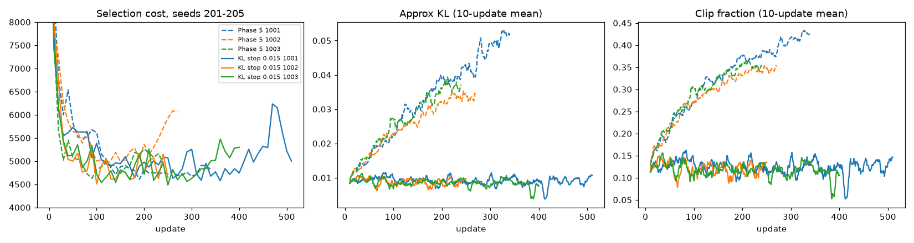
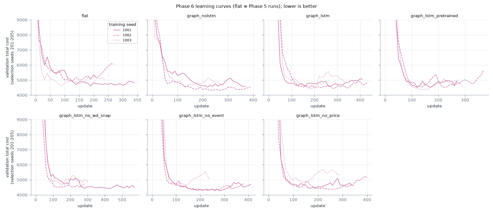
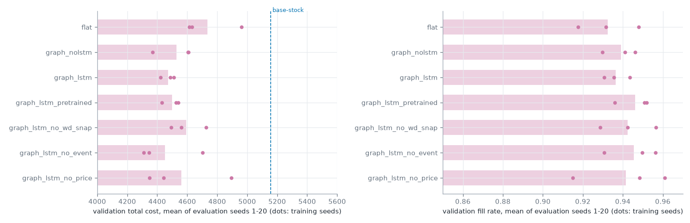

# Phase 6 checkpoint report: the spatio-temporal encoder

Date: 2026-11-17. Validation days only; no test day was used for training, selection, pretraining
or evaluation. All costs are relative weights over simulated days (D-14 c).

**Result: Gate G3 is not passed, so the reading is "no benefit observed" (D-56).** The contender
chosen by the fixed rule, `graph_nolstm`, is clearly better than the flat model for training seed
1002 and for the three-seed mean, but ties with it for seeds 1001 and 1003. The flat model stays
an equally valid headline, and `ppo` stays the Phase 5 checkpoint
(`checkpoints/phase5/ppo_selected.pt`).

**Read this with two caveats.**

1. **The other two graph candidates would have passed, but the rule did not pick them.**
   `graph_lstm` and `graph_lstm_pretrained` are clearly cheaper than the flat model for every
   training seed and for the mean. The rule picks the contender on selection seeds 201 to 205,
   and `graph_nolstm` won that by 10 to 18 cost units (4,462 against 4,472 and 4,480). The rule
   was fixed in advance, so the verdict stands as found; changing the pick after seeing seeds 1 to
   20 would be selection on the evaluation seeds.
2. **A22 applies.** On the four-node network the edge features are constant and almost carry no
   information, so the graph cannot add much through them. The gains seen come from a smaller,
   per-node model with shared weights, not demonstrably from graph structure.

Commands:

    python -m supply_chain_rl.rl.bench --variant graph_lstm      # and graph_nolstm --devices cpu
    python -m supply_chain_rl.rl.train --variant <name> --seed <1001|1002|1003>
    python -m supply_chain_rl.rl.ablation

## What was built

| File | Role |
| --- | --- |
| `rl/encoder.py` | Graph attention in plain PyTorch (D-55): vector step, 2 attention layers with edge features in the score and self-loops (A33), LSTM per node with shared weights, shared actor head per ordering node, critic on the mean summary, attention weights returned. |
| `rl/pretrain.py` | Encoder pretraining on next-day store demand from base-stock windows (D-58). |
| `rl/ablation.py` | Scores every variant on seeds 1 to 20, ablation table, paired comparisons, Gate G3 (D-56), figures. |
| `rl/flat_ppo.py` | Optional KL early stop (`target_kl`, off; D-54); one encoder pass per minibatch for both heads; gradient-limit groups per model. |
| `rl/train.py`, `rl/policy.py`, `rl/bench.py` | `--variant`; model factory; checkpoints carry the model kind (Phase 5 ones load as flat); bench per variant. |
| `config.yaml` | `graph_head_hidden`, `phase6_target_kl: null`, `phase6_dir`, `variants`, `pretrain`. |
| Tests | `tests/test_encoder.py`: 20 tests named after their rule. |

## Checkpoint P6 (manual 12.4, as amended by D-36, D-56)

| # | Item | Result | Evidence |
| --- | --- | --- | --- |
| 1 | Shape and permutation tests | PASS | `test_manual_12_4_encoder_output_one_vector_per_node`, `test_manual_12_4_consistent_node_reordering_reorders_the_outputs` (with and without LSTM), attention sums, self-loops. |
| 2 | Same budget and selection rule for every model | PASS | Phase 5 PPO settings (D-54), min 200 / max 1,000 updates, patience 15, selection seeds 201 to 205, training seeds 1001 to 1003, CPU with 1 thread (D-59). |
| 3 | Ablation table written | PASS | Below. |
| 4 | G3 outcome | **Not passed: no benefit observed** | Section "Gate G3". |
| 5 | Repeatability | PASS | Same seed gives identical weights on CPU; resume gives identical weights (`test_D48_D55_...`, `test_D50_D55_...`, bench). |
| 6 | Phase 5 unchanged | PASS | With the KL stop off, the reworked trainer reproduces the Phase 5 bench validation cost 6,756.8 at update 20; Phase 5 results untouched. |

`pytest`, `ruff check`, `ruff format --check` and `mypy` (strict) are clean.

## Stabilisation tried and not adopted (D-54)

A KL early stop (`target_kl` 0.015) was tested on the flat model against a rule fixed in advance.
It kept update size steady (KL 0.009 against 0.030 to 0.040; clip fraction 0.12 against 0.32 to
0.37) and lowered the best selection cost (mean 4,523 against 4,715), but seed 1003 ended 18.1%
above its best, failing criterion 2 (at most 15%). Not adopted; every Phase 6 model uses the
Phase 5 settings and the flat variant is the Phase 5 runs.

## Speed (D-59)

`graph_lstm`, 20 updates: CPU 24.1 updates/min, GPU 15.7; `graph_nolstm` CPU 57.0; flat 64.3.
All runs used the CPU with one thread. With 18 runs in parallel each ran at about 3 updates per
minute; all 18 finished within 1 hour 50 minutes (20:18 to 22:06).

## Training runs

All 21 runs stopped by patience; **none is flagged as possibly under-trained** (no best checkpoint
in the last 10% of its updates, none stopped at `max_updates`). Source: `results/phase6/summary.json`.

| Variant | Updates (1001 / 1002 / 1003) | Best update | Best selection cost (201 to 205) | Mean |
| --- | --- | --- | --- | --- |
| flat (Phase 5) | 340 / 270 / 240 | 190 / 120 / 90 | 4,607 / 4,912 / 4,627 | 4,715 |
| graph_nolstm | 370 / 390 / 280 | 220 / 240 / 130 | 4,548 / 4,325 / 4,513 | **4,462** |
| graph_lstm | 410 / 430 / 330 | 260 / 280 / 180 | 4,562 / 4,450 / 4,429 | 4,480 |
| graph_lstm_pretrained | 270 / 370 / 290 | 120 / 220 / 140 | 4,526 / 4,513 / 4,377 | 4,472 |
| graph_lstm_no_wd_snap | 570 / 280 / 300 | 420 / 130 / 150 | 4,422 / 4,487 / 4,665 | 4,524 |
| graph_lstm_no_event | 410 / 380 / 240 | 260 / 230 / 90 | 4,269 / 4,305 / 4,636 | 4,403 |
| graph_lstm_no_price | 340 / 400 / 290 | 190 / 250 / 140 | 4,431 / 4,362 / 4,842 | 4,545 |

The graph variants learn more slowly in the first updates (smaller network: about 5,500
parameters against 127,000), then reach lower selection costs than the flat model and stop
later.

## Ablation table (validation days, control, evaluation seeds 1 to 20)

Mean over the three training seeds of each seed's 20-seed mean; "sd eval" = mean spread over
evaluation seeds; "sd train" = spread across training seeds. Source: manual 10.2 metrics,
reward-based cost R7 and D-38 d; `results/phase6/ablation.csv`. Base-stock: 5,157, fill 90.0%.

| Variant | Total cost | sd eval | sd train | Reward-based cost | Fill rate | sd train (points) | Chain bullwhip | Order-change cost |
| --- | --- | --- | --- | --- | --- | --- | --- | --- |
| flat (Phase 5) | 4,736 | 184 | 197 | 5,309 | 93.24% | 1.52 | 1.24 | 572 |
| graph_nolstm | 4,527 | 244 | 137 | 4,881 | 93.90% | 0.83 | 0.86 | 354 |
| graph_lstm | 4,473 | 240 | 45 | 4,749 | 93.65% | 0.65 | 0.94 | 275 |
| graph_lstm_pretrained | 4,499 | 240 | 60 | 4,759 | 94.62% | 0.89 | 0.86 | 260 |
| graph_lstm_no_wd_snap | 4,593 | 248 | 120 | 4,822 | 94.25% | 1.39 | 0.82 | 230 |
| graph_lstm_no_event | 4,452 | 254 | 217 | 4,710 | 94.55% | 1.33 | 0.88 | 258 |
| graph_lstm_no_price | 4,562 | 240 | 291 | 4,802 | 94.15% | 2.38 | 0.82 | 240 |

Per training seed (total cost 1001 / 1002 / 1003): flat 4,630 / 4,963 / 4,615; graph_nolstm
4,607 / 4,369 / 4,605; graph_lstm 4,509 / 4,487 / 4,424; pretrained 4,527 / 4,541 / 4,431.

## Gate G3 (D-56)

Contender: `graph_nolstm` (lowest mean selection cost among the three full-feature graph
variants). Paired total-cost difference, contender minus flat, over seeds 1 to 20, approximate 95%
interval. Source: `results/phase6/paired.csv`.

| Training seed | Difference | 95% interval | Seeds graph better | Excludes zero below |
| --- | --- | --- | --- | --- |
| 1001 | -23 | -96 to +51 | 14 | no |
| 1002 | -594 | -675 to -513 | 20 | yes |
| 1003 | -11 | -83 to +62 | 11 | no |
| Mean of the three seeds | -209 | -269 to -149 | 18 | yes |
| **G3** | | | | **not passed: no benefit observed** |

Reported beside it (not deciding, D-56): reward-based cost is lower for the contender on every
seed (-346, -777, -159; mean -427); fill rate ties for 1001, +2.8 points for 1002 and -0.7 points
for 1003 (flat better).

**The other candidates against flat (same method, not the contender):**

| Candidate | 1001 | 1002 | 1003 | Mean |
| --- | --- | --- | --- | --- |
| graph_lstm | -121 (-199 to -43) | -476 (-555 to -397) | -192 (-264 to -119) | -263 (-318 to -208) |
| graph_lstm_pretrained | -103 (-166 to -41) | -422 (-496 to -349) | -185 (-257 to -112) | -237 (-292 to -182) |

Both would meet the G3 criterion. They are reported, not substituted: the contender rule was
fixed before training, and choosing between candidates on seeds 1 to 20 is what D-53 and D-56
rule out. Note too that much of every graph gain comes from training seed 1002, where the
flat model is weakest (4,963).

## Feature ablations (D-37 b; each against graph_lstm, D-56)

Paired total-cost difference, removal minus `graph_lstm`; positive means the feature helps.

| Removed | 1001 | 1002 | 1003 | Mean of seeds | Reading |
| --- | --- | --- | --- | --- | --- |
| weekday and SNAP | -17 (-89 to +54) | +74 (+32 to +117) | +302 (+271 to +333) | +120 (+82 to +157) | helps on 2 seeds and the mean; not on all seeds |
| event flag | -200 (-256 to -144) | -141 (-171 to -111) | +278 (+244 to +313) | -21 (-47 to +5) | no consistent effect |
| price | -66 (-121 to -12) | -138 (-171 to -104) | +470 (+431 to +509) | +89 (+67 to +110) | no consistent effect |

No feature group's effect holds across all training seeds. Removing a group raises the fill rate
in most runs (+0.5 to +0.9 points on the mean) while cost moves either way. Training-seed 1003
dominates every removal result: its removal runs are 278 to 470 dearer, while seeds 1001 and 1002
are mostly cheaper. These differences are as large as those between training seeds, so the feature
ablation is inconclusive on this network.

## Pretraining (D-58)

Next-day store demand, validation days, selection seeds 201 to 205 (970 windows: 194 decision days x 5 seeds; 24,000
training windows per seed):

| Training seed | MAE (units) | RMSE (units) | 7-day average as forecast: MAE / RMSE |
| --- | --- | --- | --- |
| 1001 | 9.49 | 12.27 | 12.56 / 15.60 |
| 1002 | 9.63 | 12.41 | 12.56 / 15.60 |
| 1003 | 9.54 | 12.27 | 12.56 / 15.60 |

The encoder forecasts better than the moving average (it sees weekday, SNAP, event and price),
but pretraining does not change PPO's result: against `graph_lstm` it ties on total cost (mean
+26, -4 to +56) and raises fill by 1.0 point.

## Honest reading

- **G3: no benefit observed**, by the rule fixed in advance. The rule's contender ties with the
  flat model on two of three training seeds.
- **The graph architectures are cheaper on average.** All three full-feature graph variants have
  lower mean cost (4,473 to 4,527 against 4,736), lower reward-based cost (4,749 to 4,881 against
  5,309), smoother orders and similar or better fill. They also vary less across training seeds.
  `graph_lstm` and `graph_lstm_pretrained` are clearly better than flat on every seed.
- **What the gain is from is not shown.** By A22 the edge features carry almost no information,
  and `graph_nolstm` (attention on one day) does nearly as well. The likelier cause is the small
  per-node model with shared weights (5,500 parameters, smoother orders), not graph reasoning.
- **Selection and evaluation share the validation days**, as in Phase 5; the test days in Phase 7
  are the independent check.
- **No tuning was done**, as instructed, since the graph did not win under the rule.

## Registration and dashboard

G3 not passed, so `ppo` is unchanged: `rl.selected_checkpoint` stays
`checkpoints/phase5/ppo_selected.pt`, and its validation logs in `runs/val/control/` from Phase 5
remain current. No `checkpoints/phase6/ppo_selected.pt` was written. The attention panel was not
added (no graph model is registered).

## Decisions and assumptions of this phase

D-54 (KL stop tried, not adopted), D-55 (encoder in PyTorch), D-56 (G3 procedure, contender only
from full-feature variants), D-57 (variants), D-58 (pretraining), D-59 (CPU); A32 (today's edge
features for all days), A33 (self-loops).

## Files

| What | Where | Committed |
| --- | --- | --- |
| Checkpoints, curves, logs, pretraining | `checkpoints/phase6/` (18 graph runs, 3 KL-stop evidence runs, `pretrain_s*`) | no (back up) |
| Results | `results/phase6/` (`metrics_runs.csv`, `ablation.csv`, `paired.csv`, `summary.json`, `bench_*.json`) | no (D-22) |
| Figures | `reports/figures/phase6_*.png`; tracked copies in `docs/figures/phase_6/` | copies only |

## Open items

1. Which graph variant enters Phase 7 alongside the flat headline is the owner's call; the rule
   gives no graph headline.
2. With 18 runs in parallel each ran at about 3 updates per minute; fewer parallel runs would be
   faster for Phase 8.
