# Phase 7 checkpoint report: integration and the single test run

## Recorded before the test run (2026-11-18)

Written before any learned policy ran on the test days (1701 to 1941). `rl.allow_test_split` was
false, `reports/test_lock.json` did not exist, git was clean at 792fcd2, and the 20 frozen
checkpoints of D-61 were present with matching SHA-256 (checked 2026-11-18, 20 of 20).

- **Frozen list and naming confirmed by the owner** (D-61): 20 learned policies; `ppo` is the
  unchanged flat Phase 5 model; `graph_lstm` (G3b training seed 1005) is the headline and carries
  its label in every table. Nothing is renamed.
- **The headline was fixed on validation evidence (G3b, D-60, D-61).** Gate G3 failed (D-56). G3b
  is a post-hoc hypothesis, generated from the G3 data and tested on fresh training seeds. A22
  applies: *the architecture beat the flat model on fresh seeds; this does not show that graph
  structure is the reason.*
- **If the test days disagree, nothing changes after the fact**: no label, headline, checkpoint
  or rule. This report states the test outcome plainly, including where `graph_lstm` is equal to
  or worse than `ppo`, base-stock or the supplementary rows.
- **Fixed before any learned test number was read:** attention recording during the single
  run (D-64), the reproduction design (D-65) and every table and interval of this report (D-66).

## Result in brief

Test days 1701 to 1941 (235 decision days), evaluation seeds 1 to 20, common random numbers,
six scenarios. All costs are relative weights over simulated days (D-14 c). One learned test run,
2026-11-18 22:56:35, recorded in `reports/test_lock.json` (20 learned policies, hashes equal to
D-61).

- **The headline `graph_lstm` against base-stock: cheaper in every scenario.** Total cost
  -338 to -377 (95% intervals all below 0; 18 to 20 of 20 seeds cheaper), fill rate +1.2 to
  +1.5 points, reward-based cost -1,900 to -1,969, chain bullwhip 0.73 to 0.79 against 2.96 to
  3.32.
- **The headline against `ppo` (the flat Phase 5 model): no clear difference in total cost in
  any of the six scenarios** (-41 to +11; every interval contains 0). This is where the test days
  disagree with validation: on validation days `graph_lstm` cost 4,317 and `ppo` 4,630. On the
  test days `graph_lstm` is better than `ppo` on the reward-based cost (-453 to -502), fill rate
  (+0.9 to +1.0 points), chain bullwhip (-0.38 to -0.44) and total cost inside the shock window
  (-17 to -42, clear in all five shocked scenarios). Total cost over the whole run, the measure
  G3b used, shows no clear difference.
- **The pre-registered G3 contender `graph_nolstm` is the cheapest named policy on the test
  days**: -151 to -219 against `ppo` and -509 to -553 against base-stock, clear in all six
  scenarios. It is not the headline and does not become one (D-61).
- **The headline checkpoint is the most expensive of the five G3b `graph_lstm` seeds on the test
  days** (control 4,981 against 4,531 to 4,722). The G3b comparison itself, recomputed on the test
  days for description only, still favours `graph_lstm` over flat: mean -491 (t interval -872 to
  -110), 4 of 5 seeds clearly better in the control and 5 of 5 in every shocked scenario. Seed 1005,
  the headline's pair, has the smallest gap (-54 in the control).
- **`ppo_shock` is worse than `ppo` in total cost in all six scenarios** (+269 to +369, 0 of 20
  seeds cheaper) and shows no clear difference from base-stock. Inside the window it is cheaper
  than `ppo` under the demand spike, the high discount and the combined shock (-28 to -30), not
  clearly different under the transit delay, and dearer under the small discount (+25).
- **Where the baselines win:** after each of the four single shocks, base-stock and moving
  average are back to their usual stockout level sooner (4.2 to 5.1 days against 5.5 to 9.5 for
  the four named learned policies). Under the combined shock base-stock needs 5.6 days and
  moving average 4.8, against 5.2 to 6.8 for the learned policies. The warm-up rule keeps the
  highest fill rate (99.3 to 99.9%) at about three times the cost.
- **The price signal is not used.** With the same demand rise, showing the discounted price
  changes St1 orders by less than one unit per day (the graph models order 0.7 to 0.9 units *less*)
  and total cost not clearly. No policy anticipates the discount (hidden shocks, E6).

The headline description stays exactly as fixed before the run: **`graph_lstm` is the headline,
fixed on validation evidence by G3b. Gate G3 failed (D-56); G3b is a post-hoc hypothesis tested on
fresh seeds (D-60). A22: the architecture beat the flat model on fresh seeds; this does not show
that graph structure is the reason.** On the test days the headline does not beat `ppo` on total
cost; that is reported here and changes nothing.

Commands:

    python -m supply_chain_rl.eval.run --policies <warmup,basestock,movavg + rl.evaluated> --split val --scenarios control
    python -m supply_chain_rl.eval.run --policies <warmup,basestock,movavg + rl.evaluated> --split test   # once (lock)
    python -m supply_chain_rl.eval.phase7
    python -m supply_chain_rl.dashboard.screenshots --phase7
    python -m supply_chain_rl.reproduce            # [--train] [--dashboard]

## Checkpoint (manual 13.1 steps and the 13.2 prototype checklist, M1)

### 13.1 steps

| Step | Status | Evidence |
| --- | --- | --- |
| 1. Register the trained policy, frozen weights, mean action, same R1 and environment | done | `ppo` = `checkpoints/phase5/ppo_selected.pt` (unchanged, D-53); every `rl.evaluated` policy loads through `eval.runner.learned_checkpoint` with its SHA-256 checked (D-61); `PPOPolicy.act` returns the actor mean; played in `fraction` mode through R1 by the same `SupplyChainEnv` as the baselines. |
| 2. Control, four shock scenarios and one combined on the test days, baselines and learned policies, 20 seeds, CRN, hidden shocks; test once after G3; shock-trained variant compared | done | 2,760 runs (23 policies x 6 scenarios x 20 seeds) in 557 s, one call; lock written; baseline rows of the five Phase 3/4 scenarios identical to before (300 rows, 56 columns, 0 cells differ); `combined` baselines equal D-63 (5,564 / 5,689 / 16,568). `ppo_shock` (D-62) against `ppo` below. |
| 3. Learned policy in the dashboard's policy list | done | All 20 `rl.evaluated` policies with logs appear (`store.policies_available(..., extra)`); labels and colours in `dashboard/theme.py`; screenshots 09 to 13. |
| 4. Model-internals panels (optional) | done (attention) | "Attention" tab: heatmap of the day's weights per layer and the weights into a chosen node over the run, read from `*_attention.csv` written during the single run (D-64). |
| 5. Reproduction script with training behind a flag; README with figures | done | `python -m supply_chain_rl.reproduce` (`--train`, `--dashboard`; D-65); README "Phase 7 results" with the figures of `docs/figures/phase_7/` and screenshots 09 to 13. |

### 13.2 prototype checklist, line by line

| # | Line | Holds? | Evidence |
| --- | --- | --- | --- |
| 1 | Data, DataCo statistics, skeleton, figures and the partial node table exist and pass the Phase 1 checkpoint | yes | `reports/phase_1.md` (Phase 1 checkpoint passed, G0 accepted 2026-11-04); rebuilt from the raw files by `reproduce` steps 1 to 3 in this session (`data.build`, `data.dataco`, `graph.build`; `derived.yaml` and every tracked file unchanged afterwards). |
| 2 | The simulator passes all golden and property tests | yes | `tests/test_golden.py`, `tests/test_properties.py` inside the full suite: 249 tests, 0 failures, 0 skipped (2026-11-18); `ruff check .`, `ruff format --check .` and `mypy` clean. |
| 3 | Both baselines tuned on training days and evaluated on test days | yes | `eval.baselines tune` on training days, seeds 101 to 105 (`reports/phase_3.md`, D-19); test results reproduced cell for cell before and after the learned run (above) and by `reproduce` (360 rows, 56 columns, 0 cells differ). |
| 4 | A PPO model was trained, selected on validation days, and evaluated on test days once | yes | Training seeds and selection on validation seeds 201 to 205 (`reports/phase_5.md`, D-35 d; G3b, D-60); one learned test run, `reports/test_lock.json` 2026-11-18 22:56:35; a second learned test run is refused (`test_D61_...`, `test_M33_D41_...`). |
| 5 | The flat-versus-graph ablation is reported | yes | Validation: `reports/phase_6.md` (G3 failed, feature ablations, pretraining) and D-61 (G3b passed). Test (descriptive): the supplementary tables and the G3b statistic replayed below. |
| 6 | All shock types were run for every policy under the same seeds, and the results are in the comparison table | yes, with one stated exception | Transit delay, demand spike, price discount (u 0.2 and 0.5) and the combined shock for all 23 policies, seeds 1 to 20 (tables below). The supplier outage (S4) is in no configured scenario (manual 13.1 step 2 does not list it); it remains exploratory in the dashboard's custom shocks for the baselines only. |
| 7 | The dashboard has every component of 11.3 and replays any scenario with every policy | yes, with one stated limit | Components: `reports/phase_4.md` checklist, plus the attention panel (11.3 model internals). Every configured scenario replays with every policy from the official logs (`test_app_renders_every_panel...` passes on the real files). Limit: custom shocks run the baselines only, because the test lock forbids further learned runs on the test days (D-64). |
| 8 | A single command sequence reproduces the baseline results from raw files | yes | `python -m supply_chain_rl.reproduce` run in this session from the raw files: data build, DataCo inference, graph build, baseline tuning, baselines on the test days (360 rows x 56 columns, 0 cells differ from `results/test/`), frozen checkpoints against the lock (20 of 20), every policy on validation days (460 rows x 56 columns, 0 cells differ), tables and figures regenerated; exit code 0, log `results/phase7/reproduce_console.txt`. |
| 9 | Every number in every table carries a source tag or rule id; `ASSUMPTIONS.md` is complete | yes, per column or table (M-36) | Each table below names its tags. No new assumption arose in Phase 7: the analysis choices are decisions (D-64 to D-66), and the A22 limitation is repeated wherever the headline is described. |
| 10 | `reports/` holds one checkpoint report per phase | yes | `phase_0.md` to `phase_7.md`, plus `reproduction.md`. |

**Success measure M1.** A person can follow the README from the raw files to the baseline table
and the dashboard replay (`reproduce --dashboard`). The learned policies' test results come from
the saved checkpoints and seeds, but by design they cannot be re-run on the test days (D-61). Their
reproducibility is shown on the validation days instead: every policy matches the G3b validation
rows exactly (200 rows, 29 columns, 0 cells differ) and `reproduce` matches `results/val/`
(460 rows, 0 cells differ).

## How the run was made (D-61, D-64)

- `rl.allow_test_split` set to true after the owner's confirmation; one call of `eval.run` with
  `warmup,basestock,movavg` and the 20 policies of `rl.evaluated`, `--split test`, all six
  scenarios, seeds 1 to 20; 557 s. The lock lists each checkpoint and SHA-256, the scenarios, the
  seeds and the config hash.
- Before it, every policy was scored on validation days (control): `results/val/`, 460 runs. The
  harness reproduces the G3b validation numbers exactly.
- Attention weights of `graph_lstm` and `graph_nolstm` were written beside their logs in the same
  run (240 files); recording does not change actions (`test_D64_attention_...`).
- An official copy of `results/test/` is kept in `results/phase7/test_official/`.

Tags in every table below: orders are **A** (learned policies) or **B** (baselines, R11/R12) and
the warm-up rule is R9; stock, sales, stockouts and costs are computed by **R5 to R7**; metrics
are the manual 10.2 definitions over the seeds (`eval/metrics.py`); the reward-based cost adds
the order-change term (**C** `cost_order_change`, D-38 d); intervals are D-66 (a). Attention
weights are internal values of the learned network (**L**). Demand shares are **D**.

## Comparison tables (test days)

### Scenario `control` (test days, 20 seeds, mean ± sd)

| policy | label | total cost [R5-R7] | reward-based cost [D-38 d] | fill rate [10.2] | stockout units | holding | order change | chain bullwhip |
| --- | --- | --- | --- | --- | --- | --- | --- | --- |
| graph_lstm | headline: G3b passed (post-hoc hypothesis tested on fresh seeds); G3 failed | 4,981 ± 206 | 5,356 | 98.92% | 270 | 4,711 | 375 | 0.79 |
| ppo | flat Phase 5 model (G2), former headline | 4,970 ± 237 | 5,810 | 98.03% | 493 | 4,477 | 840 | 1.23 |
| graph_nolstm | pre-registered G3 contender, G3 not passed | 4,819 ± 229 | 5,246 | 98.44% | 392 | 4,427 | 427 | 0.69 |
| ppo_shock | D-27 shock-trained flat variant | 5,339 ± 229 | 6,006 | 96.83% | 795 | 4,544 | 667 | 0.91 |
| basestock | baseline, tuned on training days | 5,328 ± 243 | 7,266 | 97.68% | 582 | 4,746 | 1,938 | 3.28 |
| movavg | baseline, tuned on training days | 5,378 ± 361 | 9,380 | 96.66% | 837 | 4,541 | 4,002 | 15.78 |
| warmup | naive reference (R9 every day) | 15,161 ± 289 | 16,305 | 99.90% | 25 | 15,137 | 1,144 | 1.01 |

### Scenario `transit_delay` (test days, 20 seeds, mean ± sd)

| policy | label | total cost [R5-R7] | reward-based cost [D-38 d] | fill rate [10.2] | stockout units | holding | order change | chain bullwhip |
| --- | --- | --- | --- | --- | --- | --- | --- | --- |
| graph_lstm | headline: G3b passed (post-hoc hypothesis tested on fresh seeds); G3 failed | 4,989 ± 216 | 5,364 | 98.73% | 318 | 4,671 | 375 | 0.78 |
| ppo | flat Phase 5 model (G2), former headline | 5,030 ± 221 | 5,866 | 97.83% | 544 | 4,485 | 836 | 1.21 |
| graph_nolstm | pre-registered G3 contender, G3 not passed | 4,836 ± 229 | 5,266 | 98.24% | 442 | 4,394 | 430 | 0.68 |
| ppo_shock | D-27 shock-trained flat variant | 5,358 ± 238 | 6,021 | 96.76% | 813 | 4,545 | 662 | 0.91 |
| basestock | baseline, tuned on training days | 5,365 ± 243 | 7,279 | 97.45% | 639 | 4,727 | 1,914 | 3.15 |
| movavg | baseline, tuned on training days | 5,403 ± 375 | 9,409 | 96.45% | 890 | 4,513 | 4,006 | 15.63 |
| warmup | naive reference (R9 every day) | 15,203 ± 257 | 16,347 | 99.86% | 35 | 15,168 | 1,144 | 1.01 |

### Scenario `demand_spike` (test days, 20 seeds, mean ± sd)

| policy | label | total cost [R5-R7] | reward-based cost [D-38 d] | fill rate [10.2] | stockout units | holding | order change | chain bullwhip |
| --- | --- | --- | --- | --- | --- | --- | --- | --- |
| graph_lstm | headline: G3b passed (post-hoc hypothesis tested on fresh seeds); G3 failed | 5,092 ± 245 | 5,471 | 98.48% | 384 | 4,708 | 379 | 0.76 |
| ppo | flat Phase 5 model (G2), former headline | 5,097 ± 223 | 5,936 | 97.48% | 637 | 4,460 | 840 | 1.14 |
| graph_nolstm | pre-registered G3 contender, G3 not passed | 4,892 ± 260 | 5,322 | 98.12% | 475 | 4,417 | 430 | 0.65 |
| ppo_shock | D-27 shock-trained flat variant | 5,366 ± 252 | 6,034 | 96.65% | 846 | 4,520 | 668 | 0.88 |
| basestock | baseline, tuned on training days | 5,445 ± 261 | 7,440 | 97.02% | 755 | 4,690 | 1,995 | 3.22 |
| movavg | baseline, tuned on training days | 5,535 ± 389 | 9,513 | 95.99% | 1,014 | 4,521 | 3,978 | 14.57 |
| warmup | naive reference (R9 every day) | 15,178 ± 285 | 16,345 | 99.85% | 37 | 15,141 | 1,167 | 1.01 |

### Scenario `price_discount` (test days, 20 seeds, mean ± sd)

| policy | label | total cost [R5-R7] | reward-based cost [D-38 d] | fill rate [10.2] | stockout units | holding | order change | chain bullwhip |
| --- | --- | --- | --- | --- | --- | --- | --- | --- |
| graph_lstm | headline: G3b passed (post-hoc hypothesis tested on fresh seeds); G3 failed | 4,987 ± 223 | 5,364 | 98.88% | 283 | 4,704 | 377 | 0.78 |
| ppo | flat Phase 5 model (G2), former headline | 4,980 ± 223 | 5,821 | 97.90% | 529 | 4,451 | 841 | 1.20 |
| graph_nolstm | pre-registered G3 contender, G3 not passed | 4,814 ± 239 | 5,243 | 98.40% | 403 | 4,411 | 429 | 0.67 |
| ppo_shock | D-27 shock-trained flat variant | 5,323 ± 230 | 5,990 | 96.83% | 796 | 4,527 | 667 | 0.90 |
| basestock | baseline, tuned on training days | 5,351 ± 251 | 7,322 | 97.46% | 640 | 4,712 | 1,970 | 3.32 |
| movavg | baseline, tuned on training days | 5,454 ± 372 | 9,444 | 96.38% | 911 | 4,543 | 3,990 | 15.31 |
| warmup | naive reference (R9 every day) | 15,118 ± 289 | 16,272 | 99.90% | 25 | 15,094 | 1,153 | 1.01 |

### Scenario `price_discount_high` (test days, 20 seeds, mean ± sd)

| policy | label | total cost [R5-R7] | reward-based cost [D-38 d] | fill rate [10.2] | stockout units | holding | order change | chain bullwhip |
| --- | --- | --- | --- | --- | --- | --- | --- | --- |
| graph_lstm | headline: G3b passed (post-hoc hypothesis tested on fresh seeds); G3 failed | 5,093 ± 244 | 5,471 | 98.48% | 383 | 4,709 | 379 | 0.76 |
| ppo | flat Phase 5 model (G2), former headline | 5,097 ± 223 | 5,937 | 97.47% | 638 | 4,459 | 840 | 1.14 |
| graph_nolstm | pre-registered G3 contender, G3 not passed | 4,893 ± 260 | 5,323 | 98.11% | 479 | 4,414 | 430 | 0.65 |
| ppo_shock | D-27 shock-trained flat variant | 5,366 ± 253 | 6,034 | 96.64% | 849 | 4,517 | 668 | 0.88 |
| basestock | baseline, tuned on training days | 5,445 ± 261 | 7,440 | 97.02% | 755 | 4,690 | 1,995 | 3.22 |
| movavg | baseline, tuned on training days | 5,535 ± 389 | 9,513 | 95.99% | 1,014 | 4,521 | 3,978 | 14.57 |
| warmup | naive reference (R9 every day) | 15,178 ± 285 | 16,345 | 99.85% | 37 | 15,141 | 1,167 | 1.01 |

### Scenario `combined` (test days, 20 seeds, mean ± sd)

| policy | label | total cost [R5-R7] | reward-based cost [D-38 d] | fill rate [10.2] | stockout units | holding | order change | chain bullwhip |
| --- | --- | --- | --- | --- | --- | --- | --- | --- |
| graph_lstm | headline: G3b passed (post-hoc hypothesis tested on fresh seeds); G3 failed | 5,226 ± 244 | 5,605 | 97.96% | 517 | 4,709 | 379 | 0.73 |
| ppo | flat Phase 5 model (G2), former headline | 5,263 ± 227 | 6,097 | 97.05% | 746 | 4,518 | 833 | 1.12 |
| graph_nolstm | pre-registered G3 contender, G3 not passed | 5,045 ± 263 | 5,477 | 97.59% | 609 | 4,435 | 432 | 0.63 |
| ppo_shock | D-27 shock-trained flat variant | 5,541 ± 270 | 6,203 | 96.11% | 982 | 4,559 | 662 | 0.87 |
| basestock | baseline, tuned on training days | 5,564 ± 253 | 7,505 | 96.62% | 854 | 4,710 | 1,941 | 2.96 |
| movavg | baseline, tuned on training days | 5,689 ± 412 | 9,607 | 95.42% | 1,159 | 4,530 | 3,918 | 14.18 |
| warmup | naive reference (R9 every day) | 16,568 ± 465 | 17,734 | 99.28% | 181 | 16,386 | 1,167 | 1.01 |

## Paired differences

### Paired against base-stock: policy minus basestock, 95% interval (1.96 sd / sqrt 20)

| scenario | policy | total cost | verdict (cost) | seeds cheaper | reward-based cost | fill rate | chain bullwhip |
| --- | --- | --- | --- | --- | --- | --- | --- |
| control | graph_lstm | -347 (-441 to -252) | better | 19/20 | -1,910 (-2,047 to -1,773) | +1.24 pp (+0.97 to +1.51) | -2.49 (-2.85 to -2.14) |
| control | ppo | -358 (-458 to -258) | better | 19/20 | -1,456 (-1,587 to -1,326) | +0.35 pp (+0.09 to +0.62) | -2.05 (-2.40 to -1.70) |
| control | graph_nolstm | -509 (-602 to -416) | better | 19/20 | -2,020 (-2,153 to -1,888) | +0.76 pp (+0.49 to +1.03) | -2.59 (-2.95 to -2.23) |
| control | ppo_shock | +11 (-84 to +106) | no clear diff. | 8/20 | -1,260 (-1,388 to -1,132) | -0.85 pp (-1.09 to -0.61) | -2.36 (-2.71 to -2.02) |
| control | movavg | +50 (-112 to +212) | no clear diff. | 8/20 | +2,114 (+1,918 to +2,310) | -1.02 pp (-1.51 to -0.53) | +12.50 (+11.98 to +13.01) |
| transit_delay | graph_lstm | -377 (-468 to -285) | better | 20/20 | -1,916 (-2,047 to -1,785) | +1.28 pp (+1.03 to +1.53) | -2.38 (-2.72 to -2.03) |
| transit_delay | ppo | -336 (-430 to -242) | better | 19/20 | -1,414 (-1,529 to -1,299) | +0.38 pp (+0.14 to +0.61) | -1.95 (-2.29 to -1.61) |
| transit_delay | graph_nolstm | -529 (-619 to -439) | better | 20/20 | -2,013 (-2,137 to -1,890) | +0.78 pp (+0.54 to +1.03) | -2.48 (-2.82 to -2.13) |
| transit_delay | ppo_shock | -7 (-92 to +78) | no clear diff. | 9/20 | -1,259 (-1,372 to -1,146) | -0.70 pp (-0.92 to -0.48) | -2.24 (-2.58 to -1.91) |
| transit_delay | movavg | +38 (-121 to +196) | no clear diff. | 8/20 | +2,130 (+1,948 to +2,311) | -1.00 pp (-1.50 to -0.51) | +12.48 (+11.95 to +13.01) |
| demand_spike | graph_lstm | -353 (-453 to -253) | better | 18/20 | -1,969 (-2,118 to -1,821) | +1.46 pp (+1.14 to +1.79) | -2.46 (-2.81 to -2.10) |
| demand_spike | ppo | -348 (-454 to -242) | better | 19/20 | -1,504 (-1,637 to -1,370) | +0.47 pp (+0.16 to +0.77) | -2.08 (-2.43 to -1.72) |
| demand_spike | graph_nolstm | -553 (-651 to -455) | better | 19/20 | -2,118 (-2,262 to -1,975) | +1.11 pp (+0.80 to +1.41) | -2.57 (-2.93 to -2.21) |
| demand_spike | ppo_shock | -79 (-178 to +19) | no clear diff. | 13/20 | -1,406 (-1,540 to -1,272) | -0.36 pp (-0.66 to -0.06) | -2.34 (-2.69 to -1.99) |
| demand_spike | movavg | +90 (-64 to +245) | no clear diff. | 9/20 | +2,073 (+1,874 to +2,271) | -1.03 pp (-1.51 to -0.54) | +11.35 (+10.82 to +11.87) |
| price_discount | graph_lstm | -365 (-459 to -271) | better | 20/20 | -1,958 (-2,096 to -1,820) | +1.42 pp (+1.13 to +1.71) | -2.53 (-2.90 to -2.16) |
| price_discount | ppo | -371 (-470 to -273) | better | 19/20 | -1,500 (-1,631 to -1,369) | +0.44 pp (+0.15 to +0.72) | -2.11 (-2.48 to -1.74) |
| price_discount | graph_nolstm | -538 (-631 to -444) | better | 19/20 | -2,079 (-2,214 to -1,944) | +0.94 pp (+0.65 to +1.23) | -2.64 (-3.01 to -2.27) |
| price_discount | ppo_shock | -28 (-119 to +62) | no clear diff. | 11/20 | -1,332 (-1,456 to -1,207) | -0.62 pp (-0.88 to -0.36) | -2.42 (-2.78 to -2.05) |
| price_discount | movavg | +103 (-52 to +257) | no clear diff. | 8/20 | +2,122 (+1,927 to +2,318) | -1.08 pp (-1.56 to -0.59) | +11.99 (+11.44 to +12.55) |
| price_discount_high | graph_lstm | -352 (-452 to -252) | better | 18/20 | -1,969 (-2,117 to -1,821) | +1.47 pp (+1.15 to +1.79) | -2.46 (-2.81 to -2.10) |
| price_discount_high | ppo | -348 (-454 to -241) | better | 19/20 | -1,503 (-1,637 to -1,370) | +0.46 pp (+0.15 to +0.77) | -2.08 (-2.43 to -1.72) |
| price_discount_high | graph_nolstm | -552 (-649 to -454) | better | 19/20 | -2,117 (-2,260 to -1,974) | +1.09 pp (+0.78 to +1.40) | -2.57 (-2.93 to -2.21) |
| price_discount_high | ppo_shock | -79 (-177 to +19) | no clear diff. | 13/20 | -1,406 (-1,540 to -1,272) | -0.37 pp (-0.67 to -0.08) | -2.35 (-2.70 to -2.00) |
| price_discount_high | movavg | +90 (-64 to +245) | no clear diff. | 9/20 | +2,073 (+1,874 to +2,271) | -1.03 pp (-1.51 to -0.54) | +11.35 (+10.82 to +11.87) |
| combined | graph_lstm | -338 (-434 to -242) | better | 19/20 | -1,900 (-2,035 to -1,764) | +1.34 pp (+1.06 to +1.61) | -2.23 (-2.56 to -1.91) |
| combined | ppo | -301 (-400 to -201) | better | 19/20 | -1,408 (-1,520 to -1,297) | +0.43 pp (+0.18 to +0.68) | -1.84 (-2.16 to -1.52) |
| combined | graph_nolstm | -520 (-615 to -424) | better | 19/20 | -2,028 (-2,159 to -1,897) | +0.97 pp (+0.70 to +1.23) | -2.33 (-2.66 to -2.01) |
| combined | ppo_shock | -23 (-120 to +74) | no clear diff. | 9/20 | -1,302 (-1,426 to -1,177) | -0.51 pp (-0.77 to -0.24) | -2.09 (-2.41 to -1.77) |
| combined | movavg | +125 (-39 to +289) | no clear diff. | 9/20 | +2,102 (+1,915 to +2,289) | -1.21 pp (-1.72 to -0.69) | +11.22 (+10.67 to +11.77) |

### Paired against ppo: policy minus ppo, 95% interval (1.96 sd / sqrt 20)

| scenario | policy | total cost | verdict (cost) | seeds cheaper | reward-based cost | fill rate | chain bullwhip |
| --- | --- | --- | --- | --- | --- | --- | --- |
| control | graph_lstm | +11 (-50 to +72) | no clear diff. | 10/20 | -453 (-512 to -395) | +0.89 pp (+0.76 to +1.02) | -0.44 (-0.47 to -0.41) |
| control | graph_nolstm | -151 (-200 to -102) | better | 18/20 | -564 (-611 to -516) | +0.40 pp (+0.29 to +0.52) | -0.54 (-0.57 to -0.51) |
| control | ppo_shock | +369 (+314 to +424) | worse | 0/20 | +197 (+142 to +251) | -1.20 pp (-1.35 to -1.05) | -0.31 (-0.34 to -0.28) |
| control | basestock | +358 (+258 to +458) | worse | 1/20 | +1,456 (+1,326 to +1,587) | -0.35 pp (-0.62 to -0.09) | +2.05 (+1.70 to +2.40) |
| transit_delay | graph_lstm | -41 (-101 to +19) | no clear diff. | 12/20 | -502 (-561 to -443) | +0.91 pp (+0.78 to +1.03) | -0.43 (-0.46 to -0.40) |
| transit_delay | graph_nolstm | -194 (-239 to -148) | better | 20/20 | -600 (-644 to -555) | +0.41 pp (+0.30 to +0.51) | -0.53 (-0.56 to -0.50) |
| transit_delay | ppo_shock | +329 (+278 to +380) | worse | 0/20 | +155 (+104 to +206) | -1.07 pp (-1.24 to -0.91) | -0.30 (-0.33 to -0.26) |
| transit_delay | basestock | +336 (+242 to +430) | worse | 1/20 | +1,414 (+1,299 to +1,529) | -0.38 pp (-0.61 to -0.14) | +1.95 (+1.61 to +2.29) |
| demand_spike | graph_lstm | -4 (-70 to +61) | no clear diff. | 11/20 | -466 (-529 to -402) | +1.00 pp (+0.85 to +1.15) | -0.38 (-0.41 to -0.35) |
| demand_spike | graph_nolstm | -204 (-260 to -149) | better | 19/20 | -614 (-669 to -560) | +0.64 pp (+0.50 to +0.77) | -0.49 (-0.52 to -0.46) |
| demand_spike | ppo_shock | +269 (+209 to +330) | worse | 0/20 | +98 (+38 to +157) | -0.83 pp (-1.01 to -0.64) | -0.27 (-0.30 to -0.24) |
| demand_spike | basestock | +348 (+242 to +454) | worse | 1/20 | +1,504 (+1,370 to +1,637) | -0.47 pp (-0.77 to -0.16) | +2.08 (+1.72 to +2.43) |
| price_discount | graph_lstm | +7 (-52 to +65) | no clear diff. | 10/20 | -458 (-514 to -401) | +0.98 pp (+0.85 to +1.11) | -0.42 (-0.45 to -0.39) |
| price_discount | graph_nolstm | -166 (-214 to -119) | better | 18/20 | -578 (-624 to -533) | +0.50 pp (+0.39 to +0.62) | -0.53 (-0.56 to -0.50) |
| price_discount | ppo_shock | +343 (+295 to +391) | worse | 0/20 | +169 (+123 to +215) | -1.06 pp (-1.21 to -0.92) | -0.30 (-0.34 to -0.27) |
| price_discount | basestock | +371 (+273 to +470) | worse | 1/20 | +1,500 (+1,369 to +1,631) | -0.44 pp (-0.72 to -0.15) | +2.11 (+1.74 to +2.48) |
| price_discount_high | graph_lstm | -5 (-71 to +61) | no clear diff. | 11/20 | -466 (-529 to -402) | +1.01 pp (+0.86 to +1.16) | -0.38 (-0.41 to -0.35) |
| price_discount_high | graph_nolstm | -204 (-260 to -148) | better | 19/20 | -614 (-668 to -559) | +0.63 pp (+0.50 to +0.77) | -0.49 (-0.52 to -0.46) |
| price_discount_high | ppo_shock | +269 (+208 to +330) | worse | 0/20 | +97 (+37 to +158) | -0.83 pp (-1.02 to -0.65) | -0.27 (-0.30 to -0.24) |
| price_discount_high | basestock | +348 (+241 to +454) | worse | 1/20 | +1,503 (+1,370 to +1,637) | -0.46 pp (-0.77 to -0.15) | +2.08 (+1.72 to +2.43) |
| combined | graph_lstm | -37 (-102 to +27) | no clear diff. | 12/20 | -492 (-555 to -429) | +0.91 pp (+0.77 to +1.04) | -0.39 (-0.42 to -0.36) |
| combined | graph_nolstm | -219 (-276 to -161) | better | 18/20 | -620 (-675 to -564) | +0.54 pp (+0.41 to +0.67) | -0.49 (-0.52 to -0.46) |
| combined | ppo_shock | +278 (+211 to +344) | worse | 0/20 | +107 (+41 to +173) | -0.94 pp (-1.13 to -0.74) | -0.25 (-0.28 to -0.21) |
| combined | basestock | +301 (+201 to +400) | worse | 1/20 | +1,408 (+1,297 to +1,520) | -0.43 pp (-0.68 to -0.18) | +1.84 (+1.52 to +2.16) |

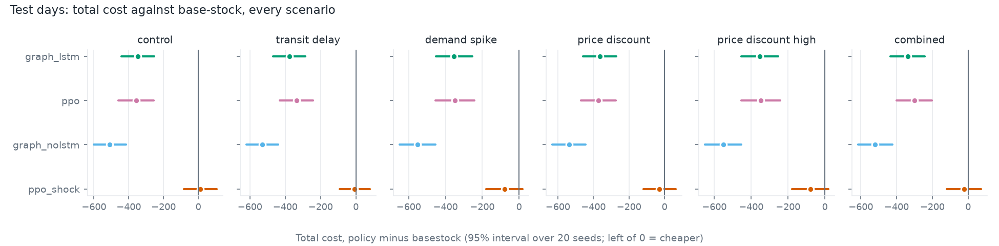

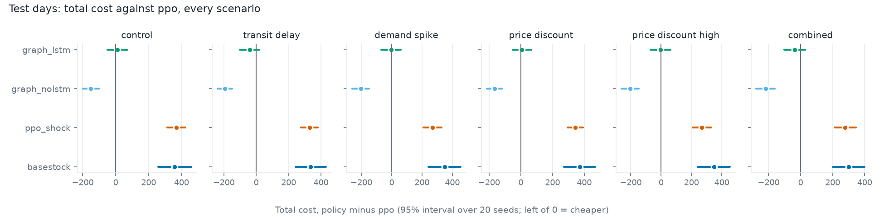

## Before, during and after each shock

### Before, during and after: `transit_delay` (window 1750 to 1759; 20-seed means)

| policy | cost/day before | cost/day during | cost/day after | fill before | fill during | fill after | stockout units during | days to recover |
| --- | --- | --- | --- | --- | --- | --- | --- | --- |
| graph_lstm | 25.5 | 16.0 | 20.5 | 98.3% | 97.4% | 98.9% | 32 | 6.9 |
| ppo | 26.9 | 18.3 | 20.3 | 97.6% | 95.3% | 98.1% | 59 | 7.7 |
| graph_nolstm | 25.5 | 16.7 | 19.6 | 97.7% | 96.4% | 98.5% | 44 | 6.5 |
| ppo_shock | 29.0 | 19.4 | 21.5 | 94.6% | 94.6% | 97.5% | 67 | 5.5 |
| basestock | 27.3 | 21.2 | 21.9 | 96.0% | 91.0% | 98.3% | 111 | 5.1 |
| movavg | 25.7 | 23.1 | 22.3 | 98.6% | 91.7% | 96.2% | 102 | 4.9 |
| warmup | 58.3 | 55.2 | 66.7 | 99.7% | 99.8% | 99.9% | 3 | 5.4 |

### Before, during and after: `demand_spike` (window 1750 to 1759; 20-seed means)

| policy | cost/day before | cost/day during | cost/day after | fill before | fill during | fill after | stockout units during | days to recover |
| --- | --- | --- | --- | --- | --- | --- | --- | --- |
| graph_lstm | 25.5 | 21.8 | 20.8 | 98.3% | 92.8% | 99.0% | 104 | 6.2 |
| ppo | 26.9 | 26.0 | 20.2 | 97.6% | 89.7% | 98.1% | 149 | 8.9 |
| graph_nolstm | 25.5 | 21.7 | 19.7 | 97.7% | 92.6% | 98.7% | 108 | 6.0 |
| ppo_shock | 29.0 | 23.2 | 21.4 | 94.6% | 91.4% | 97.6% | 124 | 7.0 |
| basestock | 27.3 | 25.8 | 22.0 | 96.0% | 87.8% | 98.0% | 177 | 4.5 |
| movavg | 25.7 | 30.6 | 22.7 | 98.6% | 87.1% | 96.0% | 187 | 4.7 |
| warmup | 58.3 | 51.8 | 66.8 | 99.7% | 99.2% | 99.9% | 12 | 3.6 |

### Before, during and after: `price_discount` (window 1750 to 1759; 20-seed means)

| policy | cost/day before | cost/day during | cost/day after | fill before | fill during | fill after | stockout units during | days to recover |
| --- | --- | --- | --- | --- | --- | --- | --- | --- |
| graph_lstm | 25.5 | 16.1 | 20.5 | 98.3% | 98.1% | 99.1% | 25 | 6.6 |
| ppo | 26.9 | 17.8 | 20.0 | 97.6% | 96.4% | 98.1% | 48 | 9.5 |
| graph_nolstm | 25.5 | 16.6 | 19.5 | 97.7% | 97.3% | 98.7% | 36 | 6.5 |
| ppo_shock | 29.0 | 20.3 | 21.3 | 94.6% | 94.9% | 97.6% | 68 | 6.9 |
| basestock | 27.3 | 18.3 | 21.9 | 96.0% | 93.6% | 98.1% | 84 | 4.5 |
| movavg | 25.7 | 23.0 | 22.6 | 98.6% | 92.7% | 96.0% | 97 | 4.2 |
| warmup | 58.3 | 55.0 | 66.3 | 99.7% | 100.0% | 99.9% | 0 | 3.1 |

### Before, during and after: `price_discount_high` (window 1750 to 1759; 20-seed means)

| policy | cost/day before | cost/day during | cost/day after | fill before | fill during | fill after | stockout units during | days to recover |
| --- | --- | --- | --- | --- | --- | --- | --- | --- |
| graph_lstm | 25.5 | 21.9 | 20.8 | 98.3% | 92.8% | 99.0% | 105 | 6.2 |
| ppo | 26.9 | 26.0 | 20.2 | 97.6% | 89.7% | 98.0% | 149 | 9.1 |
| graph_nolstm | 25.5 | 21.9 | 19.7 | 97.7% | 92.5% | 98.6% | 110 | 6.0 |
| ppo_shock | 29.0 | 23.2 | 21.4 | 94.6% | 91.4% | 97.6% | 124 | 7.3 |
| basestock | 27.3 | 25.8 | 22.0 | 96.0% | 87.8% | 98.0% | 177 | 4.5 |
| movavg | 25.7 | 30.6 | 22.7 | 98.6% | 87.1% | 96.0% | 187 | 4.7 |
| warmup | 58.3 | 51.8 | 66.8 | 99.7% | 99.2% | 99.9% | 12 | 3.6 |

### Before, during and after: `combined` (window 1750 to 1759; 20-seed means)

| policy | cost/day before | cost/day during | cost/day after | fill before | fill during | fill after | stockout units during | days to recover |
| --- | --- | --- | --- | --- | --- | --- | --- | --- |
| graph_lstm | 25.5 | 32.5 | 20.9 | 98.3% | 84.8% | 98.9% | 221 | 5.9 |
| ppo | 26.9 | 35.6 | 20.6 | 97.6% | 82.6% | 98.0% | 253 | 6.8 |
| graph_nolstm | 25.5 | 32.8 | 19.9 | 97.7% | 84.2% | 98.6% | 230 | 5.3 |
| ppo_shock | 29.0 | 32.7 | 21.8 | 94.6% | 84.0% | 97.5% | 232 | 5.2 |
| basestock | 27.3 | 39.2 | 22.0 | 96.0% | 78.7% | 98.2% | 310 | 5.6 |
| movavg | 25.7 | 39.8 | 23.0 | 98.6% | 79.8% | 95.8% | 293 | 4.8 |
| warmup | 58.3 | 62.5 | 73.8 | 99.7% | 90.2% | 99.9% | 142 | 3.8 |

### During the window only: total cost, paired, 95% interval

| scenario | comparison | total cost during | verdict |
| --- | --- | --- | --- |
| transit_delay | graph_lstm - basestock | -51 (-75 to -27) | better |
| transit_delay | graph_lstm - ppo | -23 (-35 to -11) | better |
| transit_delay | ppo_shock - ppo | +10 (-9 to +30) | no clear diff. |
| demand_spike | graph_lstm - basestock | -41 (-64 to -17) | better |
| demand_spike | graph_lstm - ppo | -42 (-53 to -31) | better |
| demand_spike | ppo_shock - ppo | -28 (-49 to -6) | better |
| price_discount | graph_lstm - basestock | -22 (-47 to +2) | no clear diff. |
| price_discount | graph_lstm - ppo | -17 (-29 to -6) | better |
| price_discount | ppo_shock - ppo | +25 (+5 to +44) | worse |
| price_discount_high | graph_lstm - basestock | -39 (-62 to -16) | better |
| price_discount_high | graph_lstm - ppo | -41 (-52 to -29) | better |
| price_discount_high | ppo_shock - ppo | -28 (-49 to -6) | better |
| combined | graph_lstm - basestock | -66 (-93 to -40) | better |
| combined | graph_lstm - ppo | -31 (-43 to -19) | better |
| combined | ppo_shock - ppo | -30 (-51 to -8) | better |

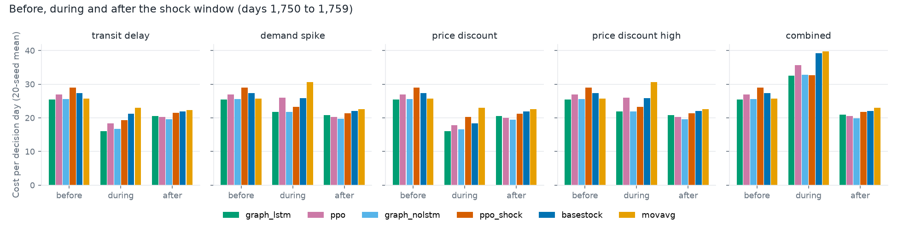

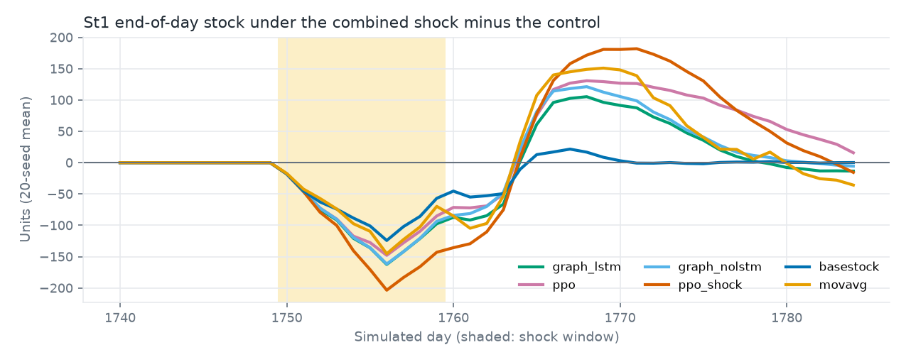

Reading: inside the window `graph_lstm` costs less than base-stock under four of the five shocks
(-39 to -66) and shows no clear difference under the small discount (-22, interval -47 to +2).
It costs less than `ppo` under all five (-17 to -42). The other learned policies were not
compared in pairs inside the window; their means are in the tables (for example `ppo_shock` 20.3
per day against base-stock 18.3 under the small discount). After a single shock the baselines
are back to their usual stockout level sooner (4.2 to 5.1 days; `graph_lstm` 6.2 to 6.9, `ppo`
7.7 to 9.5). After the combined shock `graph_nolstm` (5.3) and `ppo_shock` (5.2) are quicker than
base-stock (5.6).

## Bullwhip per level and for the chain

### Bullwhip ratio per level and for the chain: `control` (mean ± sd)

| policy | St1 | St2 | W1 | stores | warehouses | chain |
| --- | --- | --- | --- | --- | --- | --- |
| graph_lstm | 0.89 ± 0.09 | 1.06 ± 0.10 | 0.73 ± 0.08 | 1.09 ± 0.10 | 0.73 ± 0.08 | 0.79 ± 0.03 |
| ppo | 1.00 ± 0.07 | 0.71 ± 0.06 | 2.01 ± 0.21 | 0.61 ± 0.05 | 2.01 ± 0.21 | 1.23 ± 0.07 |
| graph_nolstm | 0.86 ± 0.07 | 1.07 ± 0.10 | 0.65 ± 0.06 | 1.07 ± 0.10 | 0.65 ± 0.06 | 0.69 ± 0.02 |
| ppo_shock | 1.54 ± 0.12 | 0.90 ± 0.10 | 0.92 ± 0.11 | 1.00 ± 0.11 | 0.92 ± 0.11 | 0.91 ± 0.05 |
| basestock | 2.46 ± 0.82 | 3.20 ± 1.01 | 1.08 ± 0.14 | 3.13 ± 1.08 | 1.08 ± 0.14 | 3.28 ± 0.81 |
| movavg | 11.96 ± 0.83 | 11.16 ± 1.28 | 1.35 ± 0.17 | 11.85 ± 1.31 | 1.35 ± 0.17 | 15.78 ± 1.03 |
| warmup | 1.01 ± 0.00 | 1.00 ± 0.00 | 1.01 ± 0.00 | 1.01 ± 0.00 | 1.01 ± 0.00 | 1.01 ± 0.00 |

### Bullwhip ratio per level and for the chain: `combined` (mean ± sd)

| policy | St1 | St2 | W1 | stores | warehouses | chain |
| --- | --- | --- | --- | --- | --- | --- |
| graph_lstm | 0.82 ± 0.10 | 1.06 ± 0.10 | 0.72 ± 0.08 | 1.03 ± 0.11 | 0.72 ± 0.08 | 0.73 ± 0.03 |
| ppo | 0.83 ± 0.06 | 0.73 ± 0.07 | 2.11 ± 0.21 | 0.53 ± 0.04 | 2.11 ± 0.21 | 1.12 ± 0.07 |
| graph_nolstm | 0.76 ± 0.07 | 1.06 ± 0.09 | 0.64 ± 0.07 | 0.99 ± 0.09 | 0.64 ± 0.07 | 0.63 ± 0.02 |
| ppo_shock | 1.26 ± 0.12 | 0.87 ± 0.10 | 0.98 ± 0.09 | 0.89 ± 0.08 | 0.98 ± 0.09 | 0.87 ± 0.05 |
| basestock | 2.13 ± 0.70 | 3.23 ± 1.00 | 1.06 ± 0.13 | 2.88 ± 1.00 | 1.06 ± 0.13 | 2.96 ± 0.75 |
| movavg | 10.23 ± 0.64 | 11.33 ± 1.32 | 1.28 ± 0.17 | 11.20 ± 1.22 | 1.28 ± 0.17 | 14.18 ± 1.00 |
| warmup | 1.01 ± 0.00 | 1.00 ± 0.00 | 1.01 ± 0.00 | 1.01 ± 0.00 | 1.01 ± 0.00 | 1.01 ± 0.00 |

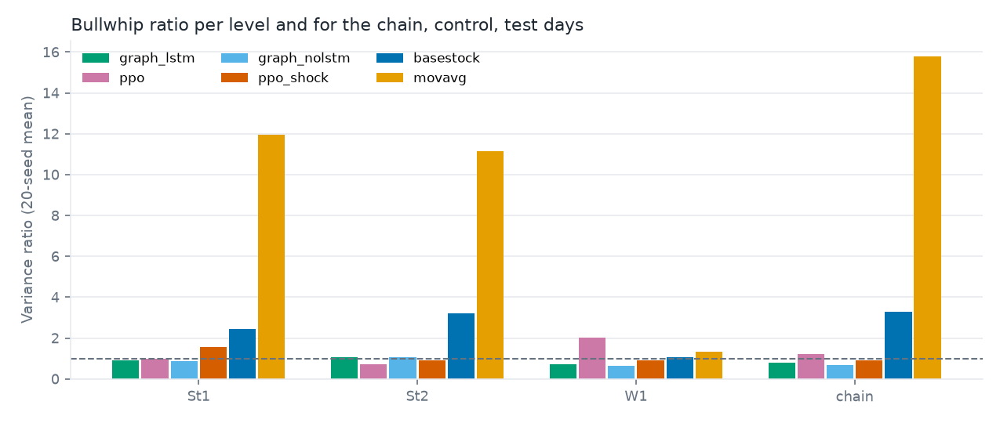

Reading: `ppo` damps the stores' orders (0.61) but amplifies at the warehouse (2.01). `graph_lstm`
keeps both levels near or below 1 (stores 1.09, warehouse 0.73). Base-stock (3.13 at the stores)
and moving average (11.85) amplify at the stores. A low ratio alone is not a success: the warm-up
rule has 1.01 at three times the cost.

## Reward-based cost beside total cost

The reward-based cost is in the scenario tables and in both paired tables. It widens every
learned advantage, because the learned policies were trained on it and change their orders much
less (order-change cost 375 to 840 against 1,938 for base-stock and 4,002 for moving average in
the control). The headline's advantage over `ppo` exists **only** on this measure (and on fill
rate and bullwhip), not on total cost.

## `ppo_shock` against `ppo` (D-62)

### `ppo_shock` minus `ppo` (both flat; 95% interval)

| scenario | total_cost | fill_rate | stockout_during_shock | verdict (cost) |
| --- | --- | --- | --- | --- |
| control | +369 (+314 to +424) | -1.20 pp (-1.35 to -1.05) | +30 (+14 to +47) | worse |
| transit_delay | +329 (+278 to +380) | -1.07 pp (-1.24 to -0.91) | +8 (-11 to +27) | worse |
| demand_spike | +269 (+209 to +330) | -0.83 pp (-1.01 to -0.64) | -25 (-46 to -4) | worse |
| price_discount | +343 (+295 to +391) | -1.06 pp (-1.21 to -0.92) | +20 (+2 to +37) | worse |
| price_discount_high | +269 (+208 to +330) | -0.83 pp (-1.02 to -0.65) | -25 (-46 to -4) | worse |
| combined | +278 (+211 to +344) | -0.94 pp (-1.13 to -0.74) | -21 (-43 to +0) | worse |

Reading: training with random shocks of the three test types (with ranges that include the test
sizes) bought a smaller loss inside two of the shock windows at a higher cost on every other day.
Over the whole run it is worse than `ppo` everywhere and level with base-stock. It was trained on
the shock types it is tested on, so this measures shock training on known types, not
generalisation (D-62).

## Price-discount behaviour

### Price-discount behaviour: `price_discount` minus control, units per day, 20-seed mean

| policy | St1 demand during | St1 order before (10 d) | St1 order during | St1 order after (10 d) | St1 stock_end during | W1 order during | W1 order after (10 d) |
| --- | --- | --- | --- | --- | --- | --- | --- |
| graph_lstm | +8.6 | +0.0 | +7.7 | +3.4 | -40.3 | +9.5 | +1.3 |
| ppo | +8.6 | +0.0 | +3.9 | +4.3 | -40.6 | +3.7 | +2.9 |
| graph_nolstm | +8.6 | +0.0 | +8.8 | +4.2 | -39.6 | +7.8 | +2.0 |
| ppo_shock | +8.6 | +0.0 | +5.2 | +10.9 | -43.2 | +7.0 | +4.0 |
| basestock | +8.6 | +0.0 | +11.6 | +4.9 | -30.8 | +3.5 | -0.3 |
| movavg | +8.6 | +0.0 | +22.7 | -0.9 | -27.7 | +7.6 | +5.4 |

### Price-discount behaviour: `price_discount_high` minus control, units per day, 20-seed mean

| policy | St1 demand during | St1 order before (10 d) | St1 order during | St1 order after (10 d) | St1 stock_end during | W1 order during | W1 order after (10 d) |
| --- | --- | --- | --- | --- | --- | --- | --- |
| graph_lstm | +21.8 | +0.0 | +14.4 | +3.5 | -81.6 | +16.9 | +0.0 |
| ppo | +21.8 | +0.0 | +8.1 | +4.8 | -78.5 | +8.9 | +2.9 |
| graph_nolstm | +21.8 | +0.0 | +17.8 | +3.9 | -77.9 | +16.5 | +1.2 |
| ppo_shock | +21.8 | +0.0 | +12.0 | +18.3 | -97.3 | +17.7 | +3.8 |
| basestock | +21.8 | +0.0 | +21.5 | +6.7 | -54.4 | +5.6 | -0.7 |
| movavg | +21.8 | +0.0 | +29.5 | +6.4 | -55.8 | +9.9 | +9.6 |

### Price signal alone: `price_discount_high` minus `demand_spike` (same demand, only the shown price differs; 20 seeds)

| policy | St1 order during, units/day | total cost |
| --- | --- | --- |
| graph_lstm | -0.68 (seeds -0.9 to -0.5) | +0.3 (-1.1 to +1.7) |
| ppo | +0.07 (seeds +0.0 to +0.3) | +0.6 (-0.5 to +1.8) |
| graph_nolstm | -0.94 (seeds -1.3 to -0.7) | +1.2 (-0.2 to +2.6) |
| ppo_shock | +0.09 (seeds +0.0 to +0.3) | +0.4 (-1.5 to +2.2) |
| basestock | +0.00 (seeds +0.0 to +0.0) | +0.0 (+0.0 to +0.0) |
| movavg | +0.00 (seeds +0.0 to +0.0) | +0.0 (+0.0 to +0.0) |

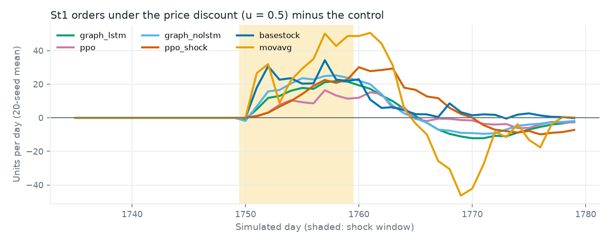

Reading: the discount is a hidden shock, so nobody orders more before day 1,750 (all +0.0).
During the window every policy follows the demand it sees. The learned policies raise St1 orders
less than base-stock (u 0.5: `graph_lstm` +14.4, `ppo` +8.1, base-stock +21.5 units per day) and
draw down more St1 stock (-81.6 and -78.5 against -54.4), yet keep a higher fill rate during the
window (92.8% and 89.7% against 87.8%). The last
table isolates the price signal. The price itself is in the observation (S3), but with demand held
equal the learned policies hardly react to it, and the graph models' small reaction goes the wrong
way. This matches the near-identical results of `demand_spike` and `price_discount_high`.

## Supplementary rows: every training seed (D-61)

Supplementary rows never change a headline or label. Each is a frozen checkpoint from the D-61
list; `ppo`, `graph_nolstm` and `graph_lstm` are the named members of their families.

### Supplementary: every training seed (20-seed means)

| family | train_seed | policy | val control | test control | test, mean of 6 scenarios | test fill, control |
| --- | --- | --- | --- | --- | --- | --- |
| Phase 5 flat | 1001 | ppo | 4,630 | 4,970 | 5,073 | 98.03% |
| Phase 5 flat | 1002 | ppo_p5_s1002 | 4,963 | 5,374 | 5,428 | 96.53% |
| Phase 5 flat | 1003 | ppo_p5_s1003 | 4,615 | 5,021 | 5,171 | 98.42% |
| Phase 6 graph_lstm | 1001 | graph_lstm_p6_s1001 | 4,509 | 4,561 | 4,659 | 96.98% |
| Phase 6 graph_lstm | 1002 | graph_lstm_p6_s1002 | 4,487 | 4,551 | 4,654 | 97.62% |
| Phase 6 graph_lstm | 1003 | graph_lstm_p6_s1003 | 4,424 | 4,990 | 5,048 | 98.63% |
| Phase 6 graph_nolstm | 1001 | graph_nolstm_p6_s1001 | 4,607 | 4,918 | 5,002 | 98.14% |
| Phase 6 graph_nolstm | 1002 | graph_nolstm | 4,369 | 4,819 | 4,883 | 98.44% |
| Phase 6 graph_nolstm | 1003 | graph_nolstm_p6_s1003 | 4,605 | 5,226 | 5,270 | 98.62% |
| G3b flat | 1004 | flat_g3b_s1004 | 4,801 | 5,514 | 5,598 | 96.52% |
| G3b flat | 1005 | flat_g3b_s1005 | 4,708 | 5,035 | 5,152 | 97.74% |
| G3b flat | 1006 | flat_g3b_s1006 | 4,869 | 5,131 | 5,228 | 97.77% |
| G3b flat | 1007 | flat_g3b_s1007 | 5,396 | 5,157 | 5,254 | 94.86% |
| G3b flat | 1008 | flat_g3b_s1008 | 4,954 | 5,023 | 5,144 | 96.84% |
| G3b graph_lstm | 1004 | graph_lstm_g3b_s1004 | 4,498 | 4,623 | 4,720 | 98.07% |
| G3b graph_lstm | 1005 | graph_lstm | 4,317 | 4,981 | 5,061 | 98.92% |
| G3b graph_lstm | 1006 | graph_lstm_g3b_s1006 | 4,487 | 4,722 | 4,806 | 98.01% |
| G3b graph_lstm | 1007 | graph_lstm_g3b_s1007 | 4,296 | 4,531 | 4,618 | 98.20% |
| G3b graph_lstm | 1008 | graph_lstm_g3b_s1008 | 4,236 | 4,549 | 4,657 | 98.50% |

### Supplementary: family means over training seeds (t interval)

| family | scenario | n seeds | mean total cost | interval over seeds (t) |
| --- | --- | --- | --- | --- |
| Phase 5 flat | control | 3 | 5,122 | 4,575 to 5,668 |
| Phase 5 flat | combined | 3 | 5,415 | 5,014 to 5,816 |
| Phase 6 graph_lstm | control | 3 | 4,701 | 4,078 to 5,323 |
| Phase 6 graph_lstm | combined | 3 | 4,961 | 4,428 to 5,494 |
| Phase 6 graph_nolstm | control | 3 | 4,987 | 4,460 to 5,515 |
| Phase 6 graph_nolstm | combined | 3 | 5,208 | 4,739 to 5,676 |
| G3b flat | control | 5 | 5,172 | 4,924 to 5,420 |
| G3b flat | combined | 5 | 5,469 | 5,240 to 5,698 |
| G3b graph_lstm | control | 5 | 4,681 | 4,453 to 4,909 |
| G3b graph_lstm | combined | 5 | 4,943 | 4,730 to 5,157 |

### G3b statistic replayed (graph_lstm minus flat, per G3b training seed; descriptive, not a gate)

| split | scenario | per seed 1004..1008 | seeds clearly better | seeds clearly worse | mean | t interval |
| --- | --- | --- | --- | --- | --- | --- |
| val | control | -303, -391, -382, -1,100, -717 | 5 | 0 | -579 | -991 to -167 |
| test | control | -891, -54, -409, -627, -474 | 4 | 0 | -491 | -872 to -110 |
| test | transit_delay | -881, -103, -433, -651, -510 | 5 | 0 | -516 | -872 to -159 |
| test | demand_spike | -871, -96, -409, -632, -480 | 5 | 0 | -498 | -852 to -143 |
| test | price_discount | -862, -65, -412, -630, -472 | 5 | 0 | -488 | -853 to -124 |
| test | price_discount_high | -870, -95, -414, -631, -477 | 5 | 0 | -497 | -852 to -143 |
| test | combined | -891, -132, -452, -645, -510 | 5 | 0 | -526 | -870 to -181 |

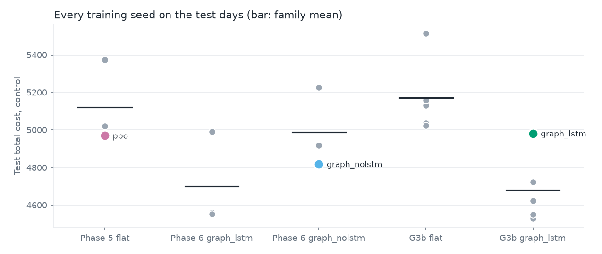

## Validation against test

### Validation against test, control (20-seed means; rank 1 = cheapest of 23)

Spearman rank correlation of the two costs: 0.83. Mean daily demand as a share of the training mean (tag D): St1 val 1.061, St1 test 0.817, St2 val 1.095, St2 test 0.984.

| policy | val cost | val_rank | test cost | test_rank | val fill | test fill |
| --- | --- | --- | --- | --- | --- | --- |
| graph_lstm_g3b_s1008 | 4,236 | 1 | 4,549 | 2 | 95.30% | 98.50% |
| graph_lstm_g3b_s1007 | 4,296 | 2 | 4,531 | 1 | 95.63% | 98.20% |
| graph_lstm | 4,317 | 3 | 4,981 | 10 | 95.94% | 98.92% |
| graph_nolstm | 4,369 | 4 | 4,819 | 7 | 94.61% | 98.44% |
| graph_lstm_p6_s1003 | 4,424 | 5 | 4,990 | 11 | 94.34% | 98.63% |
| graph_lstm_g3b_s1006 | 4,487 | 6 | 4,722 | 6 | 93.50% | 98.01% |
| graph_lstm_p6_s1002 | 4,487 | 7 | 4,551 | 3 | 93.55% | 97.62% |
| graph_lstm_g3b_s1004 | 4,498 | 8 | 4,623 | 5 | 93.61% | 98.07% |
| graph_lstm_p6_s1001 | 4,509 | 9 | 4,561 | 4 | 93.06% | 96.98% |
| graph_nolstm_p6_s1003 | 4,605 | 10 | 5,226 | 17 | 94.11% | 98.62% |
| graph_nolstm_p6_s1001 | 4,607 | 11 | 4,918 | 8 | 92.98% | 98.14% |
| ppo_p5_s1003 | 4,615 | 12 | 5,021 | 12 | 94.79% | 98.42% |
| ppo | 4,630 | 13 | 4,970 | 9 | 93.15% | 98.03% |
| flat_g3b_s1005 | 4,708 | 14 | 5,035 | 14 | 93.47% | 97.74% |
| ppo_shock | 4,748 | 15 | 5,339 | 19 | 92.90% | 96.83% |
| flat_g3b_s1004 | 4,801 | 16 | 5,514 | 22 | 94.28% | 96.52% |
| flat_g3b_s1006 | 4,869 | 17 | 5,131 | 15 | 92.45% | 97.77% |
| flat_g3b_s1008 | 4,954 | 18 | 5,023 | 13 | 91.78% | 96.84% |
| ppo_p5_s1002 | 4,963 | 19 | 5,374 | 20 | 91.76% | 96.53% |
| basestock | 5,157 | 20 | 5,328 | 18 | 90.03% | 97.68% |
| movavg | 5,394 | 21 | 5,378 | 21 | 92.62% | 96.66% |
| flat_g3b_s1007 | 5,396 | 22 | 5,157 | 16 | 88.83% | 94.86% |
| warmup | 10,861 | 23 | 15,161 | 23 | 99.52% | 99.90% |

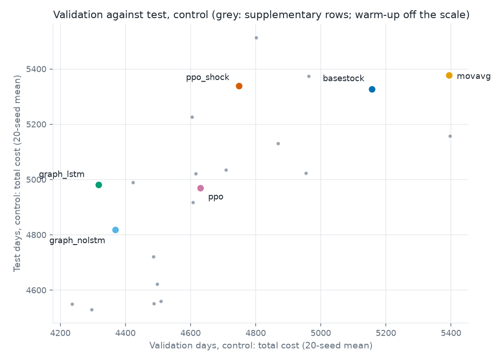

Reading: the validation ranking carries over moderately (Spearman 0.83 over 23 policies). The
headline falls from rank 3 to rank 10, and `ppo` rises from 13 to 9. Total costs are not
comparable in level between the splits, because validation has 194 decision days and test 235;
per decision day the control costs fall from validation to test for every named policy
(`graph_lstm` 22.25 to 21.20, `ppo` 23.87 to 21.15, `graph_nolstm` 22.52 to 20.51, base-stock
26.58 to 22.67). Demand differs too: St1 runs at 1.061 of its training mean on validation days and
**0.817 on test days** (the 0.82 of `reports/phase_1.md`), St2 at 1.095 and 0.984. A policy that
keeps more stock pays more holding cost when St1 demand falls. That fits the headline's higher
holding cost on the test days (4,711 against 4,477 for `ppo`), but it was not tested separately.

## Attention (D-64)

### Attention into St1, last layer (mean over seeds and days)

| policy | scenario | span | from St1 | from W1 |
| --- | --- | --- | --- | --- |
| graph_lstm | control | before | 0.833 | 0.167 |
| graph_lstm | control | during | 0.838 | 0.162 |
| graph_lstm | control | after | 0.848 | 0.152 |
| graph_lstm | demand_spike | before | 0.833 | 0.167 |
| graph_lstm | demand_spike | during | 0.717 | 0.283 |
| graph_lstm | demand_spike | after | 0.848 | 0.152 |
| graph_lstm | combined | before | 0.833 | 0.167 |
| graph_lstm | combined | during | 0.735 | 0.265 |
| graph_lstm | combined | after | 0.850 | 0.150 |
| graph_nolstm | control | before | 0.457 | 0.543 |
| graph_nolstm | control | during | 0.489 | 0.511 |
| graph_nolstm | control | after | 0.492 | 0.508 |
| graph_nolstm | demand_spike | before | 0.457 | 0.543 |
| graph_nolstm | demand_spike | during | 0.444 | 0.556 |
| graph_nolstm | demand_spike | after | 0.493 | 0.507 |
| graph_nolstm | combined | before | 0.457 | 0.543 |
| graph_nolstm | combined | during | 0.456 | 0.544 |
| graph_nolstm | combined | after | 0.496 | 0.504 |

Reading: on a normal day `graph_lstm`'s St1 attends 83% to itself and 17% to W1. During a demand
spike at St1 (alone or combined) the W1 share rises to 26 to 28% and falls back afterwards. `graph_nolstm` splits
about evenly and hardly changes. These weights show where the model looks, not why it orders
what it does. The edge features are constant on this network, so they cannot show that graph
structure is the reason for a result (A22).

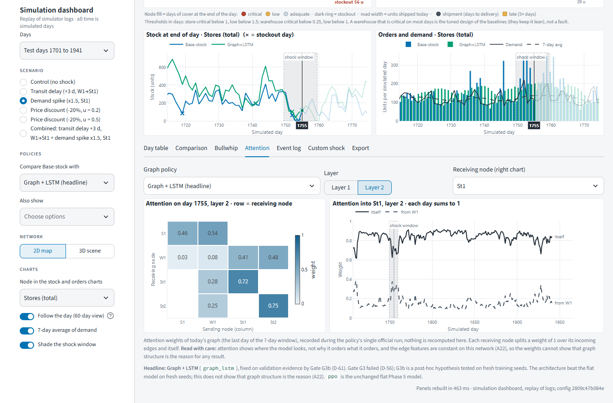

## Dashboard

- Policy list: the registry plus every `rl.evaluated` policy that has logs. `graph_lstm` is
  labelled "Graph + LSTM (headline)", `ppo` "PPO agent (flat, Phase 5)". Whenever a learned policy
  is shown, a note gives the G3/G3b/A22 wording.
- Attention tab (above). Custom shocks run the baselines only after the lock (D-64).
- The combined scenario names both shocks in the picker (it showed as a second "Transit delay"
  before; fixed, `test_store_lists_scenarios_and_registry_policies`).
- Screenshots (tracked, `docs/screenshots/09` to `13`):

| | |
| --- | --- |
| Combined shock: base-stock, Graph + LSTM, PPO | 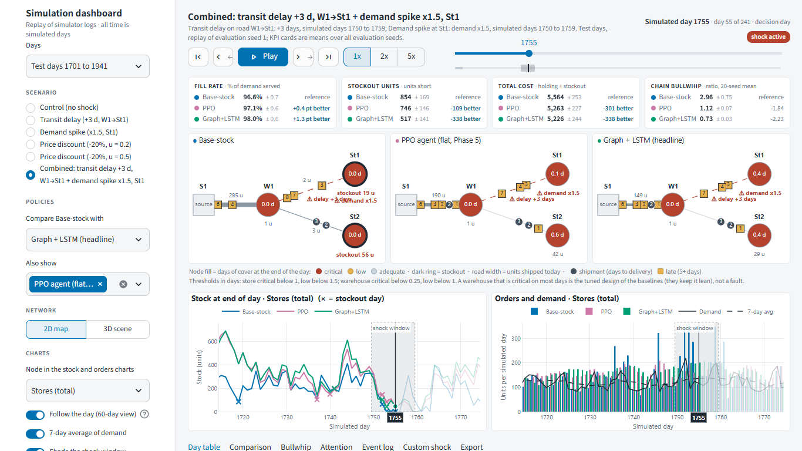 |
| 3D scene, combined shock | 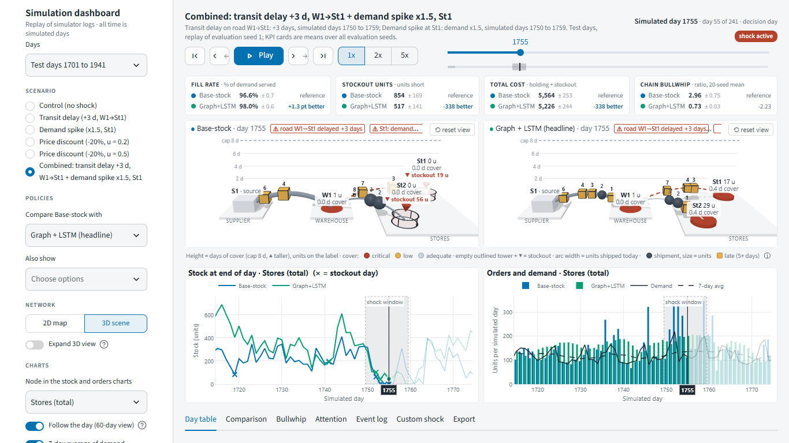 |
| Comparison table | 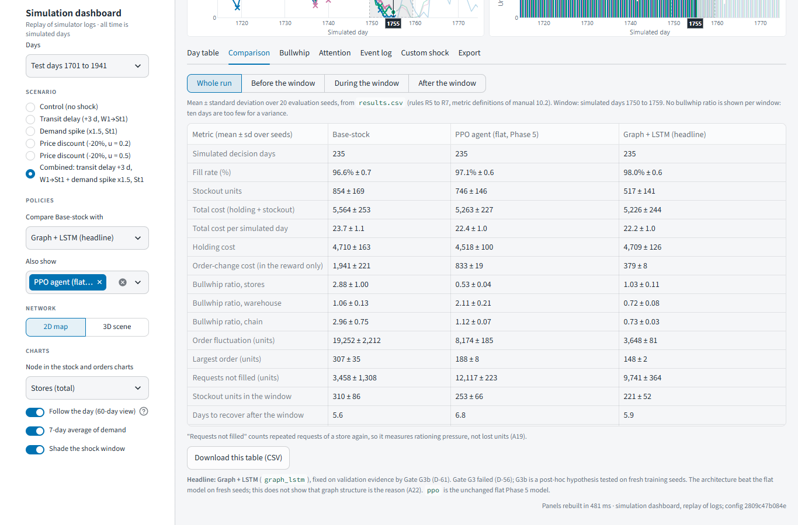 |
| Attention panel |  |
| Bullwhip tab | 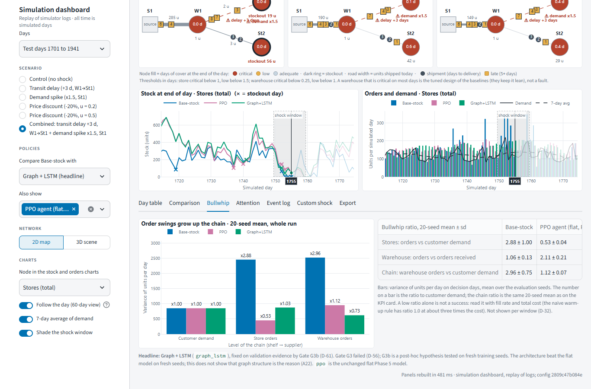 |

## What was built

| File | Role |
| --- | --- |
| `rl/encoder.py`, `rl/policy.py` | `mean_attention` (one encoder pass, `mean` calls it); `PPOPolicy.record_attention`. |
| `eval/runner.py` | Writes `*_attention.csv` for `dashboard.attention_policies` (D-64). |
| `eval/phase7.py` | Every table and figure of this report from the result files (D-66). |
| `reproduce.py` | One-command reproduction, `--train`, `--dashboard` (D-65). |
| `dashboard/` and `app/dashboard.py` | Evaluated policies, labels, headline note, attention tab, combined label, custom runs after the lock. |
| `dashboard/screenshots.py` | `--phase7` set. |
| `config.yaml` | `rl.allow_test_split: true`; `dashboard.attention_policies`. |
| Tests | `test_D64_attention_...`, `test_D64_custom_shock_...`, `test_D65_...`, `test_D66_...`; `test_M33_D41_...` now checks the post-run state. |

## Decisions of this phase

D-61 amended with the owner's confirmation and the no-change-after-the-fact rule (before the run);
D-64 attention and custom runs after the lock; D-65 reproduction; D-66 the analysis (all recorded
before the learned test results were read). No new assumption.

## Checkpoints to back up

`checkpoints/` is not committed. Back up `checkpoints/phase5/`, `checkpoints/phase6/`,
`checkpoints/g3b/` and `checkpoints/phase7/`: the 20 frozen files of D-61 are in these four
folders, and `reports/test_lock.json` holds their hashes. Also keep `results/phase7/test_official/`
and `runs/test/`: the learned test results cannot be regenerated.

## Open items

- Phase 8 (scale-up, manual 13.3) is not started.
- The learned test results are final under the lock. Anything learned from them (that
  `graph_nolstm` was cheaper, that the price signal is unused, that the headline seed was its
  family's weakest) may inform Phase 8 only as a new, pre-registered hypothesis on new days or a
  new network, never as a change to the Phase 7 headline.
