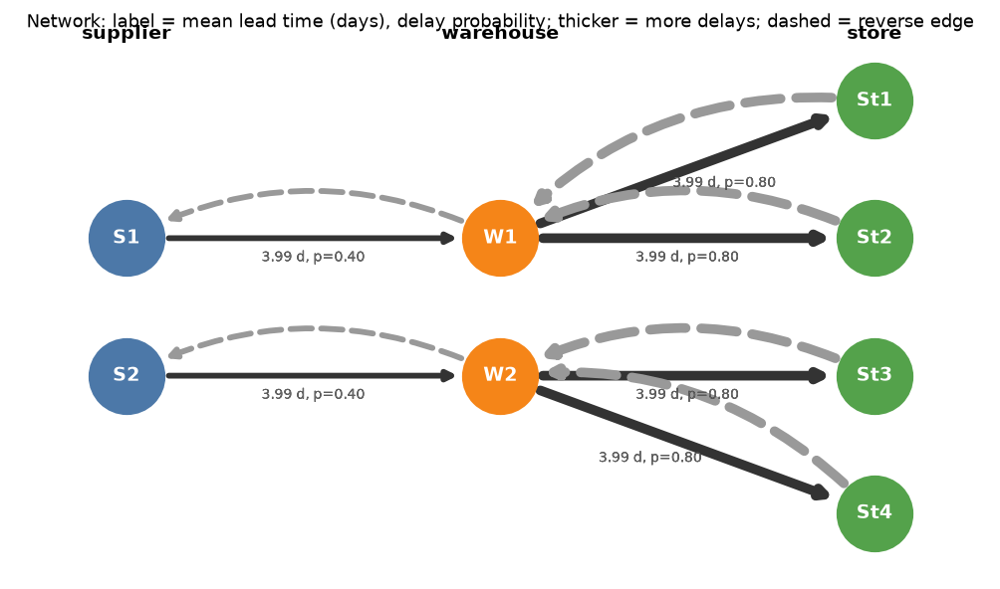
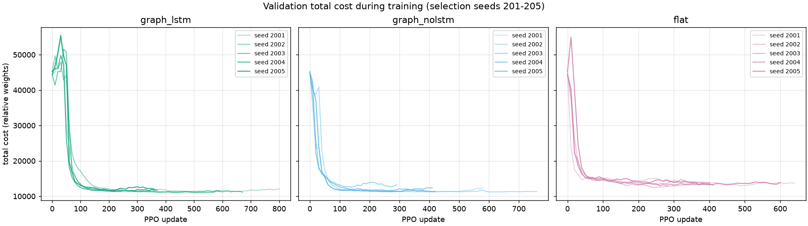
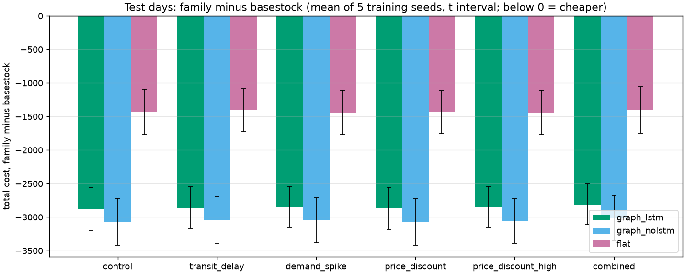
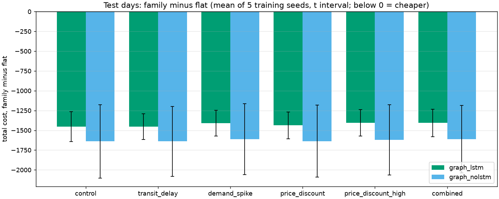

# Phase 8 checkpoint report: the eight-node network (E1, E2, E6)

## Recorded before the test run (2026-11-19)

Everything below the "Result in brief" was fixed before any eight-node test number existed:
the scope, isolation, store rule, network, gates and analysis (D-67 to D-72, commit `9d81871`),
the store choice and frozen config (D-73), E1 and the G4b thresholds (D-74), G4a (D-75), the
G4b and G4c verdicts and the frozen test list (D-76), and `eval/phase8.py` (commit `9d22360`).
The test was run once; `reports/test_lock_net8.json` refuses a second learned run. **No
label, rule, checkpoint or threshold changed after any test number was seen.** Phase 7
(results, labels, checkpoints, `reports/test_lock.json`) is untouched; the four-node
reproduction still shows 0 differing cells (D-75).

The question (pre-registered): does the graph architecture beat the flat model on a larger
network? Gate G3 on four nodes failed (D-56); G3b was a post-hoc hypothesis on fresh seeds
(D-60). Phase 8 is a new network with fresh seeds 2001 to 2005, decided by rules written in
advance. Nothing here changes the Phase 7 headline.

## Result in brief

Eight nodes: S1 -> W1 -> St1 (CA_1), St2 (CA_3) and S2 -> W2 -> St3 (TX_2), St4 (TX_3), two
separate chains. Test days 1701 to 1941, evaluation seeds 1 to 20, common random numbers, six
scenarios. Costs are relative weights over simulated days (D-14 c). Every claim is about a
**model family** (five training seeds), not one seed; there is no headline seed (D-70, D-72).

- **G4c (validation) passed and the test days confirm it (G4d, pre-registered reading).**
  `graph_lstm` minus `flat`, total cost, control: validation -1,804 (t interval -2,265 to
  -1,343), test -1,454 (-1,643 to -1,265); 5 of 5 training seeds clearly cheaper on both. The
  same holds in every shocked scenario (-1,406 to -1,455).
- **Wording (A22, fixed in D-71):** the graph architecture with LSTM beat the flat model on
  fresh seeds. This shows a benefit of the **architecture**, not that edge information or graph
  structure is the reason: all roads have the same simulated lead times, so the edge features
  carry no information. The two chains are disconnected and identical in structure, so the
  graph model applies **one shared set of weights to every node**, while the flat model must
  learn six separate outputs from a 728-number input. **Weight sharing is a likely explanation**;
  this phase did not test it separately.
- **The graph model without LSTM (`graph_nolstm`, secondary, not deciding) is the cheapest
  family on the test days** (-1,639 against flat; -3,068 against base-stock, against -2,883 for
  `graph_lstm`). This repeats the Phase 7 pattern. It was labelled in advance as a hypothesis
  suggested by the Phase 7 test results; the difference between the two graph families was
  not a pre-registered comparison and is not tested here.
- **Against the baselines, every scenario:** all three learned families have a lower total cost
  and a lower reward-based cost than base-stock and than moving average (clear in every
  scenario, 5 of 5 seeds).
- **Where the baselines win:**
  - **Fill rate: base-stock is higher than every learned family in every scenario** (by 0.9
    to 1.0 points for `graph_lstm`, 1.3 to 1.4 for `graph_nolstm`, 2.2 to 2.3 for `flat`;
    0 of 5 seeds better).
  - **Recovery after a shock:** base-stock and moving average are back in 4.5 to 5.0 days,
    the learned families in 7.7 to 12.8 days.
  - **Stockouts during the shock window:** base-stock has the fewest of all policies except the
    naive warm-up rule in every shocked scenario (for example 124 units under the demand spike against 175 to 196 for the
    learned families).
  - The warm-up rule keeps the highest fill rate (99.7 to 99.9%) at about three times the cost.
- **`flat` against the baselines:** on **validation** days flat PPO was **about 3% costlier
  than base-stock** (12,893 against 12,519; it passed G4b because the limit was 1.10 x
  base-stock). On the test days it is 1,429 cheaper than base-stock in the control; base-stock
  became more expensive on test days (next point). Flat's chain bullwhip is not clearly
  different from base-stock's; its fill rate is lower than base-stock's and not clearly
  different from moving average's.
- **Validation and test differ in level.** Test demand is 8 to 15% below training at every
  store, so base-stock's fixed targets overstock: its cost rises from 12,519 (validation) to
  14,456 (test) and its fill rate to 98.5%. Policies that react to recent demand gain from
  this. The rank correlation of the 18 policies between validation and test is 0.80.

## Checkpoint P8 and the gates

| Item | Status | Evidence |
| --- | --- | --- |
| Store list settled (M-37, D-28) | PASS | D-68 rule fixed first; TX_2 + TX_3 chosen, swing 0.340 against the 0.347 reference (small margin, stated); `data/processed/net8/store_choice.md` (D-73) |
| Eight-node network from the config, code fixed where needed | PASS | `config_net8.yaml` frozen (hash `c8b95118b7c9`); path profile and per-network lock (D-67) |
| G4a: tests and isolation | PASS | 266 tests, ruff and mypy clean; four-node reproduction 0 cells differ; mirrored G-A golden numbers in both chains; hand check of six real days (D-75) |
| E1: baselines tuned and evaluated | PASS | per-chain tuning on training days, chain-sum check (D-74); test results below |
| G4b: PPO learns on eight nodes | PASS | flat family 12,893 / 91.97% / bullwhip 1.45 against limits 13,770 / 91.63% / 3.59; 5 of 5 rising curves (D-76) |
| E2 / G4c: graph against flat | PASS | -1,804 (-2,265 to -1,343), 5 of 5, no under-trained run (D-76) |
| G4d: test reading | confirmed on test | -1,454 (-1,643 to -1,265), 5 of 5 (D-77) |
| E6: hidden shocks, every policy, same seeds | PASS | six scenarios x 18 policies x 20 seeds, one run (D-77) |
| E8 baseline part (optional) | not run | left for time; nothing depends on it |
| Figures and tables from one command | PASS | `SCRL_PROFILE=net8 python -m supply_chain_rl.eval.phase8` -> `results/net8/phase8/tables.md`, `docs/figures/phase_8/` |
| Source tags | PASS | every table names its rule or tag (R5, R7, A19, D-66, D-72) |

## The network and the data (D-68, D-73)

| Store | M5 store | avg demand, training days | test / training demand |
| --- | --- | --- | --- |
| St1 | CA_1 | 46.54 | 0.82 |
| St2 | CA_3 | 69.66 | 0.98 |
| St3 | TX_2 | 103.41 | 0.85 |
| St4 | TX_3 | 80.04 | 0.84 |

W1 (CA chain) 116.20, W2 (TX chain) 183.45 units per day. Item FOODS_3_586 kept; TX prices equal
CA prices on the checked days. Roads: Standard Class upstream, Second Class to the stores (A3),
2 to 6 days on every road (A22). The CA chain's lead-time draws are not the same numbers as on
four nodes (A35), so eight-node and four-node results are not paired.

## E1: baselines (D-69 d, D-74)

| Baseline | W1 chain (CA) | W2 chain (TX) |
| --- | --- | --- |
| base-stock m (store / warehouse) | 1.35 / 1.10 | 1.35 / 1.10 |
| moving average z (store / warehouse) | 2.10 / 0.40 | 1.90 / 0.45 |

The W1 values equal the four-node tuning. The network training cost of each chosen set equals the
sum of its two chain costs (the chains are independent, `test_D69_...`).

## Training and gates on validation days (D-76)

All 15 runs stopped by patience; none at the update cap, none with its best checkpoint in its
last 10% of updates (no under-training flag). One resume: `flat_s2003` crashed in its first
update (CUDA "device busy", 15 processes starting together; it trains on the CPU) and was
resumed from `last.pt` at update 0 with the same seed (`checkpoints/net8/launch/resumes.log`).

| Training seed | flat val cost | graph_lstm val cost | graph_lstm - flat (1.96 interval) | graph_nolstm - flat (1.96 interval) |
| --- | --- | --- | --- | --- |
| 2001 | 12,781 | 11,152 | -1,629 (-1,797 to -1,460) | -1,768 (-1,923 to -1,612) |
| 2002 | 12,381 | 11,033 | -1,347 (-1,469 to -1,226) | -1,388 (-1,548 to -1,229) |
| 2003 | 13,179 | 10,825 | -2,354 (-2,477 to -2,232) | -664 (-785 to -544) |
| 2004 | 12,974 | 11,077 | -1,897 (-2,047 to -1,747) | -1,581 (-1,711 to -1,452) |
| 2005 | 13,148 | 11,355 | -1,793 (-1,936 to -1,650) | -2,113 (-2,261 to -1,966) |
| **family (t interval)** | 12,893 | 11,089 | **-1,804 (-2,265 to -1,343)**, 5 of 5 | -1,503 (-2,173 to -833), 5 of 5 |

Validation family means (total cost, reward-based cost, fill, chain bullwhip): `graph_lstm`
11,089, 11,848, 95.2%, 1.15; `graph_nolstm` 11,390, 12,289, 93.7%, 1.11; `flat` 12,893,
15,189, 92.0%, 1.45; base-stock 12,519, 17,887, 93.3%, 3.59; moving average 13,937, 92.6%,
10.78. **Flat PPO was about 3% costlier than base-stock on validation days.**

## Test days: control, every seed (20-seed means, 1.96 intervals)

| Run | total cost | minus base-stock | minus flat (same seed) | fill rate |
| --- | --- | --- | --- | --- |
| graph_lstm_s2001 | 11,680 | -2,776 (-2,916 to -2,636) | -1,370 (-1,504 to -1,236) | 97.5% |
| graph_lstm_s2002 | 11,867 | -2,589 (-2,727 to -2,450) | -1,380 (-1,510 to -1,250) | 97.8% |
| graph_lstm_s2003 | 11,339 | -3,117 (-3,262 to -2,972) | -1,679 (-1,843 to -1,515) | 97.7% |
| graph_lstm_s2004 | 11,269 | -3,187 (-3,329 to -3,045) | -1,304 (-1,475 to -1,133) | 97.1% |
| graph_lstm_s2005 | 11,708 | -2,748 (-2,923 to -2,573) | -1,537 (-1,644 to -1,429) | 97.3% |
| graph_nolstm_s2001 | 11,071 | -3,384 (-3,547 to -3,222) | -1,979 (-2,121 to -1,836) | 97.4% |
| graph_nolstm_s2002 | 11,169 | -3,287 (-3,469 to -3,105) | -2,078 (-2,228 to -1,928) | 97.3% |
| graph_nolstm_s2003 | 11,613 | -2,843 (-3,041 to -2,646) | -1,405 (-1,579 to -1,232) | 95.4% |
| graph_nolstm_s2004 | 11,359 | -3,097 (-3,245 to -2,948) | -1,214 (-1,377 to -1,051) | 97.4% |
| graph_nolstm_s2005 | 11,725 | -2,731 (-2,869 to -2,593) | -1,520 (-1,639 to -1,400) | 98.1% |
| flat_s2001 | 13,050 | -1,405 (-1,609 to -1,202) | - | 97.0% |
| flat_s2002 | 13,247 | -1,209 (-1,350 to -1,068) | - | 96.5% |
| flat_s2003 | 13,018 | -1,438 (-1,591 to -1,285) | - | 96.6% |
| flat_s2004 | 12,573 | -1,883 (-2,093 to -1,673) | - | 95.0% |
| flat_s2005 | 13,244 | -1,212 (-1,386 to -1,037) | - | 95.8% |
| base-stock | 14,456 ± 352 | - | - | 98.5% |
| moving average | 14,073 ± 496 | -382 | - | 95.7% |
| warm-up rule | 40,045 ± 408 | +25,590 | - | 99.9% |

Every seed in every scenario, with the reward-based cost, chain bullwhip and the cost of each
chain: `results/net8/phase8/tables.md` (sections "Scenario ..." and "Every seed").

## Families against the baselines, every scenario (test days)

Family = mean of the five per-seed differences, t(0.975, 4) interval; "better" / "worse" only
when the interval excludes 0 (D-66 a, D-72 m). Total cost and fill rate:

| Scenario | Family | vs base-stock: total cost | vs base-stock: fill | vs moving average: total cost | vs moving average: fill |
| --- | --- | --- | --- | --- | --- |
| control | graph_lstm | -2,883 better | -1.01 pt **worse** | -2,501 better | +1.77 pt better |
| control | graph_nolstm | -3,068 better | -1.41 pt **worse** | -2,686 better | +1.37 pt better |
| control | flat | -1,429 better | -2.31 pt **worse** | -1,047 better | +0.47 pt no clear difference |
| transit_delay | graph_lstm | -2,860 better | -1.04 pt **worse** | -2,474 better | +1.74 pt better |
| transit_delay | graph_nolstm | -3,046 better | -1.44 pt **worse** | -2,660 better | +1.34 pt better |
| transit_delay | flat | -1,406 better | -2.29 pt **worse** | -1,020 better | +0.49 pt no clear difference |
| demand_spike | graph_lstm | -2,847 better | -0.93 pt **worse** | -2,455 better | +1.79 pt better |
| demand_spike | graph_nolstm | -3,050 better | -1.32 pt **worse** | -2,658 better | +1.41 pt better |
| demand_spike | flat | -1,438 better | -2.20 pt **worse** | -1,045 better | +0.52 pt no clear difference |
| price_discount | graph_lstm | -2,871 better | -0.93 pt **worse** | -2,494 better | +1.81 pt better |
| price_discount | graph_nolstm | -3,071 better | -1.31 pt **worse** | -2,694 better | +1.43 pt better |
| price_discount | flat | -1,433 better | -2.26 pt **worse** | -1,056 better | +0.48 pt no clear difference |
| price_discount_high | graph_lstm | -2,844 better | -0.91 pt **worse** | -2,452 better | +1.81 pt better |
| price_discount_high | graph_nolstm | -3,058 better | -1.28 pt **worse** | -2,666 better | +1.45 pt better |
| price_discount_high | flat | -1,438 better | -2.20 pt **worse** | -1,046 better | +0.53 pt no clear difference |
| combined | graph_lstm | -2,809 better | -0.99 pt **worse** | -2,474 better | +1.82 pt better |
| combined | graph_nolstm | -3,014 better | -1.38 pt **worse** | -2,678 better | +1.43 pt better |
| combined | flat | -1,402 better | -2.22 pt **worse** | -1,066 better | +0.59 pt no clear difference |

Reward-based cost: every family is better than both baselines in every scenario. Chain bullwhip:
both graph families are lower than base-stock in every scenario; `flat` is not clearly
different from base-stock (4 of 5 seeds lower, 1 higher); all three are far below moving
average. Within the shock window, the learned families' total cost is lower than base-stock's
and moving average's in every shocked scenario, except `flat` against base-stock under the
demand spike and the high discount (no clear difference).

## G4d: graph against flat on the test days (D-71)

| Scenario | graph_lstm - flat (t interval over 5 seeds) | seeds clearly better | reading |
| --- | --- | --- | --- |
| **control (decides)** | **-1,454 (-1,643 to -1,265)** | 5 | **confirmed on test** |
| transit_delay | -1,455 (-1,619 to -1,291) | 5 | confirmed (descriptive) |
| demand_spike | -1,410 (-1,574 to -1,245) | 5 | confirmed (descriptive) |
| price_discount | -1,438 (-1,605 to -1,271) | 5 | confirmed (descriptive) |
| price_discount_high | -1,406 (-1,574 to -1,238) | 5 | confirmed (descriptive) |
| combined | -1,407 (-1,583 to -1,232) | 5 | confirmed (descriptive) |

Control, other metrics, `graph_lstm` minus `flat`: reward-based cost -3,368 (better), fill rate
+1.3 points (better), chain bullwhip -0.60 (no clear difference). Secondary `graph_nolstm` minus
`flat`: total cost -1,639 (-2,103 to -1,175), confirmed; fill and bullwhip no clear difference.
Within the shock windows the graph families are not clearly cheaper than `flat` except under the
small discount (-35 and -37).

## Before, during and after the shocks (family means; window 1750 to 1759)

| Scenario | Policy / family | cost/day during | stockout units during | days to recover |
| --- | --- | --- | --- | --- |
| transit_delay | graph_lstm / graph_nolstm / flat | 43.7 / 43.6 / 46.0 | 116 / 135 / 108 | 9.0 / 8.4 / 12.0 |
| transit_delay | base-stock / moving average | 52.5 / 52.4 | **80** / 121 | **4.8 / 4.5** |
| demand_spike | graph_lstm / graph_nolstm / flat | 49.9 / 49.3 / 51.4 | 185 / 196 / 175 | 8.9 / 8.4 / 12.1 |
| demand_spike | base-stock / moving average | 55.3 / 57.0 | **124** / 177 | **4.6 / 5.0** |
| price_discount | graph_lstm / graph_nolstm / flat | 41.5 / 41.3 / 45.0 | 84 / 100 / 91 | 8.8 / 8.0 / 12.8 |
| price_discount | base-stock / moving average | 49.4 / 51.4 | **47** / 101 | **4.7 / 4.8** |
| price_discount_high | graph_lstm / graph_nolstm / flat | 49.6 / 48.9 / 51.4 | 180 / 189 / 175 | 8.7 / 8.0 / 12.1 |
| price_discount_high | base-stock / moving average | 55.3 / 57.0 | **124** / 177 | **4.6 / 5.0** |
| combined | graph_lstm / graph_nolstm / flat | 62.6 / 62.5 / 63.0 | 319 / 337 / 300 | 8.4 / 7.7 / 10.8 |
| combined | base-stock / moving average | 69.8 / 69.2 | **270** / 313 | **4.6 / 4.9** |

The learned families are cheaper per day during and after each shock, but they let more units go
short during the shock than base-stock and take about twice as long to recover; the baselines
win on both, as in Phase 7. Days to recover is read against the control (A20).

## Bullwhip per level and per chain (control, means; A19)

| Policy / family | stores | warehouses | chain | chain W1 (CA) | chain W2 (TX) |
| --- | --- | --- | --- | --- | --- |
| graph_lstm | 0.75 | 1.31 | 0.92 | 0.71 | 1.00 |
| graph_nolstm | 0.80 | 1.20 | 0.88 | 0.68 | 0.98 |
| flat | 0.76 | 2.30 | 1.52 | 1.41 | 1.91 |
| base-stock | 2.18 | 1.01 | 2.14 | 3.18 | 2.35 |
| moving average | 14.03 | 0.76 | 10.58 | 15.42 | 16.37 |
| warm-up rule | 1.00 | 1.00 | 1.00 | 1.01 | 1.00 |

The flat model's extra swings sit at the warehouses (2.30 against 1.2 to 1.3 for the graph
families).

## Validation against test (control)

Spearman rank correlation of the 18 policies 0.80. Base-stock ranks 12th on validation and 17th
on test, because test demand is lower (table above) and its targets are fixed from training
demand. Within each learned family the order of the seeds changes between validation and test
(for example `graph_lstm_s2003` ranks 1st of 18 on validation and 4th on test, behind
`graph_lstm_s2004` within its family), which is why claims are made per family, not per seed (D-70).

## Reading the result

- The pre-registered second question has an answer for this network: the graph architecture
  with LSTM is cheaper than the flat model on validation and on test days, on every training
  seed and in every scenario, with a higher fill rate.
- It is **not** evidence that graph structure or edge information causes the gain (A22). The two
  chains are disconnected and identical, every road has the same lead-time distribution, and
  the graph model shares its weights across nodes. A flat model with shared per-node weights
  would be the direct test of the weight-sharing explanation; it was not run.
- The learned policies trade service for cost: they are cheaper than base-stock but give a
  lower fill rate, more shortages during shocks and a slower recovery. Under the configured
  20:1 stockout-to-holding ratio this trade lowers total cost; at another ratio it might not
  (E8, not run).
- Limitations of Phases 0 to 7 apply (manual 14.2 as amended): one product, simulated
  warehouses and suppliers, sales used as demand, identical road behaviour (A22), a 7-day
  window (A23), hidden shocks only, results about the simulated chain only.

## Commands

    python -m supply_chain_rl.data.net8_stores                              # D-68 store choice
    $env:SCRL_PROFILE = "net8"                                              # PowerShell; bash: export SCRL_PROFILE=net8
    python -m supply_chain_rl.data.build; python -m supply_chain_rl.data.dataco; python -m supply_chain_rl.graph.build
    python -m supply_chain_rl.eval.baselines tune --workers 10              # E1 (per chain)
    python -m supply_chain_rl.rl.train --seed 2001 --variant graph_lstm     # x 3 models x 5 seeds
    python -m supply_chain_rl.rl.net8                                       # G4b, G4c
    python -m supply_chain_rl.eval.run --policies <frozen list> --split test   # once (lock)
    python -m supply_chain_rl.eval.phase8                                   # tables and figures

## What was built

| File | Role |
| --- | --- |
| `paths.py` | Path profiles (`SCRL_PROFILE`), `require_prototype` (D-67) |
| `eval/runner.py`, `eval/run.py` | Results, logs and lock from the profile; checkpoints in any lock refused (D-67) |
| `policies/basestock.py`, `movavg.py`, `registry.py` | Parameters per warehouse chain (D-69 d) |
| `eval/baselines.py` | Per-chain tuning with the chain-sum check (D-69 d) |
| `data/net8_stores.py`, `data/m5.py`, `data/build.py` | Store rule (D-68), fixed item |
| `rl/net8.py` | G4b and G4c (D-71) |
| `eval/phase8.py` | Every table and figure of this report (D-72 m) |
| `config_net8.yaml`, `derived_net8.yaml` | Eight-node settings and derived facts |
| `tests/test_net8.py` | 17 tests named by rule id |

## Decisions of this phase

D-67 to D-72 (pre-registration), D-73 (stores, frozen config), D-74 (E1, G4b thresholds), D-75
(G4a, speed), D-76 (G4b, G4c, frozen list), D-77 (test run, G4d). Assumptions A34, A35.

## Back up (not committed)

`checkpoints/net8/` (the 15 frozen checkpoints and their training logs), `results/net8/`,
`runs/net8/` (the test logs cannot be regenerated after the lock), `data/processed/net8/`,
`derived_net8.yaml`, `config_net8.yaml`, `reports/test_lock_net8.json`. The last three are also
committed.

## Open items

- E8 baseline part (optional, D-72 c) not run.
- The dashboard is not extended to eight nodes.
- A flat model with weights shared across nodes would test the weight-sharing explanation; it
  would be a new, pre-registered question.
